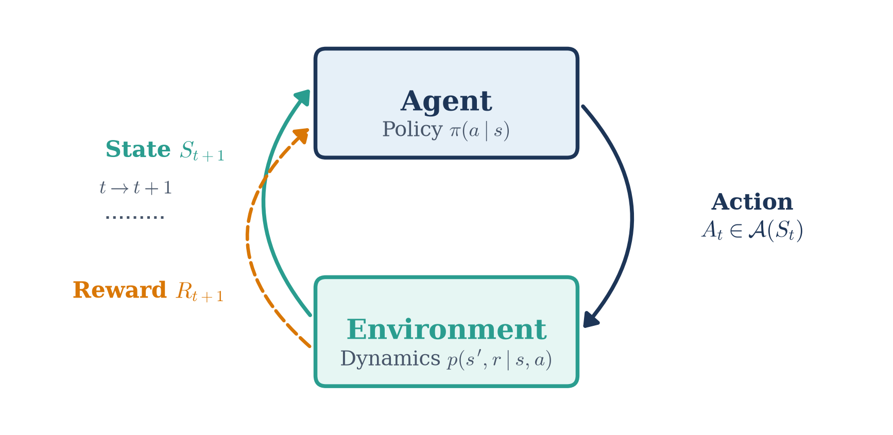

- **Markov Decision Processes (MDPs)** provide the standard mathematical framework for sequential decision problems in which every choice affects both the immediate payoff and the future states the learner encounters.
- Because current actions alter later opportunities, agents face an inherent tradeoff between **immediate and delayed rewards**.
- Whereas bandit algorithms learn context-free arm values $q_*(a)$, MDP agents must learn state-conditioned values $q_*(s, a)$ (or state values $v_*(s)$) to attribute long-term outcomes to specific decisions (the **credit assignment** problem).
- Formalizing full reinforcement learning rests on three tightly linked concepts: **returns**, **value functions**, and **Bellman equations**.

## The Agent-Environment Interface {#sec-ch03-3-1}

::: {#fig-31}
{width=85% fig-align="center" fig-alt="Agent-environment interaction loop showing action A_t sent to environment and next state S_{t+1} and reward R_{t+1} returned."}

**Agent-environment interaction loop.** At each discrete step $t$, the agent applies action $A_t$ to the environment, which responds with the next state $S_{t+1}$ and scalar reward $R_{t+1}$.
:::

- **Agent**: the decision-making system that observes states, selects actions, and adapts its behavior from feedback.
- **Environment**: everything external to the agent's direct control that responds to actions with new states and numerical rewards.
- Interaction unfolds across discrete rounds $t = 0, 1, 2, 3, \dots$ (not necessarily uniform clock ticks), producing a recurring stream of transitions $(S_t, A_t, R_{t+1}, S_{t+1})$.
- **Trajectory**: the full chronological sequence of states, actions, and rewards generated jointly by the agent and environment:

$$\textbf{Trajectory, }\mathcal{T} \equiv (S_0, A_0, R_1, S_1, A_1, R_2, S_2, A_2, R_3, \ldots )$$

### Dynamics function {#dynamics-function}

- **Finite MDP**: the state space $\mathcal{S}$, action space $\mathcal{A}$, and reward set $\mathcal{R}$ all contain finitely many elements.
- **Markov property**: the joint distribution of the next state $S_t$ and reward $R_t$ depends solely on the immediately preceding state $S_{t-1}$ and action $A_{t-1}$, making earlier history redundant once the current state is known.
- **Dynamics function** $p$: completely specifies a finite MDP by giving the joint probability of transitioning to $s' \in \mathcal{S}$ and observing reward $r \in \mathcal{R}$ after taking $a \in \mathcal{A}(s)$ in $s \in \mathcal{S}$:

$$\boxed{p(s', r \mid s, a) \doteq \mathbb{P}\{S_t = s',\, R_t = r \mid S_{t-1} = s,\, A_{t-1} = a\} }$$

- Mathematically, $p$ is a deterministic four-argument mapping into $[0, 1]$:

$$p : \mathcal{S} \times \mathcal{R} \times \mathcal{S} \times \mathcal{A} \to [0,1]$$

- The conditioning bar "|" indicates that every fixed pair $(s, a)$ induces a valid joint probability distribution over $(s', r)$:

$$\sum_{s' \in \mathcal{S}} \sum_{r \in \mathcal{R}} p(s', r \mid s, a) = 1 \quad \forall\, s \in \mathcal{S},\, a \in \mathcal{A}(s)$$

### Derived quantities {#derived-quantities}

- Marginalizing or averaging the four-argument law $p(s', r \mid s, a)$ yields all other environment quantities of interest:

- **State-transition probabilities** ($p: S \times S \times A \to [0,1]$), obtained by summing over all possible rewards:

$$p(s'|s,a) \doteq \mathbb{P}\{S_t = s' \mid S_{t-1} = s,\, A_{t-1} = a\} = \sum_{r \in R} p(s', r | s, a)$$

- **Expected state-action rewards** ($r: S \times A \to \mathbb{R}$), giving the mean immediate payoff for executing $a$ in $s$:

$$r(s,a) \doteq \mathbb{E}\left[R_t \mid S_{t-1} = s,\, A_{t-1} = a\right] = \sum_{r \in R} r \sum_{s' \in S} p(s', r | s, a)$$

- **Expected transition rewards** ($r: S \times A \times S \to \mathbb{R}$), conditioning further on the realized successor state $s'$:

$$r(s,a,s') \doteq \mathbb{E}\left[R_t \mid S_{t-1} = s,\, A_{t-1} = a,\, S_t = s'\right] = \sum_{r \in R} r\, \frac{p(s', r | s, a)}{p(s' | s, a)}$$

## Goals & Rewards {#sec-ch03-3-2}

- **Reward signal**: at every round, the environment emits a single scalar $R_t \in \mathbb{R}$ communicating the task objective.
- The learner targets long-horizon cumulative reward rather than myopic single-step gains, an idea codified by the **reward hypothesis**.

::: {.callout-note title="Reward Hypothesis (Sutton & Barto, 2018, §3.2)"}
> "That all of what we mean by goals and purposes can be well thought of as the maximization of the expected value of the cumulative sum of a received scalar signal (called reward)."
:::

- **Reward design**: because an RL algorithm optimizes whatever scalar signal it is fed, rewards must accurately reflect the true task objective.
- **What, not how**: reward functions should encode the desired end outcome rather than rewarding handcrafted subgoals or heuristics, which can accidentally incentivize unintended shortcuts.

## Returns & Episodes {#sec-ch03-3-3}

- **Return** ($G_t$): the aggregate future payoff following step $t$ that the agent seeks to maximize in expectation. In finite-horizon settings ending at final step $T$, the undiscounted return is simply the sum:

$$G_t \doteq R_{t+1} + R_{t+2} + R_{t+3} + \ldots + R_T, \quad \quad T = \text{final time step}$$

- **Episode**: a self-contained trajectory that starts from an initial state distribution and ends upon reaching a designated terminal state $S_T$, after which the interaction resets cleanly for the next trial:

$$\textbf{Episode } \equiv (S_0, A_0, R_1, S_1, A_1, R_2, S_2, A_2, R_3, \ldots, S_T )$$

- **Episodic tasks**: problems that naturally break into independent episodes terminating at some $S_T$.
- **Continuing tasks**: ongoing interactions with no natural endpoint ($T_{\text{final}} = \infty$), where raw undiscounted sums could diverge.

### Discounting {#discounting}

- **Discount factor** ($\gamma \in [0, 1]$): scales down rewards received further in the future, ensuring finite returns in continuing tasks and encoding time preference.
- **Horizon trade-off**: $\gamma$ near $0$ produces a **myopic** learner focused on immediate gains, whereas $\gamma$ approaching $1$ yields a **far-sighted** learner that weighs distant consequences almost equally.

$$\boxed{G_t \doteq R_{t+1} + \gamma R_{t+2} + \gamma^2 R_{t+3} + \ldots = \sum_{k=0}^{\infty} \gamma^k R_{t+k+1}}$$

### Recursive form of Expected return {#recursive-form-of-expected-return}

- Factoring $\gamma$ out of all terms after $R_{t+1}$ links consecutive returns recursively, a relation fundamental to Bellman equations:

$$
\begin{aligned}
G_t &= R_{t+1} + \gamma R_{t+2} + \gamma^2 R_{t+3} + \gamma^3 R_{t+4} + \ldots \\
&= R_{t+1} + \gamma\left(R_{t+2} + \gamma R_{t+3} + \gamma^2 R_{t+4} + \ldots\right) \\
&= R_{t+1} + \gamma G_{t+1}
\end{aligned}
$$

- Whenever rewards are bounded and $\gamma < 1$, the infinite sum converges; for instance, a constant payoff of $+1$ at every step produces a closed-form geometric series:

$$G_t = \sum_{k=0}^{\infty} \gamma^k = \frac{1}{1-\gamma}$$

## Unified Notation for Episodic & Continuing Tasks {#sec-ch03-3-4}

- **Absorbing terminal state**: episodic and continuing problems can share one notation by modeling termination as entry into a dedicated absorbing state that only self-transitions and forever emits reward $0$.

### State transition diagram {#state-transition-diagram}

$$S_0 \xrightarrow{R_1=+1} S_1 \xrightarrow{R_2=+1} S_2 \xrightarrow{R_3=+1} \square \circlearrowright \quad \left\{ \begin{array}{l} R_4 = 0 \\ R_5 = 0 \\ \vdots \end{array} \right\}$$

- Here the square node marks the absorbing state representing episode end.
- Starting at $S_0$, the observed rewards $+1, +1, +1, 0, 0, \ldots$ sum to the exact same total whether truncated at $T = 3$ or extended to infinity, even under discounting.
- **Unified return**: allowing either $T = \infty$ or $\gamma = 1$ (but not both simultaneously) covers both task types in a single expression:

$$\boxed{\tilde{G}_t = \sum_{k=t+1}^{T} \gamma^{k-t-1} R_k}$$

## Policies, Value Functions & Bellman Equations {#sec-ch03-3-5}

- **Policy** ($\pi$): a decision rule mapping every state $s \in \mathcal{S}$ to a probability distribution over valid actions $a \in \mathcal{A}(s)$:

$$\boxed{\pi(a|s) = \mathbb{P}\left[A_t = a \mid S_t = s\right]}$$

- The vertical bar "|" emphasizes that $\pi(\cdot \mid s)$ sums to $1$ across $a \in \mathcal{A}(s)$ for every state $s$.
- Reinforcement learning algorithms differ primarily in how they update $\pi$ (explicitly or implicitly) from interaction data.

### State-value function for policy $\pi$

- **State-value function** $v_\pi(s)$: the expected return when starting in state $s$ and selecting all subsequent actions according to $\pi$:

$$v_\pi(s) \doteq \mathbb{E}_\pi\left[G_t \mid S_t = s\right] = \mathbb{E}_\pi\left[\sum_{k=0}^{\infty} \gamma^k R_{t+k+1} \,\middle|\, S_t = s\right], \quad \forall s \in S$$

### Action-value function for policy $\pi$

- **Action-value function** $q_\pi(s, a)$: measures expected long-term payoff after committing to move $a$ from state $s$ and obeying $\pi$ on all subsequent steps:

$$q_\pi(s,a) \doteq \mathbb{E}_\pi\left[G_t \mid S_t = s,\, A_t = a\right] = \mathbb{E}_\pi\left[\sum_{k=0}^{\infty} \gamma^k R_{t+k+1} \,\middle|\, S_t = s,\, A_t = a\right]$$

- Throughout, $\mathbb{E}_\pi[\cdot]$ denotes expectation under trajectories generated by policy $\pi$ and environment dynamics $p$.

### Bellman Equation for $v_\pi$

- **Bellman equations**: recursive consistency identities satisfied by value functions in MDPs, expressing each state's value in terms of immediate rewards and discounted successor values:

$$
\begin{aligned}
v_\pi(s) &\doteq \mathbb{E}_\pi\left[G_t \mid S_t = s\right] \\
&= \mathbb{E}_\pi\left[R_{t+1} + \gamma G_{t+1} \mid S_t = s\right] \\
&= \sum_a \pi(a \vert s) \sum_{s'} \sum_r p(s', r \vert s, a)\left[r + \gamma\, \mathbb{E}_\pi\left[G_{t+1} \mid S_{t+1} = s'\right]\right] \\
&= \sum_a \pi(a \vert s) \sum_{s', r} p(s', r \vert s, a)\left[r + \gamma v_\pi(s')\right], \quad \forall\, s \in S
\end{aligned}
$$

- **Interpretation**: the expectation weights every feasible action by $\pi(a \mid s)$ and every resulting transition by $p(s', r \mid s, a)$, equating $v_\pi(s)$ to the expected immediate reward plus the discounted value of the next state.
- **Backup diagram**: graphically, one-step lookahead trees depict open nodes for states ($s$ at the root and successor states $s'$ at the leaves) connected through filled nodes for state-action pairs $(s, a)$; the diagram illustrates how estimates at successor states are averaged and passed upward ("backed up") to update the root state (see Sutton & Barto, 2018, Fig. 3.4).

- Expressing $v_\pi(s)$ directly as an expectation over action values under $\pi$:

$$ 
\begin{split}
v_{\pi}(s) & \doteq \mathbb{E}_{\pi,p} [G_t\ |\ S_t{=}s]\\
& = \mathbb{E}_{\pi,p} [q_{\pi}(s,A_t)\ |\ S_t{=}s], \quad \text{(cf. [*])}\\
& = \displaystyle \sum_{a} \pi(a|s) q_{\pi}(s,a)\\
\end{split}
$$

[*] Conditioning on both a state and an action yields the action-value expectation.

- Here $G_t$ depends on the fixed state $s$ and the stochastic action $A_t \sim \pi(\cdot \mid s)$ inside $\mathbb{E}_{\pi, p}$.
- Expanding step by step using the Markov property confirms that $v_\pi$ is the **unique solution** to the state-value Bellman equation:

$$
\begin{aligned}
v_{\pi}(s) & \doteq \mathbb{E}_{\pi,p} [G_t\ |\ S_t{=}s]\\
& = \mathbb{E}_{\pi,p} [R_{t+1} + \gamma G_{t+1}\ |\ S_t{=}s]\\
& = \displaystyle \sum_{a} \pi(a|s) \mathbb{E}_{p,\pi} [R_{t+1} + \gamma G_{t+1}\ |\ S_t{=}s, A_t{=}a ]\\
& = \displaystyle \sum_{a} \pi(a|s) \sum_{s',r} p(s',r|s,a) \mathbb{E}_{\pi,p} [r + \gamma G_{t+1}\ |\ S_t{=}s, A_t{=}a, S_{t+1}{=}s' ]\\
& = \displaystyle \sum_{a} \pi(a|s) \sum_{s',r} p(s',r|s,a) \mathbb{E}_{\pi,p} [r + \gamma G_{t+1}\ |\ S_{t+1}{=}s' ] \;\; \text{(by the Markov property)}\\
& = \displaystyle \sum_{a} \pi(a|s) \sum_{s',r} p(s',r|s,a) \Big[r + \gamma \mathbb{E}_{\pi,p} [G_{t+1}\ |\ S_{t+1}{=}s'] \Big]\\
& = \displaystyle \sum_{a} \pi(a|s) \sum_{s',r} p(s',r|s,a) \Big[r + \gamma v_{\pi}(s') \Big]\\
\end{aligned}
$$

- Summary identity:

$$
\boxed{\begin{array}{rcl}
v_{\pi}(s) &=& \displaystyle\sum_{a} \pi(a \vert s)\, q_{\pi}(s,a)\\[1em]
&=& \displaystyle\sum_{a} \pi(a \vert s) \sum_{s',r} p(s',r \vert s,a) \Big[r + \gamma v_{\pi}(s') \Big]
\end{array}}
$$

### Bellman equation for $q_{\pi}(s,a)$

- Because action $a$ is already chosen, $q_\pi(s, a)$ averages solely over the environment's stochastic transition $(S_{t+1}, R_{t+1})$:

$$
\begin{aligned}
q_{\pi}(s,a) & \doteq \mathbb{E}_{p,\pi} [G_t\ |\ S_t{=}s, A_t{=}a]\\
& = \mathbb{E}_{p,\pi} [R_{t+1} + \gamma G_{t+1}\ |\ S_t{=}s, A_t{=}a]\\
& = \mathbb{E}_{p,\pi} [R_{t+1} + \gamma v_{\pi}(S_{t+1})\ |\ S_t{=}s, A_t{=}a], \quad \text{(cf. [*])}\\
& = \displaystyle \sum_{s',r} p(s',r|s,a) \Big[r + \gamma v_{\pi}(s')\Big]\\
\end{aligned}
$$

[*] Conditioning solely on the next state $s'$ yields the state-value expectation.

- Substituting $v_\pi(s') = \sum_{a'} \pi(a' \mid s') q_\pi(s', a')$ yields the **Bellman equation for action values**, to which $q_\pi$ is the **unique solution**:

$$
\begin{aligned}
q_{\pi}(s,a) & \doteq \mathbb{E}_{p,\pi} [G_t\ |\ S_t{=}s, A_t{=}a]\\
& = \mathbb{E}_{p,\pi} [R_{t+1} + \gamma G_{t+1}\ |\ S_t{=}s, A_t{=}a]\\
& = \displaystyle \sum_{s',r} p(s',r|s,a) \mathbb{E}_{\pi,p} [r + \gamma G_{t+1}\ |\ S_t{=}s, A_t{=}a, S_{t+1}{=}s' ]\\
& = \displaystyle \sum_{s',r} p(s',r|s,a) \mathbb{E}_{\pi,p} [r + \gamma G_{t+1}\ |\ S_{t+1}{=}s' ], \quad \text{(by the Markov property)}\\
& = \displaystyle \sum_{s',r} p(s',r|s,a) \Big[r + \gamma \mathbb{E}_{\pi,p} [G_{t+1}\ |\ S_{t+1}{=}s'] \Big]\\
& = \displaystyle \sum_{s',r} p(s',r|s,a) \Big[r + \gamma \sum_{a'} \pi(a'|s') \mathbb{E}_{p,\pi} [G_{t+1}\ |\ S_{t+1}{=}s', A_{t+1}{=}a'] \Big]\\
& = \displaystyle \sum_{s',r} p(s',r|s,a) \Big[r + \gamma \sum_{a'} \pi(a'|s') q_{\pi}(s',a') \Big]\\
\end{aligned}
$$

- Summary identity:

$$
\boxed{\begin{array}{rcl}
q_{\pi}(s,a) &=& \displaystyle\sum_{s',r} p(s',r \vert s,a) \Big[r + \gamma v_{\pi}(s')\Big]\\[1em]
&=& \displaystyle\sum_{s',r} p(s',r \vert s,a) \Big[r + \gamma \sum_{a'} \pi(a' \vert s')\, q_{\pi}(s',a') \Big]
\end{array}}
$$

## Optimal Policies & Optimal Value Functions {#sec-ch03-3-6}

- **Policy partial ordering**: value functions induce a natural ranking over policies, where $\pi$ dominates $\pi'$ whenever $\pi$ attains at least as high an expected return in every state:

$$\pi \geq \pi' \iff v_\pi(s) \geq v_{\pi'}(s) \quad \forall s \in S$$

- **Optimal policy** ($\pi_*$): every finite MDP admits at least one policy that beats or ties all others simultaneously across all states. Multiple optimal policies can exist, yet they all share the same **optimal state-value function** $v_*$:

$$v_*(s) \doteq \max_\pi v_\pi(s) \quad \forall s \in S$$

- **Optimal action-value function** ($q_*$): similarly unique across all optimal policies, assigning every pair $(s, a)$ the best achievable return when starting with $a$ in $s$:

$$q_*(s,a) \doteq \max_\pi q_\pi(s,a) \quad \forall s \in S,\, a \in A(s)$$

- Because an optimal policy governs behavior from the next step onward, $q_*$ connects directly to $v_*$:

$$q_*(s,a) = \mathbb{E}\left[R_{t+1} + \gamma v_*(S_{t+1}) \mid S_t = s,\, A_t = a\right]$$

### Bellman Optimality Equations {#ch03-bellman-optimality-equations}

- **Bellman optimality**: under an optimal policy, the value of any state must equal the expected return of its highest-scoring action, eliminating explicit reference to $\pi$ and introducing a nonlinear $\max$ operator.

#### Optimal state-value function, $v_{*}(s)$

$$
\begin{aligned}
v_{*}(s) &= \max_{a \in A(s)} q_{\pi_{*}}(s,a) \\
&= \max_a\, \mathbb{E}_{\pi^*}\left[G_t \mid S_t = s,\, A_t = a\right] \\
&= \max_a\, \mathbb{E}_{\pi^*}\left[R_{t+1} + \gamma G_{t+1} \mid S_t = s,\, A_t = a\right] \\
&= \max_a\, \mathbb{E}\left[R_{t+1} + \gamma v_{*}(S_{t+1}) \mid S_t = s,\, A_t = a\right] \\
&= \max_a \sum_{s', r} p(s', r \vert s, a)\left[r + \gamma v_{*}(s')\right]
\end{aligned}
$$

$$
\boxed{\begin{array}{rcl}
v_{*}(s) &=& \displaystyle \max_a \sum_{s', r} p(s', r \vert s, a)\left[r + \gamma v_{*}(s')\right]
\end{array}}
$$

#### Optimal action-value function, $q_{*}(s,a)$

$$
\boxed{
\begin{aligned}
q_{*}(s,a) &= \mathbb{E}\left[R_{t+1} + \gamma \max_{a'} q_{*}(S_{t+1}, a') \mid S_t = s,\, A_t = a\right] \\
&= \sum_{s', r} p(s', r \vert s, a)\left[r + \gamma \max_{a'} q_{*}(s', a')\right]
\end{aligned}
}
$$

- **Optimality backup structure**: unlike policy-evaluation backups that average across actions according to $\pi$, optimality backups apply a $\max$ arc at the action-selection branch (at the root state $s$ for $v_*$, and at each successor state $s'$ for $q_*$; see Sutton & Barto, 2018, Fig. 3.5).

```{=latex}
\clearpage
```

### Takeaways {#ch03-takeaways}

- **Unique fixed point**: in a finite MDP, the Bellman optimality equation forms a nonlinear system of $|\mathcal{S}|$ equations in $|\mathcal{S}|$ unknowns with a unique solution $v_*$ whenever the dynamics $p$ are fully known.
- **One-step lookahead optimality**: because $v_*$ already folds all optimal future payoffs into every successor state, any policy acting **greedily with respect to** $v_*$ over a single lookahead step is automatically globally optimal.
- **Model-free greediness via $q_*$**: knowing $q_*$ removes even the one-step lookahead, since selecting $\arg\max_a q_*(s, a)$ requires neither transition probabilities $p$ nor successor state values.
- **Why exact solutions rarely apply**: directly solving the Bellman optimality system demands three idealized conditions that seldom hold together:
  1. Complete, accurate knowledge of environment dynamics $p$.
  2. Enough computation and memory to sweep every state and action.
  3. Exact validity of the Markov property.
- **Sample-based approximation**: practical RL algorithms replace exact dynamics and exhaustive computation with **approximate updates** driven by sampled transitions.

## Optimality & Approximation {#sec-ch03-3-7}

- **Curse of scale**: storing a lookup table ($Q$-table) over all states and actions rapidly becomes infeasible in realistic domains (such as board games or continuous robotics), even if perfect dynamics are known.
- **Resource bounds**: every deployed agent operates under hard limits on per-step **computation** and **memory**, which govern how faithfully it can represent value functions, policies, and environment models.
- **Tabular vs. parameterized representations**: small discrete spaces permit exact **tabular methods**, whereas huge or continuous spaces require compact **function approximation** that generalizes across states.
- **Online state prioritization**: because RL learns during live interaction, it naturally concentrates representation capacity and update effort on frequently encountered states while tolerating higher error on states rarely visited, setting RL apart from classical offline MDP solvers.

## Summary {#sec-ch03-3-8}

- **Agent-environment loop**: reinforcement learning formalizes goal-directed learning from interaction through discrete exchanges of **states**, **actions**, and scalar **rewards**.
- **Finite MDPs**: encode sequential decision tasks using finite state, action, and reward spaces governed by Markovian transition dynamics $p(s', r \mid s, a)$.
- **Returns**: summarize cumulative future rewards (undiscounted in finite episodic tasks, discounted by $\gamma$ in continuing tasks, and unified via absorbing zero-reward terminal states).
- **Value functions & optimality**: $v_\pi$ and $q_\pi$ measure expected returns under $\pi$, while $v_*$ and $q_*$ satisfy the Bellman optimality equations and make greedy action selection globally optimal.
- **Knowledge regimes**: planning algorithms assume **complete dynamics** $p$, whereas learning algorithms operate under **incomplete knowledge** using sampled experience.
- **Practical approximation**: memory and runtime budgets push realistic agents from exact tabular solutions toward online function approximation focused on high-traffic states.

```{=latex}
\newpage
```

## Glossary {#sec-ch03-3-9}

- **Reinforcement Learning**: learning goal-directed behavior through trial-and-error interaction with an environment.
- **Agent**: the controllable learner and decision maker operating at discrete steps $t = 0, 1, 2, \dots$
- **Environment**: everything external to the agent's control, whose mechanics may be stochastic or unknown.
- **Actions**: choices emitted by the agent at each step.
- **States**: representations summarizing the current situation to inform decisions.
- **Rewards**: scalar feedback signals defining what the agent should maximize cumulatively.
- **Policy**: a conditional distribution mapping states to action probabilities (the agent's behavior rule) $$\boxed{\pi(a|s) = \mathbb{P}[A_t = a | S_t = s]}$$
- **MDP**: a sequential decision formulation coupling states, actions, rewards, and Markovian transition probabilities.
- **Finite MDP**: an MDP whose state, action, and reward sets are all finite.
- **MRP**: Markov Reward Process (a Markov chain augmented with rewards and discounting, without action choices).

|**Markov Property** | **Markov Chain/Process** | **MRP** | **MDP** |
|---|---|---|---|
| $\mathbb{P}[S_{t+1} \mid S_t] =$ <br/> $\mathbb{P}[S_{t+1} \mid S_1, \ldots, S_t]$ | $\langle S, P \rangle$ | $\langle S, P, R, \gamma \rangle$ | $\langle S, A, P, R, \gamma \rangle$ |
| State-transition <br/> probability matrix: <br/> $P_{ss'} = \mathbb{P}[S_{t+1} = s' \mid S_t = s]$ | Sequences of random <br/> states $(S_1, S_2, \ldots)$ + <br/> Markov property | Markov Chain with Values | MRP + decisions |

- **MDP components:**

$$
\text{MDP} \left\{ \begin{array}{lll}
S & \to & \text{finite set of states} \\
A & \to & \text{finite set of actions} \\
P & \to & \text{state transition probability matrix,} \quad P^a_{ss'} = \mathbb{P}[S_{t+1} = s' \vert S_t = s,\, A_t = a] \\
R & \to & \text{reward function,} \qquad\qquad\qquad\qquad\quad R^a_s = \mathbb{E}[R_{t+1} \vert S_t = s,\, A_t = a] \\
\gamma & \to & \text{discount factor,} \qquad\qquad\qquad\qquad\qquad \gamma \in [0,1]
\end{array} \right\}
$$

- **Return**: aggregate function of future rewards targeted for maximization in expectation.
- **Tasks**:
  - **Episodic**: decompose into independent runs ending at a terminal state (e.g., a game of ping pong).
  - **Continuing**: proceed indefinitely without termination (e.g., continuous portfolio control).
- **Discount factor ($\gamma$)**: weights future rewards relative to immediate ones.
- **Value functions** ($v_\pi, q_\pi$): score individual states or state-action choices by their long-run expected payoff under $\pi$.
- **Optimal value functions** ($v_*, q_*$): record the maximum expected payoff achievable from each state or choice across all candidate policies.
- **Optimal policy** ($\pi_*$): any policy attaining $v_*$ in every state $\left[v_*(s) = \max_\pi v_\pi(s)\right]$.
  - Dominates or ties every policy ($\pi \geq \pi'$ iff $v_\pi(s) \geq v_{\pi'}(s)\ \forall s \in S$).
  - While $v_*$ and $q_*$ are unique for a given MDP, multiple distinct optimal policies $\pi_*$ can coexist.
  - Any policy acting **greedily** with respect to $v_*$ or $q_*$ is guaranteed to be optimal.
- **Bellman Optimality Equations**: nonlinear self-consistency conditions satisfied by $v_*$ and $q_*$ whose solution immediately yields an optimal policy $\pi_*$.
