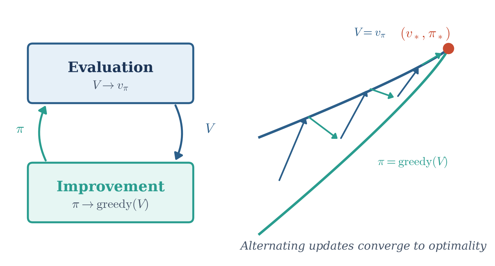

- **Dynamic Programming (DP)**: a family of planning methods that compute exact optimal value functions and policies when a complete, accurate MDP model of the environment is available.

**Modeling assumptions:**

1. **Finite MDP structure**: states ($\mathcal{S}$), available choices ($\mathcal{A}(s)$), and possible rewards ($\mathcal{R}$) all have finite cardinality.
2. **Known transition law**: the exact dynamics $p(s', r \mid s, a)$ are provided for every $s \in \mathcal{S}$, $a \in \mathcal{A}(s)$, $r \in \mathcal{R}$, and $s' \in \mathcal{S}^+$ (where $\mathcal{S}^+$ appends any terminal state to $\mathcal{S}$ in episodic tasks):

$$p(s', r | s, a) = \mathbb{P}\left[R_{t+1} = r,\, S_{t+1} = s' \mid S_t, A_t\right]$$

**Core DP strategy:**

- **Value-guided search**: use value functions to structure the search over policies rather than searching policy space directly.
- **Bellman equations as update rules**: convert the Bellman identities from Chapter 3 into iterative assignments that compute $v_\pi$, $v_*$, or $q_*$.
- **Greedy policy extraction**: once $v_*$ or $q_*$ satisfies the **Bellman Optimality Equations**, an optimal policy $\pi_*$ follows immediately by acting greedily.

### Bellman Optimality Equations {#ch04-bellman-optimality-equations}

$$\quad \forall s \in S,\, a \in A(s),\, s' \in S^+$$

- **State-Value function:**

$$
\begin{aligned}
v_{*}(s) &= \max_a\, \mathbb{E}\left[R_{t+1} + \gamma v_{*}(S_{t+1}) \mid S_t = s,\, A_t = a\right] \\
&= \max_a \sum_{s', r} p(s', r \vert s, a)\left[r + \gamma v_{*}(s')\right]
\end{aligned}
$$

- **Action-Value function:**

$$
\begin{aligned}
q_{*}(s,a) &= \mathbb{E}\left[R_{t+1} + \gamma \max_{a'} q_{*}(S_{t+1}, a') \mid S_t = s,\, A_t = a\right] \\
&= \sum_{s', r} p(s', r \vert s, a)\left[r + \gamma \max_{a'} q_{*}(s', a')\right]
\end{aligned}
$$

## Policy Evaluation (Prediction) {#sec-ch04-4-1}

- **Policy evaluation (prediction problem)**: given a fixed policy $\pi$, compute its exact state-value function $v_\pi$.

$$
\begin{aligned}
v_\pi(s) &\doteq \mathbb{E}\left[G_t \mid S_t = s\right] \\
&= \mathbb{E}_\pi\left[R_{t+1} + \gamma G_{t+1} \mid S_t = s\right] \\
&= \mathbb{E}_\pi\left[R_{t+1} + \gamma v_\pi(S_{t+1}) \mid S_t = s\right] \\
&= \sum_a \pi(a \vert s) \sum_{s', r} p(s', r \vert s, a)\left[r + \gamma v_\pi(s')\right]
\end{aligned}
$$

- **Linear system view**: with known dynamics $p$, this identity defines $|\mathcal{S}|$ coupled linear equations in the $|\mathcal{S}|$ unknown values $v_\pi(s)$. Direct matrix inversion works for small domains, but iterative updates scale much better.
- **Iterative approximation**: start from an arbitrary table $v_0: \mathcal{S}^+ \to \mathbb{R}$ (keeping terminal states fixed at $0$) and generate $v_1, v_2, \ldots$ by applying the Bellman equation as an assignment rule for every $s \in \mathcal{S}$:

$$
\begin{aligned}
v_{k+1}(s) &\doteq \mathbb{E}_\pi\left[R_{t+1} + \gamma v_k(S_{t+1}) \mid S_t = s\right] \\
&= \sum_a \pi(a \vert s) \sum_{s', r} p(s', r \vert s, a)\left[r + \gamma v_k(s')\right]
\end{aligned}
$$

### Iterative Policy Evaluation {#iterative-policy-evaluation}

- **Convergence**: under the standard conditions ensuring $v_\pi$ exists (either $\gamma < 1$ or guaranteed termination from every state under $\pi$), the sequence $\{v_k\}$ converges to the unique fixed point $v_\pi$ as $k \to \infty$.
- **Expected updates**: each assignment averages over the full probability distribution of possible next states and rewards via $p$, rather than relying on a single sampled transition.
- **State-space sweeps**: synchronous evaluation updates all states in a full pass using $v_k$ to build $v_{k+1}$; an **in-place** variant overwrites a single value array immediately as each state is visited, cutting memory in half and typically converging faster.

## Policy Improvement {#sec-ch04-4-2}

- **Evaluating alternative actions**: once $v_\pi$ is known, we can test whether choosing a different action $a \neq \pi(s)$ in state $s$ and reverting to $\pi$ afterward improves expected return by computing $q_\pi(s, a)$:

$$
\begin{aligned}
q_\pi(s,a) &\doteq \mathbb{E}\left[R_{t+1} + \gamma v_\pi(S_{t+1}) \mid S_t = s,\, A_t = a\right] \\
&= \sum_{s', r} p(s', r \vert s, a)\left[r + \gamma v_\pi(s')\right]
\end{aligned}
$$

- **Greedy policy improvement**: given a deterministic policy $a = \pi(s)$, construct a revised policy $\pi'$ that selects a value-maximizing action at every state: $\pi'(s) = \arg\max_{a \in A} q_\pi(s, a)$.
- **Policy improvement theorem (monotonicity)**: by definition of the maximum, acting greedily for one step cannot worsen expected return from any state:

$$q_\pi(s, \pi'(s)) = \max_{a \in A} q_\pi(s,a) \geq q_\pi(s, \pi(s)) = v_\pi(s)$$

- Repeatedly expanding this inequality forward along trajectories governed by $\pi'$ proves that the new policy is uniformly at least as good as $\pi$, i.e., $v_{\pi'}(s) \geq v_\pi(s)$ for every $s \in \mathcal{S}$:

$$
\begin{aligned}
v_\pi(s) &\leq q_\pi(s, \pi'(s)) \\
&= \mathbb{E}\left[R_{t+1} + \gamma v_\pi(S_{t+1}) \mid S_t = s,\, A_t = \pi'(s)\right] \\
&= \mathbb{E}_{\pi'}\left[R_{t+1} + \gamma v_\pi(S_{t+1}) \mid S_t = s\right] \\
&\leq \mathbb{E}_{\pi'}\left[R_{t+1} + \gamma q_\pi(S_{t+1}, \pi'(S_{t+1})) \mid S_t = s\right] \\
&= \mathbb{E}_{\pi'}\left[R_{t+1} + \gamma\, \mathbb{E}\left[R_{t+2} + \gamma V_\pi(S_{t+2}) \mid S_{t+1}, A_{t+1} = \pi'(S_{t+1})\right] \mid S_t = s\right] \\
&= \mathbb{E}_{\pi'}\left[R_{t+1} + \gamma R_{t+2} + \gamma^2 V_\pi(S_{t+2}) \mid S_t = s\right] \\
&\leq \mathbb{E}_{\pi'}\left[R_{t+1} + \gamma R_{t+2} + \gamma^2 R_{t+3} + \gamma^3 V_\pi(S_{t+3}) \mid S_t = s\right] \\
&\quad \vdots \\
&\leq \mathbb{E}_{\pi'}\left[R_{t+1} + \gamma R_{t+2} + \gamma^2 R_{t+3} + \gamma^3 R_{t+4} + \ldots \mid S_t = s\right] \\
&= \mathbb{E}_{\pi'}\left[\sum_{k=0}^{\infty} \gamma^k R_{t+k+1} \mid S_t = s\right] \\
&= \mathbb{E}_{\pi'}\left[G_t \mid S_t = s\right] \\
&= v_{\pi'}(s) \\
\therefore \quad v_\pi(s) &\leq v_{\pi'}(s)
\end{aligned}
$$

- **Optimality at fixed points**: if greedy improvement produces no value gain anywhere ($v_{\pi'}(s) = v_\pi(s)$ for all $s$), then $v_\pi(s) = \max_{a \in A} q_\pi(s, a)$ holds for every state.
- That identity is precisely the Bellman optimality equation, which guarantees $v_\pi = v_{\pi'} = v_*$ and confirms that both $\pi$ and $\pi'$ are optimal.
- Hence, greedy improvement always produces a **strictly stronger policy** unless the current policy is already optimal.

## Policy Iteration {#sec-ch04-4-3}

- **Policy iteration**: alternates full policy evaluation and greedy policy improvement to generate a monotonically improving chain of policies and value tables.
- **Procedure**:
  1. Compute $v_\pi$ for the current policy $\pi$ via iterative policy evaluation.
  2. Derive a greedy improved policy $\pi'$ from $v_\pi$.
  3. Evaluate $\pi'$ to obtain $v_{\pi'}$ (typically warm-starting from $v_\pi$ to speed up convergence).
  4. Repeat until the policy stabilizes; because a finite MDP has finitely many deterministic policies, termination at an optimal policy $\pi_*$ is guaranteed in finitely many rounds.

    $$\pi_0 \xrightarrow{E} V_{\pi_0} \xrightarrow{I} \pi_1 \xrightarrow{E} V_{\pi_1} \xrightarrow{I} \pi_2 \xrightarrow{E} \ldots \xrightarrow{I} \pi_* \xrightarrow{E} V_*$$

    Here $\xrightarrow{E}$ marks policy evaluation ($v_\pi(s) = \mathbb{E}_\pi\left[G_t \mid S_t = s\right]$) and $\xrightarrow{I}$ marks greedy policy improvement ($\pi' = \text{greedy}(v_\pi)$).

<!-- $$V_\pi(s) = \mathbb{E}_\pi\left[G_t \mid S_t = s\right] \qquad \pi' = \text{greedy}(V_\pi)$$ -->

- In practice, policy iteration usually reaches $\pi_*$ in remarkably few outer iterations.

## Value Iteration {#sec-ch04-4-4}

- **Bottleneck of policy iteration**: waiting for iterative policy evaluation to fully converge inside every outer step is wasteful, since exact evaluation formally requires infinitely many sweeps while the greedy policy often stabilizes far earlier.
- **Truncated evaluation**: stopping policy evaluation early preserves convergence to optimal values.
- **Value iteration**: takes truncation to the extreme by halting evaluation after just **one sweep** over all states, fusing improvement and single-step evaluation into a single backup ($\forall s \in \mathcal{S}$):

$$
\begin{aligned}
v_{k+1}(s) &\doteq \max_a\, \mathbb{E}\left[R_{t+1} + \gamma v_k(S_{t+1}) \mid S_t = s,\, A_t = a\right] \\
&= \max_a \sum_{s', r} p(s', r \vert s, a)\left[r + \gamma v_k(s')\right]
\end{aligned}
$$

- **Direct Bellman optimality backup**: value iteration simply applies the Bellman optimality equation directly as an iterative assignment rule, stopping once the largest value change across a sweep drops below a chosen tolerance $\theta$.

## Asynchronous Dynamic Programming {#sec-ch04-4-5}

- **Motivation**: full state-space sweeps become prohibitive when $|\mathcal{S}|$ is enormous, even if only a tiny subset of states matters for good behavior.
- **Asynchronous DP**: performs **in-place** backups on individual states in arbitrary order, always using whatever current estimates exist for successor states instead of waiting for synchronized passes.
- Convergence still holds as long as every state continues to be updated infinitely often (or all relevant states receive backups in episodic tasks).
- **Three common variants**:
  - **In-place DP**: updates a single shared value table directly without maintaining separate old and new copies.
  - **Prioritized sweeping**: schedules backups first on states whose predecessors just experienced large value changes.
  - **Real-time DP**: focuses updates on states actively visited along simulated or real agent trajectories.

## Generalized Policy Iteration (GPI) {#sec-ch04-4-6}

- **Generalized Policy Iteration (GPI)**: the overarching pattern of interleaving policy evaluation and policy improvement at any granularity, whether full convergence, single sweeps, or individual state updates.
- **Competing yet cooperative dynamics**: evaluation pushes the value table toward the current policy's true value $v_\pi$ (which can make the policy non-greedy), while improvement shifts the policy to be greedy over the current table (which changes the target value function). Together, these opposing adjustments stabilize only at the joint optimal solution $(v_*, \pi_*)$.

::: {#fig-41}
{width=85% fig-align="center" fig-alt="Generalized Policy Iteration diagram showing evaluation and improvement driving estimates toward optimal v_* and pi_*."}

**Generalized Policy Iteration (GPI).** Policy evaluation moves the value estimate toward $v_\pi$ while policy improvement pushes the policy toward greediness with respect to $V$, driving both toward $(v_*, \pi_*)$.
:::

## Efficiency of Dynamic Programming {#sec-ch04-4-7}

- **Polynomial complexity**: although DP suffers from the **curse of dimensionality** when state variables multiply, its worst-case runtime grows only polynomially in $|\mathcal{S}|$ and $|\mathcal{A}|$, making it exponentially faster than exhaustive search across the space of all policies.
- **Comparison with alternatives**: linear programming can also solve finite MDPs in polynomial time, yet DP methods scale far better to large state spaces in practice.
- **Scaling with asynchronous updates**: on massive domains where full sweeps are impractical, asynchronous DP concentrates computation on reachable, high-impact states.

## Summary {#sec-ch04-4-8}

- **Policy evaluation** computes a policy's state values iteratively from known dynamics, while **policy improvement** greedily refines the policy to guarantee monotonic gains until optimality.
- **Policy iteration** and **value iteration** combine these two operations at opposite ends of evaluation depth, both converging to exact optimal values and policies in finite MDPs.
- **Expected updates** average over every successor state weighted by exact transition probabilities $p(s', r \mid s, a)$ to satisfy the Bellman equations.
- **Asynchronous DP** eliminates full state-space sweeps by updating states individually in place, directing compute where it matters most.
- **Generalized Policy Iteration (GPI)** unifies DP and almost all subsequent RL methods as an ongoing interplay between value estimation and greedy policy updates.
- **Bootstrapping**: all DP backups revise value estimates using other value estimates; Chapter 5 relaxes both the requirement for a known model and bootstrapping via Monte Carlo methods.
