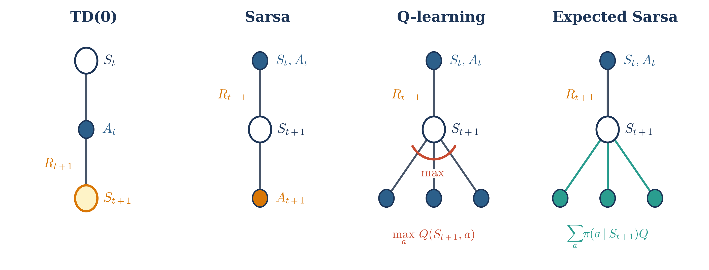

- **Experience-driven learning**: Temporal-difference (TD) algorithms estimate value functions directly from observed transitions without waiting for a full model.
- **Model-free paradigm**: Like Monte Carlo, TD requires no knowledge of state-transition probabilities or reward distributions.
- **Bootstrapping**: Unlike Monte Carlo, TD revises value estimates using other learned estimates, enabling updates from **incomplete** trajectories after every single step.

## TD Prediction {#sec-ch06-6-1}

- **Prediction goal**: Estimate the state-value function $V_\pi$ from sampled trajectories generated by a fixed policy $\pi$.
- **Comparing MC and TD**: Both families learn from direct interaction, yet they differ sharply in when and how they form update targets.
- **Constant-$\alpha$ every-visit MC**: A basic incremental MC rule well suited to nonstationary settings updates toward the realized return $G_t$:

$$V(S_t) \leftarrow V(S_t) + \alpha\left[G_t - V(S_t)\right]$$

$$
\begin{aligned}
\text{where } G_t &\equiv \text{actual return following time } t \\[6pt]
\alpha &\equiv \text{constant step-size parameter}
\end{aligned}
$$

- **One-step TD, or TD(0)**: Rather than waiting until episode termination to compute $G_t$, TD(0) updates immediately after observing a single transition $(S_t, R_{t+1}, S_{t+1})$:

$$\boxed{V(S_t) \leftarrow V(S_t) + \alpha\underbrace{\left[R_{t+1} + \gamma V(S_{t+1}) - V(S_t)\right]}_{\text{TD Error}}}$$

$$
\begin{aligned}
\text{where } R_{t+1} + \gamma V(S_{t+1}) &\equiv \text{the } \textbf{TD target}
\end{aligned}
$$

### Implementation: Tabular TD(0)

```python
from collections import defaultdict


def td0_prediction(env, policy, episodes, alpha=0.1, gamma=0.99):
    """Estimate state values V for a fixed policy using one-step TD(0)."""
    V = defaultdict(float)

    for _ in range(episodes):
        state, done = env.reset(), False
        while not done:
            action = policy(state)
            next_state, reward, done = env.step(action)
            bootstrap = 0.0 if done else V[next_state]
            td_error = reward + gamma * bootstrap - V[state]
            V[state] += alpha * td_error
            state = next_state

    return dict(V)
```

- **Bellman foundation of bootstrapping**: TD(0) replaces the expectation over next states and rewards with a single sampled transition, and substitutes the current approximation $V(S_{t+1})$ for the unknown true value $v_\pi(S_{t+1})$:

$$
\begin{aligned}
v_\pi(s) &\doteq \mathbb{E}\left[G_t \mid S_t = s\right] \\
&= \mathbb{E}_\pi\left[R_{t+1} + \gamma G_{t+1} \mid S_t = s\right] \\
&= \mathbb{E}_\pi\left[R_{t+1} + \gamma v_\pi(S_{t+1}) \mid S_t = s\right] \\
\end{aligned}
$$

- **Dual approximation in the TD target**: The target $R_{t+1} + \gamma V(S_{t+1})$ approximates the Bellman expectation in two ways: it samples one transition instead of summing over the full distribution, and it bootstraps from the running table $V$ instead of $v_\pi$.
- **Hybrid strength**: TD [@sutton1988] merges the **sampling** of Monte Carlo with the **bootstrapping** of Dynamic Programming (see @fig-61 in [Section 6.6](#sec-ch06-6-6) and Sutton & Barto, 2020, Ch. 6).

### TD Error & its Relationship to MC Error {#td-error-its-relationship-to-mc-error}

The **TD error** $\delta_t \doteq R_{t+1} + \gamma V(S_{t+1}) - V(S_t)$ captures the one-step discrepancy discovered upon observing $R_{t+1}$ and $S_{t+1}$. Whenever the value table $V$ stays frozen throughout an episode (as in batch or offline MC updates), the full Monte Carlo error telescopes cleanly into a discounted sum of TD errors:

$$\text{MC error} = \sum_t \text{TD error}$$

Expanding $G_t - V(S_t)$ by adding and subtracting $\gamma V(S_{t+1})$ recursively gives:

$$
\begin{aligned}
G_t - V(S_t) &= R_{t+1} + \gamma G_{t+1} - V(S_t) + \gamma V(S_{t+1}) - \gamma V(S_{t+1}) \\[6pt]
&= \underbrace{R_{t+1} + \gamma V(S_{t+1}) - V(S_t)}_{\delta_t} + \gamma G_{t+1} - \gamma V(S_{t+1}) \\[6pt]
&= \delta_t + \gamma\left(G_{t+1} - V(S_{t+1})\right) \\[6pt]
&= \delta_t + \gamma\left(R_{t+2} + \gamma G_{t+2} - V(S_{t+1})\right) \\[6pt]
&= \delta_t + \gamma\left(R_{t+2} + \gamma V(S_{t+2}) - V(S_{t+1}) + \gamma G_{t+2} - \gamma V(S_{t+2})\right) \\[6pt]
&= \delta_t + \gamma\underbrace{\left(R_{t+2} + \gamma V(S_{t+2}) - V(S_{t+1})\right)}_{\delta_{t+1}} + \gamma^2\left(G_{t+2} - V(S_{t+2})\right) \\[6pt]
&= \delta_t + \gamma \delta_{t+1} + \gamma^2\left(G_{t+2} - V(S_{t+2})\right) \\[6pt]
&= \delta_t + \gamma \delta_{t+1} + \gamma^2\left(R_{t+3} + \gamma V(S_{t+3}) - V(S_{t+2}) + \gamma G_{t+3} - \gamma V(S_{t+3})\right) \\[6pt]
&= \delta_t + \gamma \delta_{t+1} + \gamma^2 \delta_{t+2} + \gamma^3\left(G_{t+3} - V(S_{t+3})\right) \\[6pt]
&\quad \vdots \\[6pt]
&= \delta_t + \gamma \delta_{t+1} + \gamma^2 \delta_{t+2} + \gamma^3 \delta_{t+3} + \ldots + \gamma^{T-t-1} \delta_{T-1} + \gamma^{T-t}\underbrace{\left[G_T - V(S_T)\right]}_{=\, 0}
\end{aligned}
$$

$$\boxed{G_t - V(S_t) = \sum_{k=t}^{T-1} \gamma^{k-t}\, \delta_k}$$

## Advantages of TD Prediction Methods {#sec-ch06-6-2}

- **No environment model needed**: Unlike DP, TD operates purely on sampled transitions without transition matrices or reward specifications.
- **Online step-by-step updates**: Whereas MC delays learning until an episode finishes, TD adjusts values immediately after every single transition.
- **Handles incomplete and continuing tasks**: Because TD never needs a terminal state, it applies seamlessly to truncated rollouts and non-terminating continuing problems where MC fails.
- **Tabular convergence**: For a fixed policy $\pi$, tabular TD(0) converges to $v_\pi$ under standard step-size schedules (though stability with arbitrary function approximation requires additional care).
- **Lower variance and faster empirical convergence**: Because a one-step target depends on just one random reward and next state rather than an entire trajectory of random outcomes, TD exhibits **low variance** (at the cost of initial bootstrapping bias) and typically learns faster than constant-$\alpha$ MC on stochastic Markov tasks.

## Optimality of TD(0) {#sec-ch06-6-3}

- **Batch updating**: Given a fixed, finite dataset of episodes, we can repeatedly sweep over the entire batch, accumulating all per-step increments and applying their sum to $V$ once per pass until the table stabilizes.
- **Deterministic batch limits**: With sufficiently small step size $\alpha$, both batch constant-$\alpha$ MC and batch TD(0) converge to unique, $\alpha$-independent solutions, yet those two solutions generally differ.
- **Batch MC objective**: Repeated MC passes locate the value table that **minimizes mean-squared error** against the observed empirical returns in the training dataset.
- **Batch TD(0) objective**: Repeated TD(0) passes yield the exact value function of the **maximum-likelihood Markov model** estimated from the observed transitions and rewards.
  - **Certainty-equivalence estimate**: Solving the empirical MDP as if its estimated transition probabilities and expected rewards were exact produces the **certainty-equivalence estimate**.
  - **Implicit Markov exploitation**: Batch TD(0) converges directly to this certainty-equivalence solution without ever explicitly constructing or inverting the $O(|\mathcal{S}|^2)$ transition matrix, explaining why TD often outperforms MC on Markovian domains.

## Sarsa: On-policy TD Control {#sec-ch06-6-4}

- **TD inside GPI**: To turn TD prediction into a control algorithm, we plug TD policy evaluation into the Generalized Policy Iteration (GPI) loop while continually improving the policy.
- **Action-value transitions**: Model-free control evaluates state-action pairs $q_\pi(s, a)$ rather than state values alone. Following the alternating state and action sequence of an episode (Sutton & Barto, 2020, Ch. 6), we bootstrap from the next state-action estimate:

$$\boxed{Q(S_t, A_t) \leftarrow Q(S_t, A_t) + \alpha\Big[\underbrace{R_{t+1} + \gamma Q(S_{t+1}, A_{t+1})}_{\text{TD target}} - Q(S_t, A_t)\Big]}$$

- **Why the name Sarsa**: Introduced by @rummery1994, every update depends on the five-element transition tuple $(S_t, A_t, R_{t+1}, S_{t+1}, A_{t+1})$ (visualized alongside the other one-step backups in @fig-61).
- **Tightly coupled on-policy loop**: At every time step, Sarsa performs both halves of GPI simultaneously:
  - **Policy evaluation**: Update $Q \approx q_\pi$ using the actually sampled successor action $A_{t+1}$.
  - **Policy improvement**: Derive the next action from an $\varepsilon$-greedy (or $\varepsilon$-soft) policy over $Q$.
- **Convergence conditions**: Under [Robbins-Monro step-size decay](ch02-multi-armed-bandits.qmd#step-size-parameter), continual sampling of all state-action pairs, and a GLIE exploration schedule, tabular Sarsa almost surely approaches $q_*$ and an optimal policy.

### Implementation: Sarsa

```python
import random
from collections import defaultdict


def eps_greedy(Q, state, num_actions, eps):
    if random.random() < eps:
        return random.randrange(num_actions)
    q_vals = [Q[state, a] for a in range(num_actions)]
    best = max(q_vals)
    tied = [a for a, v in enumerate(q_vals) if v == best]
    return random.choice(tied)


def sarsa(env, num_actions, episodes, alpha=0.1, gamma=0.99, eps=0.1):
    """On-policy one-step TD control estimating action values Q."""
    Q = defaultdict(float)

    for _ in range(episodes):
        state, done = env.reset(), False
        action = eps_greedy(Q, state, num_actions, eps)
        while not done:
            next_state, reward, done = env.step(action)
            next_action = None if done else eps_greedy(Q, next_state, num_actions, eps)
            target = reward + (0.0 if done else gamma * Q[next_state, next_action])
            Q[state, action] += alpha * (target - Q[state, action])
            state, action = next_state, next_action

    return dict(Q)
```

## Q-learning: Off-Policy TD Control {#sec-ch06-6-5}

$$\boxed{Q(S_t, A_t) \leftarrow Q(S_t, A_t) + \alpha\Big[\underbrace{R_{t+1} + \gamma \max_{a'} Q(S_{t+1}, a')}_{\text{Q-learning target}} - Q(S_t, A_t)\Big]}$$

- **Direct optimal value estimation**: Q-learning [@watkins1989; @watkins1992] breaks the link between the policy being evaluated and the policy collecting data; $Q$ directly approximates $q_*$ regardless of the exploratory behavior policy, while $v_*$ follows immediately from a **1-step lookahead** ($\max_a Q(s, a)$).
- **Off-policy separation**: Updates bootstrap through the greedy maximum over successor actions, whereas actions executed in the environment can follow an exploratory policy such as $\varepsilon$-greedy.
- **Convergence guarantee**: Decoupling the target from behavior simplifies theory. Provided every $(s, a)$ pair keeps being updated (satisfied under GLIE or any persistent exploration) and $\alpha_t$ obeys [**stochastic approximation** step-size rules](ch02-multi-armed-bandits.qmd#step-size-parameter) ($\sum \alpha_t = \infty$, $\sum \alpha_t^2 < \infty$), $Q$ converges almost surely to $q_*$:

$$Q(s,a) \longrightarrow q_*(s,a)$$

### Off-Policy Action-Value Perspective

- **Behavior action**: The agent acts using an exploratory behavior policy $\mu$:

$$A_{t+1} \sim \mu(\cdot | S_t)$$

- **Hypothetical target action**: Instead of bootstrapping from $A_{t+1}$, the update evaluates a target action $A' \sim \pi(\cdot | S_t)$ drawn from the target policy $\pi$:

$$Q(S_t, A_t) \leftarrow Q(S_t, A_t) + \alpha\Big[\underbrace{R_{t+1} + \gamma Q(S_{t+1}, A')}_{\text{Q-learning target}} - Q(S_t, A_t)\Big]$$

- **Value-iteration analogy**: Because the target takes a direct $\max$ over successor actions, Q-learning acts as a sample-based, model-free counterpart to value iteration.

### Off-policy Control with Q-learning {#off-policy-control-with-q-learning}

- **Dual policy improvement**: Both policies evolve as $Q$ improves:
  - **Greedy target policy ($\pi$)**: Picks the best estimated action deterministically:
  $$\pi(S_{t+1}) = \arg\max_{a'} Q(S_{t+1}, a')$$
  - **Exploratory behavior policy ($\mu$)**: Typically **$\varepsilon$-greedy** with respect to $Q(s, a)$ to ensure continual exploration.
- **Simplified target**: Substituting the deterministic greedy target policy collapses the target directly to the maximum successor Q-value:

$$R_{t+1} + \gamma Q(S_{t+1}, A') = R_{t+1} + \gamma Q\!\left(S_{t+1}, \arg\max_{a'} Q(S_{t+1}, a')\right) = R_{t+1} + \gamma \max_{a'} Q(S_{t+1}, a')$$

### Implementation: Q-learning

```python
from collections import defaultdict


def q_learning(env, num_actions, episodes, alpha=0.1, gamma=0.99, eps=0.1):
    """Off-policy one-step TD control directly estimating q_*."""
    Q = defaultdict(float)

    for _ in range(episodes):
        state, done = env.reset(), False
        while not done:
            action = eps_greedy(Q, state, num_actions, eps)
            next_state, reward, done = env.step(action)
            best_next = 0.0 if done else max(Q[next_state, a] for a in range(num_actions))
            target = reward + gamma * best_next
            Q[state, action] += alpha * (target - Q[state, action])
            state = next_state

    return dict(Q)
```

## Expected Sarsa {#sec-ch06-6-6}

- **Expectation over successor actions**: Rather than bootstrapping from a single sampled successor action (Sarsa) or taking the hard maximum (Q-learning), **Expected Sarsa** weights every successor action value by its probability under the target policy $\pi$:

$$
\boxed{\begin{aligned}
Q(S_t, A_t) &\leftarrow Q(S_t, A_t) + \alpha\left[R_{t+1} + \gamma\, \mathbb{E}_\pi\left[Q(S_{t+1}, A_{t+1}) \vert S_{t+1}\right] - Q(S_t, A_t)\right] \\[6pt]
Q(S_t, A_t) &\leftarrow Q(S_t, A_t) + \alpha\left[R_{t+1} + \gamma \sum_a \pi(a \vert S_{t+1})\, Q(S_{t+1}, a) - Q(S_t, A_t)\right]
\end{aligned}}
$$

- **Variance elimination**: Conditioned on arriving in $S_{t+1}$, Expected Sarsa takes the exact deterministic step corresponding to Sarsa's average direction, completely removing sampling noise from the choice of $A_{t+1}$.
- **Stronger sample efficiency**: At only modest extra per-step cost (summing over $|\mathcal{A}(S_{t+1})|$ actions), Expected Sarsa routinely learns faster and tolerates larger step sizes than standard Sarsa.
- **Unifying on-policy and off-policy control**: When $\pi$ matches the behavior policy, Expected Sarsa is on-policy; when $\pi$ differs from an exploratory behavior policy $\mu$, it learns off-policy without importance sampling.
  - **Special case**: Choosing $\pi$ to be strictly greedy while $\mu$ is $\varepsilon$-greedy recovers **Q-learning** identically.

::: {#fig-61}
{width=98% fig-align="center" fig-alt="Side-by-side one-step backup schematics for TD(0), Sarsa, Q-learning, and Expected Sarsa."}

**One-step TD backup schematics.** Comparing the single-step update targets of TD(0), Q-learning, Sarsa, and Expected Sarsa.
:::

## Maximization Bias & Double Learning {#sec-ch06-6-7}

- **Hidden upward bias of $\max$**: Control updates that maximize over noisy action-value estimates systematically overestimate true values.
- **Concrete intuition**: Suppose every action in state $s$ has true value $q(s, a) = 0$, while finite-sample estimates $Q(s, a)$ fluctuate randomly above and below zero. The true maximum is $0$, yet $\max_a Q(s, a)$ is almost surely strictly positive whenever any single estimate happens to overshoot zero.
- **Maximization bias**: This systematic upward distortion is known as **maximization bias**:

$$
\begin{aligned}
q(s,a) = 0 \quad \forall s,a &\implies \max_{s,a} q(s,a) = 0 \\[6pt]
Q(s,a) = \left\{ \begin{array}{l} \geq 0 \\ < 0 \end{array} \right\} &\implies \max_{s,a} Q(s,a) > 0
\end{aligned}
$$

- **Double Learning**: To break this positive feedback loop, maintain two independently updated tables, $Q_1$ and $Q_2$, separating **action selection** from **action evaluation**:
  - Pick the maximizing action with the first estimator: $A^* = \arg\max_a Q_1(a)$.
  - Evaluate that chosen action with the second estimator: $Q_2(A^*) = Q_2(\arg\max_a Q_1(a))$.
- **Unbiased evaluation**: Because $Q_2$ is statistically independent of the noise that caused $Q_1$ to choose $A^*$, its evaluation is unbiased: $\mathbb{E}\left[Q_2(A^*)\right] = q(A^*)$.
- **Resource trade-off**: Double Learning doubles table storage while keeping per-step computation virtually unchanged (only one of the two tables updates at each transition).
- **Double Q-learning**: Applying this dual-estimator scheme to Q-learning yields **Double Q-learning** (see Sutton & Barto, 2020, Ch. 6).

### Implementation: Double Q-learning

```python
import random
from collections import defaultdict


def double_q_learning(env, num_actions, episodes, alpha=0.1, gamma=0.99, eps=0.1):
    """Double Q-learning using two decoupled Q tables to curb maximization bias."""
    Q1, Q2 = defaultdict(float), defaultdict(float)

    for _ in range(episodes):
        state, done = env.reset(), False
        while not done:
            if random.random() < eps:
                action = random.randrange(num_actions)
            else:
                totals = [Q1[state, a] + Q2[state, a] for a in range(num_actions)]
                best = max(totals)
                action = random.choice([a for a, v in enumerate(totals) if v == best])

            next_state, reward, done = env.step(action)
            if random.random() < 0.5:
                a_star = max(range(num_actions), key=lambda a: Q1[next_state, a])
                target = reward + (0.0 if done else gamma * Q2[next_state, a_star])
                Q1[state, action] += alpha * (target - Q1[state, action])
            else:
                a_star = max(range(num_actions), key=lambda a: Q2[next_state, a])
                target = reward + (0.0 if done else gamma * Q1[next_state, a_star])
                Q2[state, action] += alpha * (target - Q2[state, action])
            state = next_state

    return dict(Q1), dict(Q2)
```

**Double Q-learning Update Rule:**

$$\boxed{Q_1(S_t, A_t) \leftarrow Q_1(S_t, A_t) + \alpha\left[R_{t+1} + \gamma\, Q_2\!\left(S_{t+1},\, \arg\max_a Q_1(S_{t+1}, a)\right) - Q_1(S_t, A_t)\right]}$$

## Games, Afterstates & Other Special Cases {#sec-ch06-6-8}

- **Standard pre-action valuation**: Conventional action-value functions score a state-action pair $(s, a)$ **before** the action alters the environment.
- **Afterstate value functions**: When the immediate deterministic consequence of an agent's move is known before the environment (or opponent) responds, it is far more efficient to assign values to the resulting post-move configuration, called an **afterstate**.
  - **Board-game example**: In tic-tac-toe or chess, evaluating the board immediately after the agent's move captures the exact strategic position before the opponent replies.
- **Partial dynamics advantage**: Afterstates exploit known first-stage mechanics without needing a full model of the environment's stochastic reaction.
- **Collapsing redundant state-action pairs**: Multiple distinct $(s, a)$ pairs frequently transition into the identical afterstate; sharing a single afterstate entry pools experience across all paths leading there.
- **GPI compatibility**: Afterstate control fits cleanly into Generalized Policy Iteration, still requiring either an on-policy or off-policy exploration strategy.

## Summary {#sec-ch06-6-9}

- **Core TD paradigm**: Temporal-difference methods solve model-free prediction directly from incomplete trajectories by bootstrapping from current value estimates.
- **TD control via GPI**: Pairing TD evaluation with policy improvement yields simple, single-equation control algorithms that address exploration through either on-policy or off-policy updates:
  - **Sarsa** (on-policy, bootstraps from the actually executed next action).
  - **Q-learning** (off-policy, bootstraps greedily toward $q_*$).
  - **Expected Sarsa** (on-policy or off-policy, replaces the sampled next action with its policy-weighted expectation, strictly lowering update variance).
  - **Double Q-learning** (maintains twin value tables to separate action choice from value scoring, removing upward estimation bias).
- **Scope of Chapter 6**: Every method developed here is a **one-step, tabular, model-free** TD algorithm. [Chapter 7](ch07-nstep-bootstrapping.qmd#sec-ch07-7-1) generalizes the lookahead horizon from a single step to arbitrary $n$ steps.
