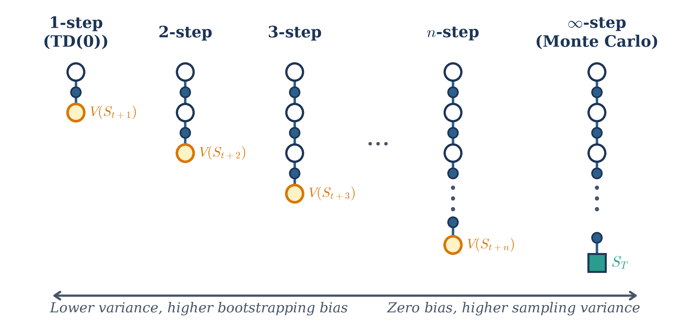
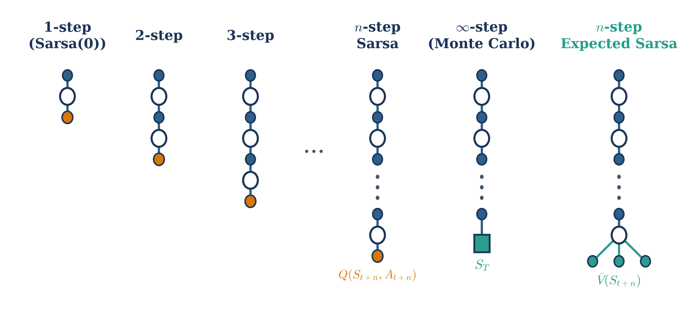
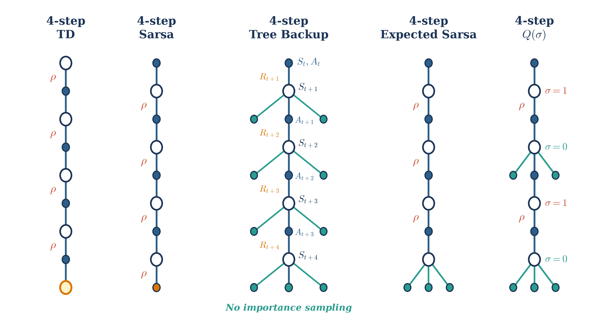

- **Bridging TD and Monte Carlo**: Multi-step ($n$-step) bootstrapping unifies one-step temporal-difference learning and full-episode Monte Carlo methods inside a single parameterized family.
- **Continuous spectrum of horizons**: Setting $n = 1$ recovers TD(0), while letting $n \to \infty$ recovers Monte Carlo; empirically, intermediate lookahead values often outperform both endpoints by balancing bias and variance.
- **Beyond single-step updates**: Bootstrapping after $n$ transitions decouples the update interval from the environment's base time step, letting the agent match backup depth to the task's reward delay.
- **Pathway to eligibility traces**: Understanding finite $n$-step backups lays the conceptual foundation for **eligibility traces** ([Chapter 12](ch12-eligibility-traces.qmd#sec-ch12-12-1)), which blend multiple lookahead horizons simultaneously with constant per-step memory.

## $n$-step TD Prediction, $\text{TD}(\lambda)$ {#sec-ch07-7-1}

- **Extending the lookahead window**: Consider estimating $V_\pi$ from trajectories generated under policy $\pi$ while letting the update target accumulate $n$ actual rewards before bootstrapping:
  - **Monte Carlo**: Waits until termination and updates each visited state from the complete remaining reward sequence.
  - **One-step TD**: Updates after a single reward $R_{t+1}$ and immediately bootstraps from $V(S_{t+1})$.
  - **$n$-step TD**: Collects an intermediate span of $n$ consecutive rewards before bootstrapping from the estimated value $n$ steps ahead (see @fig-71).

::: {#fig-71}
{width=96% fig-align="center" fig-alt="Diagram illustrating n-step returns spanning 1-step TD(0) through finite n-step bootstrapping to full-episode Monte Carlo."}

**Spectrum of $n$-step returns.** Increasing lookahead $n$ trades bootstrapping bias for sampling variance, bridging TD(0) at $n = 1$ and Monte Carlo at $n = \infty$.
:::

- **Family of truncated returns**: Indexing the value estimate available at step $t$ by $V_t : S \to \mathbb{R}$, the lookahead targets progress smoothly across $n$:

$$
\begin{aligned}
G_t^{(n)} &= G_{t:t+n} \equiv \text{the return from time step } t \text{ to } t+n \\[10pt]
n=1\ (\text{TD(0)}): \quad G_t^{(1)} &= R_{t+1} + \gamma V_t(S_{t+1}) \\[6pt]
n=2: \quad G_t^{(2)} &= R_{t+1} + \gamma R_{t+2} + \gamma^2 V_{t+1}(S_{t+2}) \\[6pt]
&\quad \vdots \\[6pt]
n=\infty\ (\text{MC}): \quad G_t^{(\infty)} &= R_{t+1} + \gamma R_{t+2} + \ldots + \gamma^{T-1} R_T
\end{aligned}
$$

- **General $n$-step return**: Truncate the true episodic return after $n$ rewards and replace the unobserved tail with the discounted estimate $\gamma^n V_{t+n-1}(S_{t+n})$:

$$\boxed{G_t^{(n)} = R_{t+1} + \gamma R_{t+2} + \ldots + \gamma^{n-1} R_{t+n} + \gamma^n V_{t+n-1}(S_{t+n}),}$$

$$\forall n, t \quad \text{ s.t. } \quad n \geq 1 \text{ and } 0 \leq t \leq T-n$$

- **Boundary condition near termination**: Whenever $t + n \geq T$, the episode ends before $n$ steps elapse, so all post-terminal terms vanish and the $n$-step target collapses to the exact full return:

$$G_{t:t+n} = G_t^{(n)} \doteq G_t \quad \text{if } t+n \geq T$$

- **Delayed update timing**: For $n > 1$, computing $G_t^{(n)}$ requires waiting until time step $t + n$, when both $R_{t+n}$ and $V_{t+n-1}(S_{t+n})$ are known.
  - **Incremental $n$-step state-value update**:

    $$V_{t+n}(S_t) \doteq V_{t+n-1}(S_t) + \alpha\left[G_t^{(n)} - V_{t+n-1}(S_t)\right], \quad 0 \leq t < T$$

  - **Unvisited states remain fixed**:

    $$V_{t+n}(s) = V_{t+n-1}(s), \quad \forall s \neq S_t$$

  - **Compact $n$-step TD rule**:

    $$\boxed{V(S_t) \leftarrow V(S_t) + \alpha\left[G_t^{(n)} - V(S_t)\right]}$$

- **Error reduction property**: Taking the expectation of any $n$-step return shrinks worst-case state-value error by at least a factor of $\gamma^n$ relative to $V_{t+n-1}$, guaranteeing asymptotic convergence of tabular $n$-step TD to $v_\pi$:

$$\max_s \left|\mathbb{E}_\pi\left[G_t^{(n)} \mid S_t = s\right] - v_\pi(s)\right| \leq \gamma^n \max_s \left|V_{t+n-1}(s) - v_\pi(s)\right|$$

## $n$-step Sarsa, $\text{Sarsa}(\lambda)$ {#sec-ch07-7-2}

- **Extending multi-step backups to control**: Replacing state values $V(s)$ with action values $Q(s, a)$ and pairing the updates with an $\varepsilon$-greedy policy yields **$n$-step Sarsa**.
- **Action-anchored backup structure**: Whereas $n$-step TD chains begin and terminate at state nodes, $n$-step Sarsa backups begin at $(S_t, A_t)$ and bootstrap from the sampled state-action pair $(S_{t+n}, A_{t+n})$ after $n$ rewards (see @fig-72).

::: {#fig-72}
{width=98% fig-align="center" fig-alt="Action-anchored backup diagrams for 1-step, 2-step, 3-step, n-step, Monte Carlo, and n-step Expected Sarsa."}

**Backup diagrams for $n$-step Sarsa methods.** Action-anchored lookahead chains span Sarsa(0), general $n$-step Sarsa, full-episode Monte Carlo, and $n$-step Expected Sarsa.
:::
- **Action-value return sequence**: Across lookahead horizons $n = 1, 2, \ldots, \infty$:

$$
\begin{aligned}
G_t^{(n)} &= G_{t:t+n} \\[10pt]
n=1\ (\text{Sarsa(0)}): \quad G_t^{(1)} &= R_{t+1} + \gamma Q(S_{t+1}, A_{t+1}) \\[6pt]
n=2: \quad G_t^{(2)} &= R_{t+1} + \gamma R_{t+2} + \gamma^2 Q(S_{t+2}, A_{t+2}) \\[6pt]
&\quad \vdots \\[6pt]
n=\infty\ (\text{MC}): \quad G_t^{(\infty)} &= R_{t+1} + \gamma R_{t+2} + \ldots + \gamma^{T-1} R_T
\end{aligned}
$$

- **$n$-step Q-return**:

$$\boxed{G_t^{(n)} \doteq R_{t+1} + \gamma R_{t+2} + \ldots + \gamma^{n-1} R_{t+n} + \gamma^n Q_{t+n-1}(S_{t+n}, A_{t+n})}$$

$$\forall n, t \quad \text{ s.t. } \quad n \geq 1,\ 0 \leq t \leq T-n, \quad \text{with } G_t^{(n)} = G_t \text{ if } t+n \geq T$$

- **Delayed action-value update**: Only the state-action pair visited $n$ steps earlier is modified at step $t + n$:

$$Q_{t+n}(S_t, A_t) \doteq Q_{t+n-1}(S_t, A_t) + \alpha\left[G_t^{(n)} - Q_{t+n-1}(S_t, A_t)\right], \quad 0 \leq t < T$$

$$Q_{t+n}(s,a) = Q_{t+n-1}(s,a) \quad \forall s, a \quad \text{ s.t. } \quad s \neq S_t \text{ or } a \neq A_t$$

- **$n$-step Sarsa rule**:

$$\boxed{Q_{t+n}(S_t, A_t) \leftarrow Q_{t+n-1}(S_t, A_t) + \alpha\left[G_t^{(n)} - Q_{t+n-1}(S_t, A_t)\right]}$$

### Expected Sarsa {#expected-sarsa}

- **Branching at the final step**: Multi-step **Expected Sarsa** follows $n$ sampled transitions identically to $n$-step Sarsa, but replaces the single terminal action bootstrap $Q_{t+n-1}(S_{t+n}, A_{t+n})$ with a policy-weighted average across all legal actions in $S_{t+n}$.
- **$n$-step Expected Sarsa target**:

$$G_t^{(n)} = R_{t+1} + \gamma R_{t+2} + \ldots + \gamma^{n-1} R_{t+n} + \gamma^n \bar{V}_{t+n-1}(S_{t+n}), \quad t+n < T$$

$$
\begin{aligned}
\text{with } G_t^{(n)} &= G_t \quad \text{if } t+n \geq T
\end{aligned}
$$

- **Expected approximate value ($\bar{V}_t$)**: Denotes the policy-weighted average of current action-value entries for state $s$:

$$\bar{V}_t(s) \doteq \sum_a \pi(a|s)\, Q_t(s,a), \quad \forall s \in S$$

- **Terminal convention**: For any terminal state $\mathcal{T}$, define $\bar{V}_t(\mathcal{T}) = 0$.

## $n$-step Off-policy Learning {#sec-ch07-7-3}

- **Decoupled behavior and target policies**: In off-policy learning, we evaluate or optimize target policy $\pi$ (often greedy over $Q$) using trajectories gathered by a separate exploratory behavior policy $b$ (often $\varepsilon$-greedy).
- **Truncated importance weighting**: Because an $n$-step target depends only on actions across an $n$-step window rather than the entire episode, correcting the policy mismatch requires only the importance-sampling product over those relevant decisions:

$$\rho_{t:h} = \prod_{k=t}^{\min(h,\, T-1)} \frac{\pi(A_k|S_k)}{b(A_k|S_k)}$$

$$
\begin{aligned}
\text{where } \rho_{t:h} &\equiv \text{relative probability under the two policies of} \\
&\quad \text{taking the } n \text{ actions from } A_t \text{ to } A_{t+n-1}
\end{aligned}
$$

- **Off-policy $n$-step TD**: Scaling the TD update made at time $t + n$ by $\rho_{t:t+n-1}$ corrects for the action choices $A_t, \ldots, A_{t+n-1}$:

$$\boxed{V_{t+n}(S_t) \leftarrow V_{t+n-1}(S_t) + \alpha\, \rho_{t:t+n-1}\left[G_t^{(n)} - V_{t+n-1}(S_t)\right], \quad 0 \leq t < T}$$

- **On-policy specialization**: Whenever $\pi = b$, every ratio equals $1$ and the rule reduces immediately to ordinary $n$-step TD:

$$\text{if } \pi = b,\ \rho_{t:h} = 1 \implies V(S_t) \leftarrow V(S_t) + \alpha\left[G_t^{(n)} - V(S_t)\right]$$

- **Coverage constraint**: Importance sampling requires $b(a \mid s) > 0$ whenever $\pi(a \mid s) > 0$ so division by zero never occurs.
- **Off-policy $n$-step Sarsa**: For state-action values, $A_t$ is already conditioned on, so weighting shifts forward by one step to cover $A_{t+1}$ through $A_{t+n}$:

$$Q_{t+n}(S_t, A_t) \leftarrow Q_{t+n-1}(S_t, A_t) + \alpha\, \rho_{t+1:t+n}\left[G_t^{(n)} - Q_{t+n-1}(S_t, A_t)\right]$$

  - **Index shift**: $n$-step Sarsa uses $\rho_{t+1:t+n}$ whereas $n$-step TD uses $\rho_{t:t+n-1}$, because the initial action $A_t$ is fixed as the evaluation point rather than sampled from $\pi$.
- **Off-policy $n$-step Expected Sarsa**:

$$\boxed{Q(S_t, A_t) \leftarrow Q(S_t, A_t) + \alpha\, \rho_{t+1:t+n-1}\left[G_t^{(n)} - Q(S_t, A_t)\right]}$$

  - **Why the last ratio drops**: Because Expected Sarsa sums explicitly over all actions at $S_{t+n}$ weighted by $\pi$, the behavior action $A_{t+n}$ never enters the target and requires no importance-sampling factor.

## Per-decision Methods with Control Variates {#sec-ch07-7-4}

- **Variance drawback of basic weighting**: Multiplying the entire $n$-step error by a single ratio product as in [section 7.3](#sec-ch07-7-3) is straightforward, yet suffers from severe variance that slows learning.
- **Recursive return formulation**: Writing the ordinary $n$-step return ending at horizon $h$ recursively exposes per-step structure:

    1. **On-policy recursion**:

        $$G_{t:h} = R_{t+1} + \gamma G_{t+1:h}, \quad t < h < T$$

        $$\begin{aligned}\text{where } G_{h:h} &\doteq V_{h-1}(S_h)\end{aligned}$$

    2. **Single-step ratio**: At step $t$, the mismatch between behavior $b$ and target $\pi$ enters through the single-decision factor:

        $$\rho_t = \frac{\pi(A_t \vert S_t)}{b(A_t \vert S_t)}$$

- **Per-decision off-policy return with control variate**: Rather than scaling $R_{t+1} + \gamma G_{t+1:h}$ by $\rho_t$ alone (which pushes the target to $0$ whenever $\rho_t = 0$), add a zero-mean baseline term:

$$
\boxed{\begin{aligned}
G_{t:h} &\doteq \rho_t\left(R_{t+1} + \gamma G_{t+1:h}\right) + (1 - \rho_t) V_{h-1}(S_t), \quad t < h < T \\[6pt]
G_{h:h} &\doteq V_{h-1}(S_h)
\end{aligned}}
$$

- **Role of the control variate**: The additive correction $(1 - \rho_t) V_{h-1}(S_t)$ acts as a **control variate**:
  - **Safe zero-probability handling**: Whenever $\rho_t = 0$ (an action forbidden under $\pi$), the return defaults cleanly to $V_{h-1}(S_t)$, yielding a zero update instead of pulling the estimate toward zero.
  - **Preserves expectation**: Because $\mathbb{E}_b[\rho_t] = 1$ and $V_{h-1}(S_t)$ is independent of $A_t$, the control variate has zero expectation and keeps the estimator unbiased while cutting variance.

### For Action Values {#for-action-values}

- **Conditioning on the first action**: For action-value prediction, $A_t$ is fixed, so importance sampling begins at step $t + 1$. Incorporating a control variate into the recursive return ending at horizon $h$ produces:

$$
\boxed{\begin{aligned}
G_{t:h} &\doteq R_{t+1} + \gamma\left[\rho_{t+1} G_{t+1:h} + \bar{V}_{h-1}(S_{t+1}) - \rho_{t+1} Q_{h-1}(S_{t+1}, A_{t+1})\right] \\[6pt]
&= R_{t+1} + \gamma\, \rho_{t+1}\left(G_{t+1:h} - Q_{h-1}(S_{t+1}, A_{t+1})\right) + \gamma \bar{V}_{h-1}(S_{t+1}), \quad t < h \leq T
\end{aligned}}
$$

- **Base cases**:
  - When $h < T$, terminate the recursion with $G_{h:h} \doteq Q_{h-1}(S_h, A_h)$.
  - When $h \geq T$, terminate with $G_{T-1:h} = R_T$.
- **Connection to Expected Sarsa**: Plugging this return into the $n$-step Sarsa update rule produces a multi-step variance-reduced counterpart to Expected Sarsa.
- **Additional variance-mitigation strategies**: Because off-policy ratio products inherently inflate variance compared to on-policy updates, practical systems combine multiple remedies:
  1. **Control variates** (per-decision baselines as above).
  2. **Adaptive step sizes** that scale down automatically under high variance (e.g., Autostep).
  3. **Importance-weight-invariant updates** (Karampatziakis & Langford, 2010).
  4. **Weighted/usage-adjusted off-policy methods** (Mahmood & Sutton, 2015; Mahmood, 2017).

## Off-policy Learning Without Importance Sampling: The $n$-step Tree Backup Algorithm {#sec-ch07-7-5}

- **Ratio-free off-policy bootstrapping**: Q-learning and Expected Sarsa achieve one-step off-policy learning without importance sampling; the **$n$-step tree-backup algorithm** generalizes that exact principle to arbitrary lookahead depth $n$.
- **Anatomy of a multi-step tree backup**: Along a sampled $n$-step segment (e.g., a 4-step trajectory with unchosen action branches at every visited state; see the Tree Backup column of @fig-73), each visited state branches out to all unchosen actions in addition to the action actually taken.
  - Because no environment transition was observed for the unchosen branches, the update bootstraps directly from their current action-value estimates $Q$.
- **Leaf-only weighting**: Every **leaf node** contributes its estimated action value to the target, while **interior** action nodes (actions that were actually executed and followed further) serve only to propagate probability mass down the tree.
- **Recursive target-policy weights**: Each action branch carries weight equal to its selection probability under the target policy $\pi$:
  - Unselected actions $a \neq A_{t+1}$ at depth $1$ receive weight $\pi(a \mid S_{t+1})$.
  - The executed action $A_{t+1}$ contributes no value directly; instead, its factor $\pi(A_{t+1} \mid S_{t+1})$ multiplies the entire subtree below $S_{t+2}$.
  - Unselected actions $a' \neq A_{t+2}$ at depth $2$ carry weight $\pi(A_{t+1} \mid S_{t+1})\,\pi(a' \mid S_{t+2})$.
  - At depth $3$, each action $a''$ receives weight $\pi(A_{t+1} \mid S_{t+1})\,\pi(A_{t+2} \mid S_{t+2})\,\pi(a'' \mid S_{t+3})$, continuing inductively to depth $n$.

### Detailed Equations for the $n$-step Tree-Backup Algorithm

- **One-step case ($n = 1$)**: Matches Expected Sarsa identically for $t < T - 1$:

$$
\begin{aligned}
G_{t:t+n} &= G_t^{(n)} \\[6pt]
G_t^{(1)} &\doteq R_{t+1} + \gamma \sum_a \pi(a \vert S_{t+1})\, Q_t(S_{t+1}, a), \quad \text{for } t < T-1
\end{aligned}
$$

- **Two-step case ($n = 2$)**: For $t < T - 2$, combines immediate non-taken branches with the discounted continuation along $A_{t+1}$:

$$
\begin{aligned}
G_t^{(2)} &\doteq R_{t+1} + \gamma \sum_{a \neq A_{t+1}} \pi(a \vert S_{t+1})\, Q_{t+1}(S_{t+1}, a) + \gamma\pi(A_{t+1} \vert S_{t+1})\left(R_{t+2} + \gamma \sum_a \pi(a \vert S_{t+2})\, Q_{t+1}(S_{t+2}, a)\right) \\[6pt]
&= R_{t+1} + \gamma \sum_{a \neq A_{t+1}} \pi(a \vert S_{t+1})\, Q_{t+1}(S_{t+1}, a) + \gamma\pi(A_{t+1} \vert S_{t+1})\, G_{t+1:t+2}
\end{aligned}
$$

- **General $n$-step tree-backup return** ($\text{for } t < T - 1,\ n \geq 2$):

    $$\boxed{G_t^{(n)} \doteq R_{t+1} + \gamma \sum_{a \neq A_{t+1}} \pi(a|S_{t+1})\, Q_{t+n-1}(S_{t+1}, a) + \gamma\pi(A_{t+1}|S_{t+1})\, G_{t+1:t+n}}$$

    - Reduces to the one-step target at $n = 1$, with terminal base case $G_{T-1:t+n} = R_T$.

- **Tree-backup Q-update** ($0 \leq t < T$): Uses the exact same update skeleton as $n$-step Sarsa, with no external importance-sampling multiplier needed:

$$\boxed{Q_{t+n}(S_t, A_t) \leftarrow Q_{t+n-1}(S_t, A_t) + \alpha\left[G_t^{(n)} - Q_{t+n-1}(S_t, A_t)\right]}$$

- **Untouched entries**:

$$Q_{t+n}(s,a) = Q_{t+n-1}(s,a) \quad \forall s, a \quad \text{ s.t. } \quad s \neq S_t \text{ or } a \neq A_t$$

## A Unifying Algorithm: $n$-step $Q(\sigma)$ {#sec-ch07-7-6}

- **Comparing three action-value backups**:
  - **$n$-step Sarsa**: Samples every state-to-action transition along the trajectory.
  - **$n$-step Tree Backup**: Replaces every state-to-action transition with a full expectation over actions.
  - **$n$-step Expected Sarsa**: Samples all intermediate actions and takes a full expectation only at the final step.
- **Step-by-step unification**: Instead of locking into a single choice for the entire horizon, decide dynamically at each step $t$ whether to sample (Sarsa-style) or take an expectation (tree-backup style) (see @fig-73).

::: {#fig-73}
{width=98% fig-align="center" fig-alt="Five-column comparison of 4-step TD, 4-step Sarsa, 4-step Tree Backup with trajectory labels, 4-step Expected Sarsa, and 4-step Q(sigma)."}

**Unified 4-step off-policy and $Q(\sigma)$ backup taxonomy.** Comparing 4-step TD, Sarsa, Tree Backup (no importance sampling), Expected Sarsa, and $Q(\sigma)$ alternating between sampled ($\sigma = 1$) and expected ($\sigma = 0$) steps.
:::
- **Continuous sampling parameter ($\sigma_t$)**: Introduce $\sigma_t \in [0, 1]$ to interpolate smoothly between the two extremes on every step:
  - $\sigma_t = 1$: Full action sampling (Sarsa with importance sampling).
  - $\sigma_t = 0$: Pure expectation across actions (tree backup).
  - More generally, $\sigma_t$ can vary over time or depend on the visited state or state-action pair.
- **Resulting algorithm**: This unified family is called **$n$-step $Q(\sigma)$**.
- **Rewriting the tree-backup return via $\bar{V}$**: Setting horizon $h = t + n$, substitute $\sum_{a \neq A_{t+1}} \pi(a \mid S_{t+1}) Q_{h-1}(S_{t+1}, a) = \bar{V}_{h-1}(S_{t+1}) - \pi(A_{t+1} \mid S_{t+1}) Q_{h-1}(S_{t+1}, A_{t+1})$:

$$
\begin{aligned}
G_{t:h} &= R_{t+1} + \gamma \sum_{a \neq A_{t+1}} \pi(a \vert S_{t+1})\, Q_{h-1}(S_{t+1}, a) + \gamma\pi(A_{t+1} \vert S_{t+1})\, G_{t+1:h} \\[6pt]
&= R_{t+1} + \gamma \bar{V}_{h-1}(S_{t+1}) - \gamma\pi(A_{t+1} \vert S_{t+1})\, Q_{h-1}(S_{t+1}, A_{t+1}) + \gamma\pi(A_{t+1} \vert S_{t+1})\, G_{t+1:h} \\[6pt]
&= R_{t+1} + \gamma\pi(A_{t+1} \vert S_{t+1})\left[G_{t+1:h} - Q_{h-1}(S_{t+1}, A_{t+1})\right] + \gamma \bar{V}_{h-1}(S_{t+1})
\end{aligned}
$$

- **Linear interpolation in $Q(\sigma)$**: Notice that this form is identical to the off-policy $n$-step Sarsa return with control variates, except $\pi(A_{t+1} \mid S_{t+1})$ stands where $\rho_{t+1}$ appeared. Convexly combining those two weights with $\sigma_{t+1}$ gives the **$n$-step $Q(\sigma)$ return** for all $t < h \leq T$:

$$\boxed{G_{t:h} \doteq R_{t+1} + \gamma\left(\sigma_{t+1}\rho_{t+1} + (1-\sigma_{t+1})\pi(A_{t+1}|S_{t+1})\right)\left(G_{t+1:h} - Q_{h-1}(S_{t+1}, A_{t+1})\right) + \gamma \bar{V}_{h-1}(S_{t+1})}$$

- **Recursion termination**: End with $G_{h:h} = 0$ if $h < T$ (or equivalently $G_{h:h} = Q_{h-1}(S_h, A_h)$ in the action-value formulation before absorbing $\bar{V}$), and $G_{T-1:T} = R_T$ when $h = T$.
- **Direct update**: Because off-policy weighting is already embedded inside $G_{t:h}$, substitute $G_{t:h}$ directly into the standard $n$-step Sarsa update rule without extra outer importance ratios.

## Summary {#sec-ch07-7-7}

- **Multi-step continuum**: **$n$-step bootstrapping** spans the full spectrum between one-step TD(0) and Monte Carlo, letting intermediate lookahead depths achieve stronger empirical performance than either extreme.
- **Core multi-step algorithms**: All methods in this chapter extend backups over $n$ consecutive rewards, states, and actions, cleanly summarized by two canonical archetypes (compare the first and last columns of @fig-73; Sutton & Barto, 2020, Ch. 7):
  - **$n$-step TD with importance sampling** (state-value prediction, optionally stabilized by per-decision control variates).
  - **$n$-step $Q(\sigma)$** (a unified control update interpolating continuously between sampled transitions and full action-value tree branching).
- **Practical trade-offs of $n$-step methods**:
  - **Update latency**: Each state or state-action update waits $n$ steps before taking effect.
  - **Higher per-step compute**: Computing multi-step targets and expectations requires more work per transition than one-step TD.
  - **Sliding buffer memory**: Algorithms must retain the trailing window of $n$ states, actions, rewards, and auxiliary ratios.
- **Two off-policy philosophies**:
  - **Importance sampling**: Conceptually direct and applicable to state values, yet prone to high variance without control variates.
  - **Tree backups**: Avoids importance ratios altogether by branching over target-policy expectations, generalizing Q-learning to multi-step stochastic target policies.
- **Looking ahead**: [Chapter 12](ch12-eligibility-traces.qmd#sec-ch12-12-1) introduces **eligibility traces**, which capture multi-step credit assignment online with minimal memory and per-step overhead.
