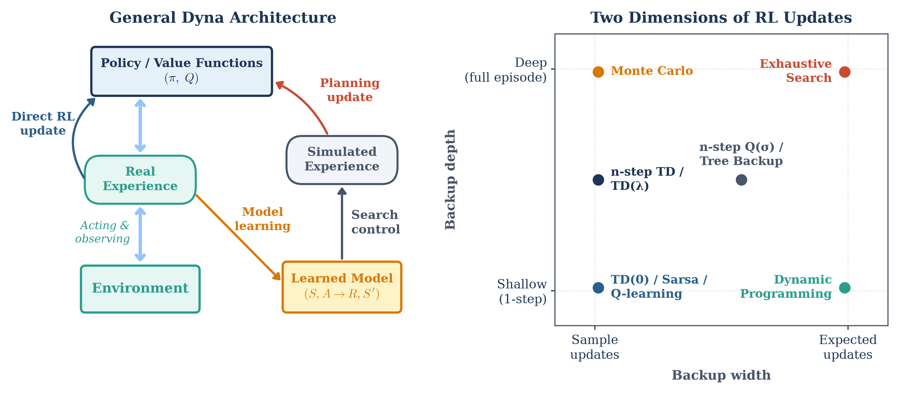
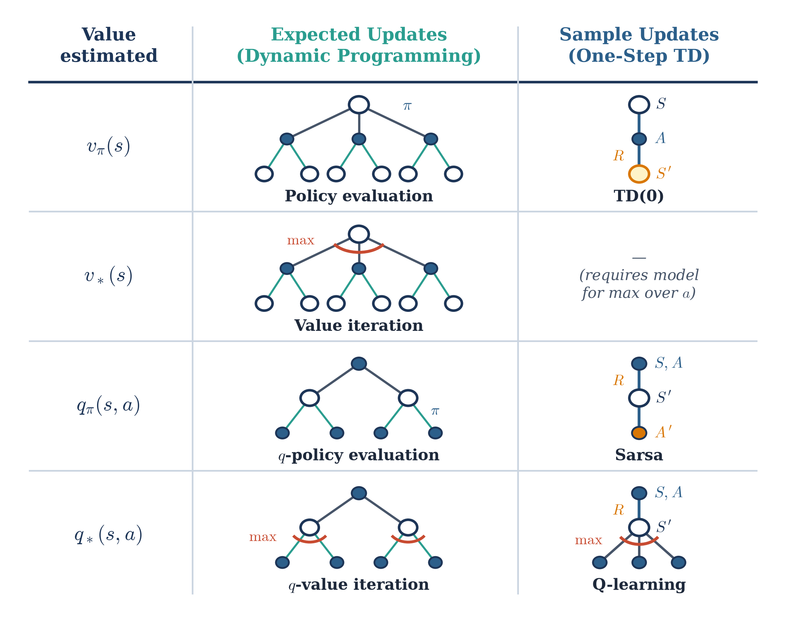
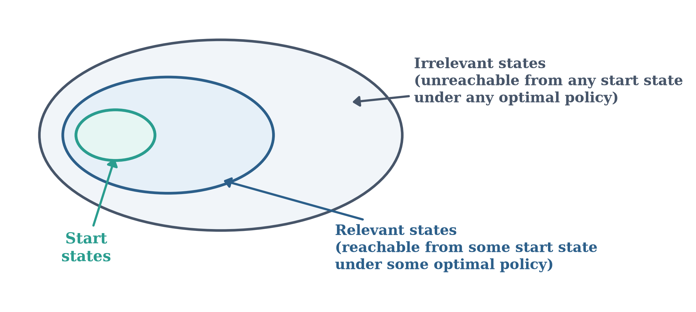
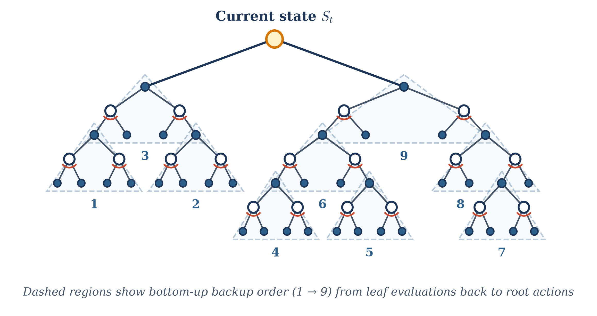
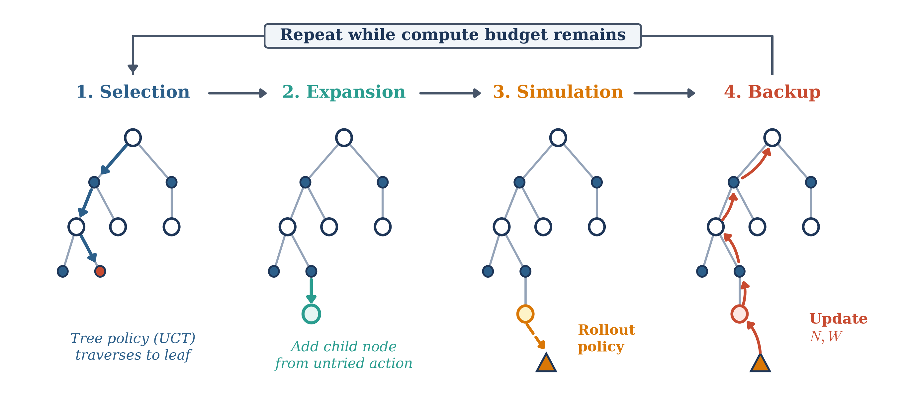

- **Model-Based RL**: algorithms that construct or exploit an explicit environment model, relying mainly on **planning** (e.g., Dynamic Programming, Heuristic Search) to derive policies.
- **Model-Free RL**: algorithms that bypass environment modeling and rely directly on **learning** from sampled interactions (e.g., Monte Carlo, Temporal-Difference methods).
- Despite this split, both paradigms estimate value functions and refine them by backing up future return estimates to preceding states or state-action pairs.

## Models & Planning {#sec-ch08-8-1}

- **Environment model**: any predictive mechanism that forecasts how the world responds to agent behavior; supplied with a state-action pair, it outputs a predicted successor state and reward.
- When transitions are stochastic, models fall into two categories:
  - **Distribution models**: enumerate every reachable successor state and reward along with their exact occurrence probabilities.
  - **Sample models**: draw a single stochastic outcome $(S', R)$ according to the underlying transition probabilities.
- Querying a model generates **simulated experience** without physically acting in the real world.

- **Planning**: any computation that ingests an environment model and outputs a new or improved policy for acting in that environment.

$$\text{model} \xrightarrow{\text{Planning}} \text{policy}$$

- Two major planning paradigms exist:
  - **State-space planning**: searches over states, where actions trigger state transitions and value functions score states to guide policy improvement.
  - **Plan-space planning**: searches directly over candidate plans using plan-modification operators, defining value (if used at all) over plans rather than states (for example, partial-order planning or evolutionary search).

- **Unified template of state-space planning**:

$$\text{model} \to \text{simulated experience} \xrightarrow{\text{backups}} \text{values} \to \text{policy}$$

  - Every state-space planner computes value estimates as an intermediate bridge toward better policies.
  - Those estimates are refined via backup updates executed over model-generated transitions.

- Classical dynamic programming sweeps across states, pulls the complete transition distribution for each state, and applies an expected backup to compute the updated value.
- Value-function estimation via backups is the shared computational core uniting planning and direct learning.
- The essential contrast lies in where transitions originate:
  - **Planning** consumes **simulated** transitions supplied by a model.
  - **Learning** consumes **real** transitions returned by the actual environment.
- Because the backup mechanics are identical, any tabular learning rule can be repurposed as a planner simply by feeding it simulated transitions instead of real ones.

### Random-sample One-step Tabular Q-Learning {#random-sample-one-step-tabular-q-learning}

- **Random-sample one-step tabular Q-planning**: a lightweight planner that pairs a sample model with single-step tabular Q-learning updates over randomly drawn state-action queries.
- Under standard step-size and coverage assumptions, this planner converges to the optimal policy for the modeled MDP just as online Q-learning converges for the real environment.

### Python Implementation: Random-Sample One-Step Tabular Q-Planning {#pseudocode-random-sample-one-step-tabular-q-learning}

```python
import random

def random_sample_q_planning(
    states, actions_fn, sample_model, alpha=0.1, gamma=0.95, steps=10_000
):
    """Run random-sample one-step tabular Q-planning against a sample model."""
    Q = {(s, a): 0.0 for s in states for a in actions_fn(s)}

    for _ in range(steps):
        s = random.choice(states)
        a = random.choice(actions_fn(s))
        r, s_next = sample_model(s, a)

        next_actions = actions_fn(s_next)
        best_next = max((Q[(s_next, a_next)] for a_next in next_actions), default=0.0)
        td_target = r + gamma * best_next
        Q[(s, a)] += alpha * (td_target - Q[(s, a)])

    return Q
```

- Breaking planning into tiny, incremental updates avoids wasting computation on sweeping huge state spaces and makes planning far more **efficient** on large problems.

## Dyna: Integrated Planning, Acting, and Learning {#sec-ch08-8-2}

::: {#fig-81}
{width=100% fig-align="center" fig-alt="Two-panel schematic: Dyna learning and planning cycle on the left, and the two-dimensional width-versus-depth RL update space on the right."}

**Dyna architecture and the two-dimensional RL update space.** Left: real experience feeds direct RL and model learning while simulated rollouts drive planning. Right: methods span backup width (sample vs. expected) and depth (shallow vs. full-episode).
:::

- Performing planning online during live interaction introduces two central design questions:
  - Newly observed transitions continuously revise the model, which in turn shifts what planning should compute.
  - Limited compute budget must be partitioned sensibly across acting, model updating, and background simulation.

- **Dyna-Q**: a clean architecture (@fig-81, left) unifying acting, direct learning, model updating, and simulated planning inside one loop.

- Real interaction data serves two distinct purposes in a Dyna agent:
  - **Model learning**: refines the internal model so its predictions align more closely with actual environment dynamics.
  - **Direct RL**: updates the value table and policy straight from real transitions.
  - **Indirect RL**: improves values and policies through planning over transitions generated by the learned model.

- Direct and indirect pathways carry complementary tradeoffs:
  - **Indirect RL** extracts substantially more policy improvement from scarce real samples.
  - **Direct RL** is simpler to implement and immune to systematic modeling errors or inductive bias in the model.

- **Dyna-Q** runs all four processes continuously (@fig-81, left): real acting, direct Q-learning, tabular model recording, and random-sample Q-planning.

- **Tabular deterministic model**: Dyna-Q's simplest model stores a lookup table assuming deterministic dynamics.
  - Upon observing a real transition $(S_t, A_t) \to (R_{t+1}, S_{t+1})$, the model overwrites its entry for $(S_t, A_t)$ with $(R_{t+1}, S_{t+1})$.
  - Querying a previously visited $(s, a)$ returns the most recently recorded $(r, s')$.
  - Planning steps sample only among $(s, a)$ pairs that the agent has genuinely experienced at least once.

- **Search control**: the strategy deciding which $(s, a)$ pairs seed simulated planning transitions (uniformly over visited pairs in basic Dyna-Q).
- Planning feeds those simulated transitions through the exact same backup operator used for real experience.
- Direct learning and planning therefore reuse identical update code, separated strictly by whether a transition came from the real world or the internal model.
- Conceptually, all four Dyna loops run concurrently; in a single-threaded implementation, acting, direct RL, and model recording execute first at low cost, leaving the bulk of each step's compute budget for $n$ planning updates.

### Python Implementation: Tabular Dyna-Q {#pseudocode-tabular-dyna-q}

```python
import random

def tabular_dyna_q(
    env, n_planning=5, alpha=0.1, gamma=0.95, eps=0.1, total_steps=5_000
):
    """Tabular Dyna-Q combining direct Q-learning, model learning, and planning."""
    Q, model, seen = {}, {}, {}

    def best_q(st, done):
        if done:
            return 0.0
        return max((Q.get((st, a), 0.0) for a in env.actions(st)), default=0.0)

    s = env.reset()
    for _ in range(total_steps):
        actions = env.actions(s)
        if random.random() < eps:
            a = random.choice(actions)
        else:
            a = max(actions, key=lambda act: Q.get((s, act), 0.0))
        r, s_next, done = env.step(a)

        q_sa = Q.get((s, a), 0.0)
        Q[(s, a)] = q_sa + alpha * (r + gamma * best_q(s_next, done) - q_sa)
        model[(s, a)] = (r, s_next, done)
        seen.setdefault(s, set()).add(a)

        visited_states = list(seen)
        for _ in range(n_planning):
            ps = random.choice(visited_states)
            pa = random.choice(tuple(seen[ps]))
            pr, ps_next, pdone = model[(ps, pa)]
            q_p = Q.get((ps, pa), 0.0)
            Q[(ps, pa)] = q_p + alpha * (pr + gamma * best_q(ps_next, pdone) - q_p)

        s = env.reset() if done else s_next
    return Q
```

- Mapping the code to the Dyna components:
  - `model[(s, a)]` stores the predicted reward, successor state, and terminal flag.
  - The initial `Q[(s, a)]` update is **direct RL**, recording into `model` is **model learning**, and the inner `n_planning` loop is **planning**.
  - Setting `n_planning = 0` strips out model usage and recovers plain one-step tabular Q-learning.

- In gridworld maze benchmarks, adding even modest planning ($n > 0$) slashes the number of real episodes needed to reach a near-optimal path.
- Because every planning step is tiny and self-contained, interleaving acting, learning, and planning is seamless: the agent reacts promptly via its current table while continually refining values in the background.

## When the Model is Wrong {#sec-ch08-8-3}

- Learned models frequently diverge from reality for three main reasons:
  - **Stochasticity and finite data**: random dynamics estimated from only a handful of samples produce noisy predictions.
  - **Function-approximation error**: an approximate model generalizes imperfectly across states.
  - **Nonstationarity**: environment dynamics shift after the agent last visited a region, leaving stale model entries.

- **Self-correcting optimistic errors**: when an inaccurate model exaggerates the reward or ease of a transition, planning steers the policy straight into that transition; trying it in reality immediately exposes the discrepancy and updates the model.
- **Hidden improvements (pessimistic errors)**: when the real environment opens a shortcut or raises rewards along an action the current policy ignores, the agent has no incentive to test that action and can stay stuck on an outdated route indefinitely.
- Balancing model verification against reward exploitation is an instance of the **exploration-exploitation tradeoff**; while no universal closed-form remedy exists, lightweight exploration bonuses work well in practice, exemplified by **Dyna-Q+**.

### Dyna-Q+ {#dyna-q}

- **Recency tracking**: Dyna-Q+ records $\tau$, the number of real environment steps elapsed since each $(s, a)$ pair was last executed; larger $\tau$ reflects higher uncertainty that the stored transition is still valid.
- **Exploration bonus in planning**: during simulated backups (not real rewards), the agent inflates the modeled reward of $(s, a)$ by $k\sqrt{\tau}$ for a small scaling constant $k > 0$:
  - The effective simulated reward becomes $r + k\sqrt{\tau}$, where $r$ is the raw recorded model reward.
- This bonus tilts simulated values toward neglected state-action pairs, motivating the agent to periodically probe stale transitions and detect shortcuts. Although extra exploration incurs a small ongoing cost, it pays off decisively in changing environments.

## Prioritized Sweeping {#sec-ch08-8-4}

- Standard Dyna-Q draws simulated $(s, a)$ pairs uniformly from past experience, which wastes compute on transitions whose values have not changed since their last backup.
- **Prioritized sweeping**: replaces uniform search control with a priority queue that focuses planning updates on $(s, a)$ pairs expected to undergo the largest value revisions.

  - **Core workflow**:
    1. Maintain a max-priority queue over $(s, a)$ pairs ordered by prospective TD error magnitude.
    2. Pop the highest-priority pair and apply a backup update to its estimate.
    3. Trace backward to predecessor pairs $(s_{\text{prev}}, a_{\text{prev}})$ that lead into the updated state $s$ (such as states bordering a newly discovered goal).

  - **Priority criterion**:
    1. Compute the absolute Bellman residual $|R + \gamma \max_{a'} Q(s', a') - Q(s, a)|$ (or $|R + \gamma V(s') - Q(s, a)|$ in value form).
    2. Insert any predecessor $(s_{\text{prev}}, a_{\text{prev}})$ into the queue whenever its estimated priority exceeds a small threshold $\theta$.
    3. Propagate changes **backward** along reverse trajectories from newly altered states.

  - **Principal benefits**:
    1. **Compute efficiency**: skips zero-change regions (such as uniform zero-reward plateaus far from the goal).
    2. **Faster convergence**: yields order-of-magnitude speedups in planning steps over uniform Dyna-Q.
    3. **Backward focusing**: channels updates strictly along causal paths feeding into changed values.

- **Stochastic extensions**: adapting prioritized sweeping to stochastic transitions is natural by storing full transition counts and predecessor links:
  - **Expected updates**: sum over all successor states $s'$ weighted by estimated transition probabilities; accurate, yet costly when many low-probability successors exist.
  - **Sample updates**: back up one transition at a time at lower per-step cost, allowing finer allocation of compute to high-impact transitions.

- More broadly, any planning scheme is characterized by two orthogonal choices:
  - **Update operator** $\Rightarrow$ expected vs. sample, single-step vs. multi-step backup.
  - **Update schedule** $\Rightarrow$ backward focusing (predecessor propagation) vs. forward focusing (following reachable trajectories under the current policy).

## Expected vs Sample Updates {#sec-ch08-8-5}

- Earlier chapters contrasted dynamic programming (which uses a distribution model to perform expected policy evaluation and improvement) with model-free sampling algorithms (Monte Carlo, TD, and $n$-step methods).
- Under a fixed computational budget, a fundamental planning question arises: should compute go into exact expected backups or cheaper sample backups?
- @fig-82 compares the seven one-step expected (DP) and sample (TD) backup rules graphically across state-value and action-value targets.

::: {#fig-82}
{width=92% fig-align="center" fig-alt="Four-by-two matrix comparing one-step Expected DP backups against Sample TD backups for v_pi, v_*, q_pi, and q_*."}

**One-step backup comparison matrix.** Contrasting full-width Dynamic Programming expected updates with single-transition TD sample updates across prediction and control.
:::

**Backup diagrams for one-step updates** (7 of 8 cases shown):

| Value estimated | Expected updates (DP) | Sample updates (one-step TD) |
|---|---|---|
| $v_\pi(s)$ | Policy evaluation <br/>(full branching over actions & next states) | TD(0) <br/>(single sampled transition) |
| $v_*(s)$ | Value iteration (max over actions, full branching) | - |
| $q_\pi(s,a)$ | $q$-policy evaluation | Sarsa |
| $q_*(s,a)$ | $q$-value iteration | Q-learning |

- One-step value backups span three binary axes:
  - **Target quantity**: **state values** ($v$) vs. **action values** ($q$).
  - **Policy scope**: evaluating a **fixed policy** ($\pi$) vs. estimating the **optimal policy** ($*$).
  - **Backup width**: **expected updates** (integrating over every possible outcome) vs. **sample updates** (using a single drawn transition).
- Combining these three binary choices yields eight combinations; seven correspond to the standard algorithms in the table above, while a sample-based one-step backup for $v_*$ is not practical without an explicit model or action-value estimates.

- Planning architectures can plug in almost any of these operators:
  - **Dyna-Q** applies sample $q_*$ backups, though it can equally be paired with expected $q_*$ backups or either flavor of $q_\pi$ backup.
  - **Dyna-AC** combines sample $v_\pi$ backups with an explicit parameterized policy.
  - Stochastic prioritized sweeping typically relies on expected updates to track exact Bellman residuals across predecessors.

- Without a distribution model, expected updates are impossible and sampling is mandatory. When a distribution model is available, choosing between them weighs accuracy against compute:
  - **Expected updates** eliminate sampling variance in a single pass.
  - **Sample updates** cost far less per backup, which matters whenever computation is the bottleneck.

### Computational Requirements & Formal Comparison (given discrete states/actions) {#computational-requirements-formal-comparison-given-discrete-statesactions}

- **Model**: known estimated dynamics $\hat{p}(s', r \mid s, a)$.
- **Objective**: approximate optimal action values $q_*$.
- **Branching factor**: $b = |\{s': p(s' \mid s,a) > 0\}|$ measures the number of reachable next states from $(s, a)$.

- **Expected Update (exact)**:
  - **Per-update cost**: $O(b)$.

$$\boxed{Q(s,a) \leftarrow \sum_{s', r} \hat{p}(s', r \mid s, a)\left[r + \gamma \max_{a'} Q(s', a')\right]}$$

- **Sample Update (stochastic)**:
  - **Per-update cost**: $O(1)$.

$$\boxed{Q(s,a) \leftarrow Q(s,a) + \alpha\left[R + \gamma \max_{a'} Q(S', a') - Q(s,a)\right]}$$

- Within the compute budget needed for a single expected backup, an agent can execute roughly $b$ sample backups.

### Theoretical Comparison (Empirical Analysis) {#theoretical-comparison-empirical-analysis}

- Consider a stylized case with $b$ equally likely successor states, exact successor values, and initial estimation error $|\text{error}| = 1$ at $(s,a)$.
- **Expected backup**: drives error to $0$ after one update at a cost of $b$ elementary operations.
- **Sample backups** (using sample-average step size $\alpha = \frac{1}{t}$): after $t$ samples, the root-mean-square error scales as $\sqrt{\frac{b-1}{bt}}$.
  - Even for moderate ($b = 10$) or large branching factors, a small fraction of $b$ sample updates eliminates most of the error.

  - Because error drops steeply during the first few samples, sample backups let the agent refresh many distinct $(s, a)$ pairs in the time one expected backup would spend perfecting a single pair:

    $$\text{error} = \sqrt{\frac{b-1}{bt}}$$

  - As $b$ grows large, $\text{error} \approx \sqrt{\frac{1}{t}}$, so $\lim_{t \to \infty} \sqrt{\frac{1}{t}} = 0$.

    $$\begin{aligned}
    b=1:& \quad \text{error} = 0 \quad \text{for } t \geq 1 \\[6pt]
    b=2:& \quad \text{error} = \frac{1}{\sqrt{2t}} \implies \text{error}(t=1) \approx 0.707,\ \text{error}(t=2) = 0.5 \\[6pt]
    b=100:& \quad \text{error} \approx \frac{1}{\sqrt{t}} \implies \text{error}(t=1) \approx 0.995,\ \text{error}(t=10) \approx 0.316,\ \text{error}(t=100) \approx 0.1
    \end{aligned}$$

- **Why sample updates win in large stochastic MDPs**:
  - **Breadth over depth**: spreading $b$ updates across multiple state-action pairs accelerates global progress.
  - **Compounding bootstrap accuracy**: updating downstream states sooner sharpens the targets seen by upstream backups.
  - **Diminishing marginal returns**: summing over tiny-probability branches contributes little accuracy per unit of compute.

- Sample updates dominate whenever branching factors and state spaces are large.
- Expected updates remain attractive only when:
  - Branching is very small ($b \leq 3$).
  - The entire state space is tiny enough for exact sweeps.
  - Transitions are deterministic ($b = 1$, where both updates coincide).

## Trajectory Sampling {#sec-ch08-8-6}

- Planning methods also differ in how they allocate updates across states:
  - **Exhaustive sweeps**: classic DP visits every state (or state-action pair) once per full pass; on massive domains, even a single sweep can exhaust the time budget.
  - **Trajectory sampling**: rolls out simulated episodes under the current policy using the model and executes one-step backups strictly along the visited states.

- Two natural state-selection distributions emerge:
  - **Uniform distribution**: equal update frequency across every state-action pair.
  - **On-policy distribution**: update frequency proportional to visitation under the current policy $\pi$.

- A key question for tabular planning is whether uniform coverage or on-policy trajectory sampling yields faster policy improvement per backup.

### Formal Comparison {#formal-comparison}

- **Uniform sweeping**:
  - Visits every entry in $|S| \times |A|$ systematically.
  - Allocates identical compute to reachable and unreachable regions alike.
  - Guarantees full-space coverage independent of how good the current policy is.
  - Uses a fixed uniform (or predetermined) weighting $\mu(S_t)$.

- **On-policy trajectory sampling**:
  - Draws states from the policy's visitation distribution $S_t \sim d^\pi$.
  - Chooses actions via $a_t \sim \pi(\cdot \mid S_t)$.
  - Simulates rollouts $\{S_0, a_0, S_1, a_1, \ldots\}$ and updates only states encountered along those rollouts.

- **Strengths of trajectory sampling**:
  - **Computational focusing**: when the reachable subset under $\pi$ is tiny compared to $|S|$, effort concentrates automatically where decisions actually occur.
  - **Automatic pruning of irrelevant states**: naturally partitions states into three groups:
    - Start states (initial state distribution).
    - Relevant states reachable under good or optimal policies.
    - Irrelevant states never visited along strong trajectories.

- **Tradeoffs and caveats**:
  - Needs a sample (generative) model capable of simulating forward rollouts.
  - Early in training, a poor policy can starve promising states of updates unless some exploration is preserved.
  - Very long trajectories can delay credit assignment back to early states.

- Empirically, on-policy trajectory sampling excels on huge state spaces with modest branching factors, especially early in planning, whereas uniform sweeps can eventually catch up once near-convergence requires visiting rare corner states.
- Trajectory sampling is complementary to prioritized sweeping: trajectory sampling chooses *which* states receive attention, while prioritization chooses *when* to update them, and both can be combined.
- Focusing updates on the on-policy distribution foreshadows the weighting issues of off-policy learning and scales seamlessly to continuous spaces with function approximation.

## Real-Time Dynamic Programming (RTDP) {#sec-ch08-8-7}

- **Real-Time Dynamic Programming (RTDP)**: applies on-policy trajectory sampling directly to DP value iteration.
- As an **asynchronous DP** method, RTDP drops systematic full-state sweeps and instead backs up states in whatever order simulated or real trajectories encounter them, always plugging in the latest available value estimates.

- RTDP fuses three mechanisms:
  - **Greedy trajectory sampling** $\Rightarrow$ rolls out trajectories using the current greedy policy.
  - **Asynchronous backups** $\Rightarrow$ updates solely the states encountered on each trial.
  - **Relevant-state focusing** $\Rightarrow$ devotes computation to **relevant states** lying along near-optimal paths to the goal.

- **RTDP backup operator**:

$$\boxed{V(S_t) \leftarrow \max_{a \in A}\left(R^a_{S_t} + \gamma \sum_{s'} P^a_{S_t s'}\, V(s')\right)}$$

- **Comparison with neighboring planners**:
  - **Value Iteration**: sweeps all states every round; RTDP updates only states along sampled trials.
  - **Prioritized Sweeping**: works backward from changed states via predecessors; RTDP rolls forward from start states.
  - **General Trajectory Sampling**: allows arbitrary sampling policies; RTDP specifically follows the greedy policy.

- **Computational complexity**:
  - Standard Value Iteration: $O(|S|^2|A|)$ per full sweep.
  - One RTDP trial: $O(L)$ backups where episode length $L \ll |S|$ on large tasks.

- RTDP bridges planning and online learning by concentrating backups on states reachable under optimal trajectories while ignoring unreachable regions (@fig-83).

::: {#fig-83}
{width=84% fig-align="center" fig-alt="Nested region diagram showing start states inside relevant states reachable under some optimal policy, surrounded by irrelevant unreachable states."}

**RTDP state-space reachability.** Real-time dynamic programming focuses updates inside the relevant state region rather than sweeping over unreachable irrelevant states.
:::
- **Convergence guarantees**: RTDP provably discovers an optimal policy across all relevant states (without necessarily visiting irrelevant states) when four conditions hold:
  1. Every goal state has initial value $0$.
  2. From every start state, at least one policy reaches a goal with probability $1$.
  3. All non-goal transitions incur strictly negative rewards (positive step costs).
  4. Initial value estimates never underestimate optimal values (optimistic initialization, easily achieved by initializing $V(s) = 0$ everywhere when rewards are negative).

- Problems satisfying these assumptions are termed **stochastic optimal path problems** (often framed as cost minimization rather than reward maximization).
  - On such benchmarks, RTDP commonly reaches an optimal policy with roughly half the backups needed by sweep-based value iteration.

### Heuristic Initialization (Optimistic) {#heuristic-initialization-optimistic}

- Initializing $V(s)$ with an admissible optimistic heuristic $h(s) \geq V^*(s)$ steers greedy rollouts immediately toward promising routes to the goal while ensuring untested paths remain attractive until proven worse.

### Considerations {#considerations}

- RTDP shines in problems characterized by:
  - Vast state spaces where full sweeps are infeasible.
  - Sparse terminal goals.
  - A concentrated start-state distribution.
  - Deterministic or low-branching stochastic dynamics.

## Planning at Decision Time {#sec-ch08-8-8}

- Planning can be scheduled at two distinct moments relative to action execution:
  - **Background planning**: runs continuously ahead of time, using simulated transitions to refine a global value table or policy so action selection later is a fast table lookup.
  - **Decision-time planning**: launches only after the agent lands in the current state $S_t$, allocating search specifically to pick the immediate next action.

- **Latency vs. scale tradeoff**: decision-time planning is well suited to massive domains where reaction time permits deliberation (e.g., board games), whereas low-latency control favors background planning.
- **Persistence**: background planning is **persistent** (retaining updated values across steps), while pure decision-time planning is **memoryless** (discarding temporary search values once the action is taken).

## Heuristic Search {#sec-ch08-8-9}

- **Heuristic search**: the classical family of decision-time state-space planners that expands a lookahead tree rooted at the current state $S_t$.
- Starting from $S_t$, the planner explores multi-step continuations down to leaf nodes, evaluates those leaves with an approximate value function, and backs the evaluations up to the root's action branches (@fig-84).

::: {#fig-84}
{width=95% fig-align="center" fig-alt="Selective depth-first lookahead tree rooted at current state S_t with numbered bottom-up backup groupings propagating leaf values toward root actions."}

**Heuristic search selective lookahead.** Expanding promising branches from $S_t$ and applying upward backups (1 through 9) refines root action values without solving the full state space.
:::
- After choosing the highest-value action at the root, the backed-up tree values are typically thrown away.
- By concentrating search strictly on immediate descendants of $S_t$, heuristic search turns a one-step greedy policy into a far stronger multi-step lookahead policy without trying to solve the entire state space.

### Theoretical Properties {#theoretical-properties}

1. **Optimality horizon**: as lookahead depth $K$ grows large enough that $\gamma^K \approx 0$, leaf approximation errors vanish and the chosen root action approaches $a^*(s)$.
2. **Computational complexity**:
   - Exhaustive tree expansion scales as $O(b^K)$ for branching factor $b$.
   - Selective expansion or pruning reduces this to $O(f(b, K))$ with $f < b^K$.
3. **Memory footprint**: depth-first traversal requires only $O(bK)$ memory.
4. **Value interpretation**: the root backed-up score $v_{\text{tree}}(s)$ represents a $K$-step lookahead estimate of the optimal value from $s$.

## Rollout Algorithms {#sec-ch08-8-10}

- **Rollout algorithms**: decision-time Monte Carlo planners that evaluate candidate actions at the current state $S_t$ by simulating complete episodes forward from $S_t$.
- For each candidate action $a$, the planner executes $a$ once and then follows a fixed **rollout policy** until termination, averaging the resulting returns to estimate $q_\pi(S_t, a)$.

- **Defining traits**:
  - **Memoryless**: estimates are computed on the fly for the current state and discarded after acting.
  - **Rollout policy $\Pi$**: typically a fast heuristic or the current greedy policy.
  - **Monte Carlo averaging**: running more simulated episodes reduces estimation variance.
  - **Architectural simplicity**: no explicit search tree is built or stored between steps.

- **Objective**: rather than computing $q_\pi$ or $q_*$ everywhere, rollout algorithms estimate $q_\pi(S_t, a)$ solely at the current state to act greedily with respect to those estimates, aiming to strictly improve over the rollout policy rather than directly solve for optimality.
- This improvement is justified by the **policy improvement theorem**: acting greedily with respect to $\hat{Q}(s,a)$ guarantees $\pi' \geq \pi$ whenever $q_\pi(s, \pi'(s)) \geq v_\pi(s)$ holds across states.

### Computational Complexity (quite expensive due to many full episodes) {#computational-complexity-quite-expensive-due-to-many-full-episodes}

- Per decision step, let:
  - $|A(s)|$ = number of legal actions at state $s$,
  - $n$ = simulated rollouts allocated per action,
  - $L$ = mean episode horizon.

$$\text{total cost} = O\left(|A(s)| \cdot n \cdot L\right)$$

- Because full-episode simulation can be slow, practical implementations reduce wall-clock cost in three ways:
  - **Parallel execution**: independent Monte Carlo rollouts scale cleanly across multiple CPU cores.
  - **Truncated rollouts**: halt simulations early and bootstrap using a stored value evaluator at the cutoff state.
  - **Action pruning**: stop allocating rollouts to candidate actions that fall clearly behind the leader.

- Although rollout planners maintain no persistent learned parameters, they borrow directly from reinforcement learning by uniting **Monte Carlo return estimation** with **greedy policy improvement**.

## Monte Carlo Tree Search (MCTS) {#sec-ch08-8-11}

- **Monte Carlo Tree Search (MCTS)**: upgrades plain rollout planning by storing and updating action-value statistics inside an incrementally grown search tree, steering subsequent simulations toward the most promising trajectories.
- Functioning as an asymmetric best-first search, MCTS balances exploration and exploitation inside the tree via confidence bounds.
- Whenever the agent enters a new state $S_t$, MCTS roots a search tree at $S_t$ and iterates through four stages until its compute or time budget expires (@fig-85).

::: {#fig-85}
{width=98% fig-align="center" fig-alt="Four-stage Monte Carlo Tree Search cycle showing Selection via UCT, Expansion of a new node, Simulation rollout to termination, and Backup of returns along the path."}

**Monte Carlo Tree Search (MCTS) four-stage cycle.** Each iteration runs Selection, Expansion, Simulation, and Backup repeatedly while the compute budget permits.
:::

**Four stages executed per MCTS iteration:**

### 1. Selection {#selection}
- Starting at the root, follow a **tree policy** driven by edge statistics down through expanded nodes until reaching a leaf (either an unexpanded node or a terminal state).
- The standard tree policy is **Upper Confidence bounds for Trees (UCT)**:

$$\boxed{\text{UCT}(s,a) = \underbrace{\frac{W(s,a)}{N(s,a)}}_{\text{exploitation}} + c\underbrace{\sqrt{\frac{\ln(N(s))}{N(s,a)}}}_{\text{exploration}} = Q(s,a) + c\sqrt{\frac{\ln(N(s))}{N(s,a)}}}$$

- Notation:
  - $Q(s,a) = \frac{W(s,a)}{N(s,a)}$: mean return observed through $(s,a)$
  - $W(s,a)$: cumulative return summed over visits to $(s,a)$
  - $N(s,a)$: visit count for edge $(s,a)$
  - $N(s)$: total visit count for parent state $s$
  - $c$: exploration weight (commonly $\sqrt{2}$); smaller values ($c < 0.5$) emphasize exploitation, while larger values ($c > 2$) emphasize exploration.

- Traversal halts once it hits either a node with untried actions or a terminal state.

### 2. Expansion {#expansion}
- If the reached leaf is non-terminal, grow the tree by adding one or more child nodes reached via previously untried actions.
- Common expansion variants:
  - **Single-node expansion**: append one new child per simulation (standard).
  - **Batch expansion**: materialize all children of the leaf simultaneously.
  - **Progressive widening**: gradually open new actions in continuous or huge action spaces.

### 3. Simulation {#simulation}
- From the selected or newly added node, play out a complete simulated trajectory to termination using a fast default **rollout policy** (so tree policy governs choices inside the tree and rollout policy takes over beyond it).

### 4. Backup {#backup}
- Propagate the final episode return backward along every edge traversed during Selection and Expansion, incrementing visit counts and updating cumulative return totals (nodes outside the tree visited solely during the rollout are not stored).

- MCTS loops over Selection, Expansion, Simulation, and Backup from the root until the allocated compute budget runs out.
- Finally, the agent executes a root action chosen from the gathered tree statistics, typically picking either the highest-mean-value action or the most-visited action (visit count is often preferred to guard against noisy high-variance outliers).

### Pseudocode: MCTS {#pseudocode-mcts}

$$
\boxed{
\begin{aligned}
&\textbf{Initialize: } \text{root} = \text{current state } S_0 \\
&\textbf{for } i = 1 \textbf{ to } \text{num\_simulations:} \\[6pt]
&\quad \triangleright\ \textbf{Selection} \\
&\quad \text{node} \leftarrow \text{root} \\
&\quad \textbf{While } \text{node is fully expanded and non-terminal:} \\
&\qquad \text{node} \leftarrow \arg\max_{a} \!\left[\frac{W(\text{node},a)}{N(\text{node},a)} + c\sqrt{\frac{\ln N(\text{node})}{N(\text{node},a)}}\right] \\[6pt]
&\quad \triangleright\ \textbf{Expansion} \\
&\quad \textbf{If } \text{node is non-terminal and not fully expanded:} \\
&\qquad \text{Select unvisited action } a' \in \mathcal{A}(S) \setminus \{\text{visited actions}\} \\
&\qquad \text{Create child node } S' \sim p(\cdot \vert S, a') \text{ and add to tree} \\
&\qquad \text{node} \leftarrow S' \\[6pt]
&\quad \triangleright\ \textbf{Simulation} \\
&\quad S \leftarrow \text{node};\quad G \leftarrow 0;\quad t \leftarrow 0 \\
&\quad \textbf{While } S \text{ is non-terminal:} \\
&\qquad a \sim \Pi_{\text{default}}(\cdot \vert S) \\
&\qquad r, S' \sim p(\cdot \vert S, a) \\
&\qquad G \leftarrow G + \gamma^t r;\quad S \leftarrow S';\quad t \leftarrow t + 1 \\[6pt]
&\quad \triangleright\ \textbf{Backup} \\
&\quad \textbf{While } \text{node} \neq \text{null:} \\
&\qquad N(\text{node}) \leftarrow N(\text{node}) + 1 \\
&\qquad W(\text{node}) \leftarrow W(\text{node}) + G \\
&\qquad \text{node} \leftarrow \text{node.parent} \\[6pt]
&\textbf{return } \arg\max_a N(S_0, a)
\end{aligned}
}
$$

### Computational Complexity {#ch08-computational-complexity}

- Per iteration (with tree depth $d$ and rollout horizon $L$):
  - Selection: $O(d)$
  - Expansion: $O(1)$
  - Simulation: $O(L)$
  - Backup: $O(d)$

$$\Rightarrow \text{total: } O\!\left(n \cdot (d + L)\right) \text{ for } n \text{ simulations}$$

### Summary of MCTS {#summary-of-mcts}

- **MCTS** conducts decision-time planning by applying Monte Carlo control to simulations rooted at the current state.
- It combines incremental, online sample-based estimation with focused policy improvement.
- Edge statistics act as an on-demand local lookup table updated via RL sample backups.
- By expanding only promising subtrees around $S_t$, MCTS sidesteps building a global action-value approximator while still leveraging accumulated simulation results to guide future rollouts.

### Pros & Cons of MCTS {#pros-cons-of-mcts}

- **Pros**:
  - Anytime behavior (can stop and return a valid action whenever time expires).
  - Asymmetric tree growth concentrates depth on promising lines of play.
  - Works without hand-crafted domain evaluation heuristics.
  - Scales gracefully to high branching factors.
- **Cons**:
  - High per-move compute budget.
  - Can overlook narrow, deep tactical traps.
  - Uniform random rollouts struggle in sharp tactical environments.
  - Limited simulation budgets can miss distant long-horizon effects.

## Summary {#sec-ch08-8-12}

- **Environment models** power planning and come in two forms:
  - **Distribution models** supply full transition probabilities, enabling DP's expected backups.
  - **Sample models** produce simulated single transitions, powering sample-based planners, and are usually far easier to acquire or learn.

- **Planning and learning are deeply unified**:
  - Both estimate the same underlying value functions.
  - Both refine estimates through long sequences of small, incremental backups.
  - Any model-free learner turns into a model-based planner when driven by simulated rather than real transitions.

- **Dyna architectures** cleanly weave acting, direct RL, model learning, and background planning into a single feedback loop whose components reinforce one another and can run asynchronously.

- **Axes separating state-space planners**:
  - **Update granularity**: finer one-step backups (as in Dyna) allow smoother interleaving than full-episode or full-sweep passes.
  - **Update distribution (search control)**:
    - **Prioritized sweeping** traces backward from states whose values just shifted.
    - **Trajectory sampling** traces forward along states frequently visited by the current policy.

- **Real-Time Dynamic Programming (RTDP)** applies greedy trajectory sampling to value iteration, proving that focusing backups on relevant states can slash computation compared to exhaustive sweeps.
- **Decision-time planning** focuses forward from the current encountered state right before acting, spanning classical **heuristic search**, **rollout algorithms**, and **Monte Carlo Tree Search (MCTS)**.

## Summary of Part I: Dimensions {#sec-ch08-8-13}

**Two primary axes of the update space** (@fig-81, right):

>$$\text{HORIZONTAL (L to R): sample backups} \xrightarrow{\text{width of update}} \text{full/expected backups}$$
>$$\text{VERTICAL (Top to Bottom): shallow backups} \xrightarrow{\text{depth/length of update}} \text{deep backups}$$

- As illustrated in the right panel of @fig-81, the tabular methods of Part I sit within a continuous multidimensional design space rather than isolated silos.
- Three unifying principles underlie every algorithm covered in Part I:
  1. **Value-function estimation**: each method learns state or action values.
  2. **Trajectory backups**: estimates improve by backing up rewards and values along real or simulated transitions.
  3. **Generalized Policy Iteration (GPI)**: every control method maintains interacting policy and value estimates that continually push each other toward optimality.

- **Three core structural dimensions**:
  - **Backup width**: single-transition sample backups vs. full-distribution expected backups.
  - **Backup depth**: degree of bootstrapping from one-step TD through $n$-step returns to full Monte Carlo rollouts ($\lambda$).
  - **Policy relationship**: **on-policy** vs. **off-policy** learning.

- **Additional design dimensions**:
  - **Return formulation**: episodic vs. continuing tasks; discounted vs. undiscounted returns.
  - **Value target**: state values, action values, or afterstate values.
  - **Exploration mechanism**: $\varepsilon$-greedy, optimistic initialization, softmax/Boltzmann, or upper confidence bounds (UCB).
  - **Scheduling**: synchronous full sweeps vs. asynchronous single-state updates.
  - **Data source**: real environment transitions vs. model-simulated transitions.
  - **Update location**: model-free learners update only encountered states, while model-based planners can target any modeled state.
  - **Update timing**: background updates between steps vs. decision-time updates before acting.
  - **Retention**: **persistent** value storage across steps vs. **memoryless** per-decision search.

- These axes are neither rigid partitions nor mutually exclusive; hybrid architectures like Dyna simultaneously combine real and simulated experience on the same value table.
- Together, they form a coherent taxonomy for analyzing existing algorithms and inventing hybrids.
- **Next frontier (Function approximation)**: Part II moves beyond tabular lookup tables along a continuum from **tabular methods** through **state aggregation**, **linear approximators**, and **nonlinear methods** such as neural networks.
