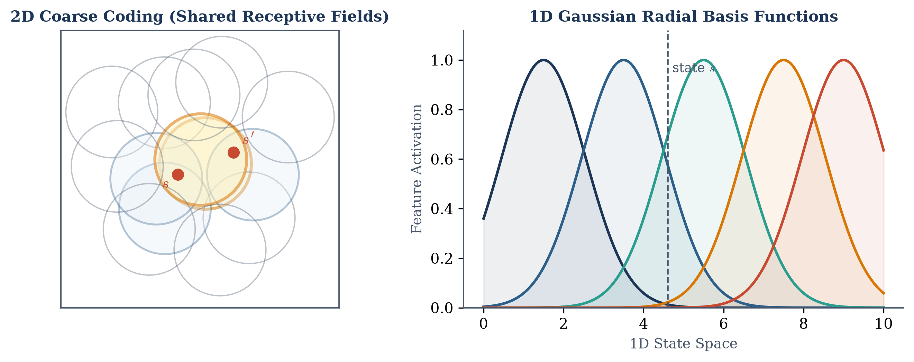

- **Function approximation in on-policy prediction**: shifts RL beyond lookup tables by estimating the state-value function $v_\pi$ from trajectories generated under a known policy $\pi$ via a parameterized model with **weight vector** $\mathbf{w} \in \mathbb{R}^d$:

$$\hat{v}(s, \mathbf{w}) \approx v_\pi(s)$$

- Here $\hat{v}(s, \mathbf{w})$ denotes the estimated value of state $s$ produced by parameters $\mathbf{w}$, where the number of parameters $d$ is typically far smaller than the total number of states.
- Candidate architectures for $\hat{v}$ span linear feature combinations, multi-layer artificial neural networks, decision trees, and kernel regressors.
- **Partial observability**: because a function approximator depends only on observable state features rather than distinct state IDs, it naturally applies to **partially observable** environments where hidden state variables are inaccessible.
- However, static function approximation by itself does not construct internal memory of past observations; handling long-term hidden state requires recurrent or history-based representations.

## Value-Function Approximation {#sec-ch09-9-1}

- Every prediction algorithm in Part I nudges an estimated state value toward a backup target $u$, written as a state-to-target training pair $s \mapsto u$:

$$
\begin{aligned}
\text{Monte-Carlo (MC):} \quad & S_t \mapsto G_t \\
\text{TD(0):} \quad & S_t \mapsto R_{t+1} + \gamma \hat{v}(S_{t+1}, \mathbf{w}_t) \\
n\text{-step TD:} \quad & S_t \mapsto G_{t:t+n} \\
\text{Dynamic Programming (DP):} \quad & s \mapsto \mathbb{E}_\pi\!\left[R_{t+1} + \gamma \hat{v}(S_{t+1}, \mathbf{w}_t) \,\middle\vert\, S_t = s\right]
\end{aligned}
$$

- **Generalization via supervised learning**:
  - In tabular RL, adjusting the estimate for $s$ leaves every other state untouched, so there is no generalization across states.
  - With parameterized approximation, modifying $\mathbf{w}$ based on $s \mapsto u$ simultaneously shifts the predicted values of many related states.
  - Learning to fit input-output pairs is **supervised learning**; when targets $u$ are continuous real numbers, the task is **function approximation** (regression).

- Treating each RL backup $s \mapsto u$ as a supervised training example unlocks the full toolbox of regression algorithms for value prediction.
- **Online capability requirement**: RL targets arrive sequentially and shift as policies or bootstrapped estimates evolve, so chosen approximators must support incremental **online learning** from nonstationary streams rather than assuming static i.i.d. datasets.

## The Prediction Objective ($\overline{\text{VE}}$) {#sec-ch09-9-2}

- Because $|\mathcal{S}| \gg d$, no parameter setting $\mathbf{w}$ can match $v_\pi(s)$ exactly at every state simultaneously.
- Reducing error on one subset of states inevitably increases error on others, forcing us to specify which states matter most via a **state weighting distribution** $\mu(s)$:

$$\mu(s) \geq 0, \quad \sum_s \mu(s) = 1$$

- **Mean Squared Value Error ($\overline{\text{VE}}$)**: weights the squared approximation error at each state by $\mu(s)$:

$$\boxed{\overline{\text{VE}}(\mathbf{w}) \doteq \sum_{s \in S} \mu(s) \left[v_\pi(s) - \hat{v}(s, \mathbf{w})\right]^2}$$

- Taking the square root $\sqrt{\overline{\text{VE}}}$ gives the typical magnitude of prediction error under $\mu$.
- In on-policy training, $\mu(s)$ is naturally set to the **on-policy distribution**, meaning the long-run proportion of time steps the agent spends in state $s$ while following $\pi$.

### On-policy Distribution {#on-policy-distribution}

1. **Continuing tasks**: $\mu(s)$ equals the stationary distribution of the Markov chain induced by $\pi$:

$$\mu(s) = \sum_{s'} \mu(s') \sum_a \pi(a \vert s')\, p(s \vert s', a), \quad \forall s \in S$$

$$
\begin{aligned}
\text{where} \\
\mu(s) &= \text{stationary probability of being in state } s \text{ under } \pi \\
s' &= \text{preceding state}
\end{aligned}
$$

::: {.callout-note title="Balance Equation"}
At stationarity, the probability mass residing in state $s$ equals the total incoming probability flow from every predecessor state $s'$ transitioning into $s$ under policy $\pi$.
:::

2. **Episodic tasks**: visitation counts depend on the start-state distribution $h(s)$ as well as transition dynamics:

$$\eta(s) = h(s) + \sum_{\bar{s}} \eta(\bar{s}) \sum_a \pi(a \vert \bar{s})\, p(s \vert \bar{s}, a), \quad \forall s \in S$$

$$
\begin{aligned}
\text{where} \\
h(s) &= \text{probability that an episode starts in state } s \\
\eta(s) &= \text{expected number of visits to state } s \text{ per episode} \\
\bar{s} &= \text{preceding state}
\end{aligned}
$$

::: {.callout-note title="Visitation Equation"}
The expected visit count for state $s$ in an episode equals the chance of starting in $s$ plus the summed incoming flow from all predecessor states $\bar{s}$ transitioning to $s$ under $\pi$.
:::

- Solving this linear system yields the expected per-episode visit counts $\eta(s)$.
- Normalizing $\eta(s)$ across all states produces the episodic on-policy distribution:

$$\mu(s) = \frac{\eta(s)}{\sum_{s'} \eta(s')}, \quad \forall s \in S$$

- When discounting is absorbed into state weighting, $\eta(s)$ is redefined with factor $\gamma$:

$$\eta(s) = h(s) + \gamma \sum_{\bar{s}} \eta(\bar{s}) \sum_a \pi(a \vert \bar{s})\, p(s \vert \bar{s}, a), \quad \forall s \in S$$

$$
\begin{aligned}
\text{where } \gamma &= \text{discount factor}
\end{aligned}
$$

### Performance Objective {#performance-objective}

- While $\overline{\text{VE}}$ provides a clean analytical benchmark for prediction, minimizing value error is only a proxy; the true **control goal** of RL is discovering a higher-performing policy.
- Under $\overline{\text{VE}}$, linear methods can reach a **global optimum** $\mathbf{w}^*$:

$$\mathbf{w}^* \quad \text{for which} \quad \overline{\text{VE}}(\mathbf{w}^*) \leq \overline{\text{VE}}(\mathbf{w}), \quad \forall \mathbf{w}$$

- Expressive nonlinear approximators generally settle at a **local optimum**, where no small perturbation improves the loss:

$$\mathbf{w}^* \quad \text{for which} \quad \overline{\text{VE}}(\mathbf{w}^*) \leq \overline{\text{VE}}(\mathbf{w}), \quad \forall \mathbf{w} \quad \text{in some neighborhood of} \quad \mathbf{w}^*$$

## Stochastic-Gradient & Semi-Gradient Methods {#sec-ch09-9-3}

### Stochastic Gradient Descent (SGD) {#stochastic-gradient-descent-sgd}

- **Stochastic Gradient Descent (SGD)**: updates a fixed-size real parameter vector incrementally from individual samples, making it a natural backbone for online RL:

$$\mathbf{w} \doteq (w_1, w_2, w_3, \ldots, w_d)^T$$

- Given an exact value label $v_\pi(S_t)$ at step $t$, SGD nudges $\mathbf{w}_t$ down the gradient of the instantaneous squared error:

$$\mathbf{w}_{t+1} \doteq \mathbf{w}_t - \frac{1}{2}\alpha \nabla\!\left[v_\pi(S_t) - \hat{v}(S_t, \mathbf{w}_t)\right]^2$$

$$\boxed{\mathbf{w}_{t+1} = \mathbf{w}_t + \alpha\!\left[v_\pi(S_t) - \hat{v}(S_t, \mathbf{w}_t)\right] \nabla \hat{v}(S_t, \mathbf{w}_t)}$$

$$
\begin{aligned}
\text{where} \\
\hat{v}(s, \mathbf{w}) &= \text{approximate value function (differentiable in } \mathbf{w},\ \forall s \in S) \\
\alpha &= \text{positive step-size parameter} \\
\nabla f(\mathbf{w}) &= \text{column vector of partial derivatives of } f(\mathbf{w}) \text{ with respect to } \mathbf{w}
\end{aligned}
$$

- Explicitly, the gradient vector collects all partial derivatives:

$$\nabla f(\mathbf{w}) \doteq \left(\frac{\partial f(\mathbf{w})}{\partial w_1},\ \frac{\partial f(\mathbf{w})}{\partial w_2},\ \frac{\partial f(\mathbf{w})}{\partial w_3},\ \ldots,\ \frac{\partial f(\mathbf{w})}{\partial w_d}\right)^T$$

- **Why "gradient descent"**: stepping opposite to the squared-error gradient moves parameters along the steepest local descent direction for that state's error.
- **Why "stochastic"**: each step relies on a noisy single state sample $S_t$ rather than averaging gradients across the entire state distribution.
- Provided $\alpha$ decays according to classical Robbins-Monro stochastic approximation conditions, true SGD converges reliably to a local minimum of $\overline{\text{VE}}$.

### True Value Estimates {#true-value-estimates}

- In real RL problems, exact $v_\pi(S_t)$ values are unavailable, so we plug in a noisy target estimate $U_t$ to obtain the general update rule:

$$\boxed{\mathbf{w}_{t+1} \doteq \mathbf{w}_t + \alpha\!\left[U_t - \hat{v}(S_t, \mathbf{w}_t)\right] \nabla \hat{v}(S_t, \mathbf{w}_t)}$$

- **Unbiased targets**: whenever $\mathbb{E}[U_t \vert S_t = s] = v_\pi(s)$ holds at every step, SGD inherits the local-optimum convergence guarantee under standard decaying step sizes.
- **Gradient Monte Carlo**: substitutes the full sample return $U_t = G_t$, which is unbiased and yields a true stochastic gradient algorithm:

$$U_t = G_t$$

$$\mathbf{w} \leftarrow \mathbf{w} + \alpha\!\left[G_t - \hat{v}(S_t, \mathbf{w})\right] \nabla \hat{v}(S_t, \mathbf{w}), \quad \alpha > 0$$

- **Semi-gradient (bootstrapping) methods**: when $U_t$ bootstraps on the current estimate $\hat{v}(\cdot, \mathbf{w}_t)$, the target itself depends on $\mathbf{w}_t$ and is therefore biased. Because the update differentiates only through $\hat{v}(S_t, \mathbf{w}_t)$ and treats $U_t$ as constant, it captures only half the true gradient and is termed a **semi-gradient** update.
  - Despite lacking full-gradient guarantees in general, semi-gradient updates converge cleanly in important settings (notably linear on-policy prediction) and learn far faster online than Monte Carlo.
  - Common bootstrapping targets include one-step TD, $n$-step returns, and DP expectations:

$$
\begin{aligned}
(\text{semi-gradient}) \quad & U_t = R_{t+1} + \gamma \hat{v}(S_{t+1}, \mathbf{w}) \\
(n\text{-step}) \quad & U_t = G_{t:t+n} \\
(\text{DP}) \quad & U_t = \sum_{a,s',r} \pi(a \vert S_t)\, p(s', r \vert S_t, a)\!\left[r + \gamma \hat{v}(s', \mathbf{w}_t)\right]
\end{aligned}
$$

### State Aggregation {#state-aggregation}

- **State aggregation**: partitions the state space into disjoint clusters and assigns a single scalar weight component in $\mathbf{w}$ to each cluster.
- It reduces to a minimal SGD instance whose feature gradient is a one-hot indicator for the active cluster:

$$\nabla \hat{v}(S_t, \mathbf{w}_t) = \left\{ \begin{array}{ll} 1 & \text{for } S_t\text{'s group's component} \\ 0 & \text{for the other components} \end{array} \right\}$$

## Linear Methods {#sec-ch09-9-4}

- **Linear function approximation**: represents state values as the inner product between parameters $\mathbf{w}$ and a state-dependent **feature vector** $\mathbf{x}(s)$:

$$\hat{v}(s, \mathbf{w}) \doteq \mathbf{w}^T \mathbf{x}(s) \doteq \sum_{i=1}^{d} w_i x_i(s)$$

$$
\begin{aligned} \\
\text{where } \quad \mathbf{x}(s) &= \textbf{feature vector } \text{representing state } s \\
\mathbf{x}(s) &\doteq \bigl(x_1(s),\ x_2(s),\ x_3(s),\ \ldots,\ x_d(s)\bigr)^T \\
x_i(s) &= \text{value of function } x_i : S \to \mathbb{R}
\end{aligned}
$$

- Each feature function $x_i : \mathcal{S} \to \mathbb{R}$ acts as a **basis function** spanning the linear subspace of representable value approximations.
- Because $\hat{v}$ is linear in $\mathbf{w}$, its gradient simplifies directly to the feature vector:

$$\nabla \hat{v}(s, \mathbf{w}) = \mathbf{x}(s)$$

- Plugging this into the general update rule gives the **linear SGD / semi-gradient update**:

$$\boxed{\mathbf{w}_{t+1} \doteq \mathbf{w}_t + \alpha\!\left[U_t - \hat{v}(S_t, \mathbf{w}_t)\right] \mathbf{x}(S_t)}$$

- Under linear approximation, **semi-gradient TD(0)** rearranges cleanly into an affine recursion in $\mathbf{w}_t$:

$$\mathbf{w}_{t+1} \doteq \mathbf{w}_t + \alpha\!\left(R_{t+1} + \gamma \mathbf{w}_t^T \mathbf{x}_{t+1} - \mathbf{w}_t^T \mathbf{x}_t\right) \mathbf{x}_t$$

$$= \mathbf{w}_t + \alpha\!\left(R_{t+1} \mathbf{x}_t - \mathbf{x}_t\!\left(\mathbf{x}_t - \gamma \mathbf{x}_{t+1}\right)^T \mathbf{w}_t\right)$$

$$
\begin{aligned} \\
\text{where} \quad \mathbf{x}_t = \mathbf{x}(S_t)
\end{aligned}
$$

- In steady state, taking the conditional expectation of the next weight vector given $\mathbf{w}_t$ yields:

$$\mathbb{E}\!\left[\mathbf{w}_{t+1} \vert \mathbf{w}_t\right] = \mathbf{w}_t + \alpha\!\left(\mathbf{b} - \mathbf{A}\mathbf{w}_t\right)$$

$$
\begin{aligned} \\
\text{where} \quad
b &\doteq \mathbb{E}\!\left[R_{t+1}\, \mathbf{x}_t\right] \in \mathbb{R}^d \\
A &\doteq \mathbb{E}\!\left[\mathbf{x}_t\!\left(\mathbf{x}_t - \gamma \mathbf{x}_{t+1}\right)^T\right] \in \mathbb{R}^{d \times d}
\end{aligned}
$$

- Any stationary solution $\mathbf{w}_\text{TD}$ of this expected update must zero out the drift term:

$$\mathbf{b} - \mathbf{A}\mathbf{w}_\text{TD} = \mathbf{0}$$

$$\mathbf{b} = \mathbf{A}\mathbf{w}_\text{TD}$$

$$\mathbf{w}_\text{TD} \doteq \mathbf{A}^{-1}\mathbf{b}$$

- **TD fixed point ($\mathbf{w}_\text{TD}$)**: the unique parameter vector to which on-policy linear semi-gradient TD(0) converges.
- Stability and invertibility of $\mathbf{A}$ follow when $\mathbf{A}$ is **positive definite**:

$$y^T \mathbf{A} y > 0, \text{ for any } y \neq 0$$

- **Semi-gradient $n$-step TD**: lifts tabular $n$-step bootstrapping (Chapter 7) directly into parameterized form:

$$\boxed{
\begin{aligned}
\mathbf{w}_{t+n} &\doteq \mathbf{w}_{t+n-1} + \alpha\!\left[G_{t:t+n} - \hat{v}(S_t, \mathbf{w}_{t+n-1})\right] \nabla \hat{v}(S_t, \mathbf{w}_{t+n-1}), \quad 0 \leq t < T \\ \\
G_{t:t+n} &\doteq R_{t+1} + \gamma R_{t+2} + \gamma^2 R_{t+3} + \cdots + \gamma^{n-1} R_{t+n} + \gamma^n \hat{v}(S_{t+n}, \mathbf{w}_{t+n-1}), \quad 0 \leq t \leq T-n
\end{aligned}
}$$

### Bounded Expansion {#bounded-expansion}

- **TD fixed-point error bound**: although $\mathbf{w}_\text{TD}$ does not minimize $\overline{\text{VE}}$ exactly, its mean squared value error is guaranteed to lie within a finite multiple of the global linear optimum:

$$\boxed{\overline{\text{VE}}(\mathbf{w}_\text{TD}) \leq \frac{1}{1-\gamma} \min_{\mathbf{w}} \overline{\text{VE}}(\mathbf{w})}$$

- Thus TD(0)'s limiting error is bounded by $\frac{1}{1-\gamma}$ times the lowest achievable error (which Monte Carlo reaches asymptotically).
- Because $\gamma$ is frequently close to $1$, the worst-case multiplier $\frac{1}{1-\gamma}$ can be sizable, highlighting a genuine asymptotic bias-vs-speed tradeoff relative to Monte Carlo.
- Parallel fixed points and error bounds hold for other linear on-policy bootstrapping schemes, including one-step **semi-gradient Sarsa(0)** for action values and episodic formulations [Bertsekas & Tsitsiklis, 1996].

## Feature Construction for Linear Methods {#sec-ch09-9-5}

- Because linear models cannot invent nonlinear cross-terms on their own, the quality of the hand-engineered feature map $\mathbf{x}(s)$ governs what value surfaces a linear learner can represent.

### Polynomials {#sec-ch09-9-5-1}

- **Polynomial basis**: encodes nonlinear interactions among continuous state variables inside a linear model.
- For a two-dimensional state $(s_1, s_2) \in \mathbb{R}^2$, using raw coordinates $\mathbf{x}(s) = (s_1, s_2)^T$ misses multiplicative coupling between $s_1$ and $s_2$; expanding to a four-dimensional vector restores both a constant offset and pairwise interaction:

$$\mathbf{x}(s) = \bigl(1,\ s_1,\ s_2,\ s_1 s_2\bigr)^T$$

- More generally, for a $k$-dimensional numerical state $(s_1, \ldots, s_k) \in \mathbb{R}^k$, each feature in the order-$n$ polynomial basis takes the product form:

$$\boxed{x_i(s) = \prod_{j=1}^{k} s_j^{c_{i,j}}}$$

$$
\begin{aligned}
\text{where} \\
c_{i,j} &= \text{integer in } \{0, 1, 2, 3, \ldots, n\}, \quad \text{for } n \geq 0 \\
(n+1)^k &= \text{number of distinct features for a } k\text{-dimensional state space}
\end{aligned}
$$

### Fourier Basis {#sec-ch09-9-5-2}

- **Fourier basis**: represents smooth target functions on a bounded domain via weighted sums of periodic cosine waves of varying frequencies, where periodicity means:

$$f(x) = f(x + \tau) \quad \forall x, \text{ for some period } \tau$$

- For a scalar state normalized to $s \in [0, 1]$, the order-$n$ Fourier cosine basis supplies $n+1$ features:

$$x_i(s) = \cos(i \pi s), \quad s \in [0, 1] \quad \text{for } i = 0, 1, 2, \ldots, n$$

- Across a $k$-dimensional normalized state vector $\mathbf{s} \in [0, 1]^k$, the $i$-th order-$n$ cosine feature is:

$$\boxed{x_i(s) = \cos\!\left(\pi \mathbf{s}^T \mathbf{c}^i\right)}$$

$$
\begin{aligned}
\text{where} \\
\mathbf{c}^i &= \bigl(c_1^i, c_2^i, \ldots, c_k^i\bigr)^T \\
c_j^i &\in \{0, 1, 2, \ldots, n\} \quad \text{for } j = 1, 2, \ldots, k \text{ and } i = 1, 2, \ldots, (n+1)^k \\
i &\equiv \text{feature index} \\
j &\equiv \text{state dimension}
\end{aligned}
$$

### Coarse Coding {#sec-ch09-9-5-3}

- **Coarse coding**: covers a continuous state space with overlapping receptive fields (for instance, circular regions in 2D as shown on the left of @fig-91).

::: {#fig-91}
{width=95% fig-align="center" fig-alt="Two-panel feature plot: 2D overlapping circular coarse-coding receptive fields on the left and 1D Gaussian radial basis functions on the right."}

**Coarse coding and 1D radial basis functions.** Left: overlapping circular receptive fields share activation between nearby states $s$ and $s'$. Right: smooth Gaussian RBFs provide continuous feature activations across a 1D state space.
:::

- **Binary feature activation**: each receptive field outputs $1$ (**present**) whenever state $s$ falls inside its boundary and $0$ (**absent**) otherwise.
- Training at a point $s$ adjusts only the weights linked to circles covering $s$, which automatically shifts the value of any neighbor $s'$ in direct proportion to how many circles cover both $s$ and $s'$.
- **Generalization geometry**: the spatial reach and directional bias of generalization are controlled by the **sizes** and **shapes** of the receptive fields, whereas asymptotic representation accuracy depends mainly on the density of features rather than their individual width.

### Tile Coding {#sec-ch09-9-5-4}

- **Tile coding**: a highly efficient, structured variant of coarse coding built for multi-dimensional continuous spaces and well matched to standard CPU hardware.
- Receptive fields are organized into multiple complete partitions of the state space: each full partition is a **tiling**, and every cell inside it is a **tile**.
- Tilings are shifted relative to one another using uniform or asymmetric offsets, and individual tiles can be squares, rectangles, stripes, or irregular shapes.
- **Computational strengths**:
  - **Constant active count**: because each of the $n$ tilings activates exactly one tile per state, every feature vector has the exact same norm ($\mathbf{x}^T\mathbf{x} = n$), simplifying step-size tuning.
  - **Fast lookup**: since active features equal $1$ and all others equal $0$, evaluating $\mathbf{w}^T\mathbf{x}(s)$ reduces to adding $n$ indexed weights rather than multiplying across all $d$ parameters.

- **Offset design and generalization**:
  - Two states generalize in proportion to how many tiles they share across the $n$ tilings.
  - **Uniform offsets** such as $(1, 1)$ scaled by the fundamental unit $\frac{w}{n}$ create diagonal striping artifacts.
  - **Asymmetric offsets** such as $(1, 3)$ yield much rounder, isotropic generalization neighborhoods.
  - Following Miller & Glanz (1996), good practice uses the **first odd integers** $(1, 3, 5, \ldots, 2k-1)$ for $k$-dimensional displacement vectors with the tiling count $n$ chosen as a **power of 2** satisfying $n \geq 4k$.

- **Resolution vs. generalization shape**:
  - Tile **width** and **count** govern spatial resolution and overall generalization breadth.
  - Tile **aspect ratio** shapes directional generalization: squares generalize isotropically, elongated strips generalize strongly along their long axis, and diagonal tiles generalize along diagonals.
  - Combining stripes (per-dimension generalization) with full multi-dimensional tiles (conjunctive interactions) lets the designer encode domain structure directly.

- **Tile hashing**: pseudorandomly maps a vast multi-dimensional tile grid onto a compact table of memory slots so disjoint tiles occasionally collide (see Sutton & Barto, 2018, §9.5, for the hashing collapse illustration).
  - Because collisions across multiple independent tilings rarely coincide at the same query state, hashing sharply reduces memory usage with minimal loss in accuracy, sidestepping exponential growth with state dimension.

### Radial Basis Functions (RBF) {#sec-ch09-9-5-5}

- **Radial Basis Functions (RBFs)**: extend coarse coding from $0/1$ indicators to smooth, continuous activations in $[0, 1]$ (see right panel of @fig-91).
- A standard Gaussian RBF feature $x_i(s)$ decays smoothly with the distance between state $s$ and feature center $c_i$, controlled by bandwidth $\sigma_i$:

$$\boxed{x_i(s) \doteq \exp\!\left(-\frac{\lVert s - c_i \rVert^2}{2\sigma_i^2}\right)}$$

- As shown in the 1D example on the right of @fig-91, overlapping Gaussian bumps generate continuous, differentiable value approximations rather than piecewise-constant steps.
- **RBF network**: a linear approximator built over fixed RBF features.
- Allowing gradient learning to also adapt centers $c_i$ and widths $\sigma_i$ converts an RBF network into a **nonlinear** approximator, trading higher expressiveness for markedly greater computational cost and sensitivity to initialization and tuning.

## Selecting Step-Size Parameters Manually {#sec-ch09-9-6}

- Picking an effective learning rate $\alpha$ is critical in function approximation:
  - Theoretical Robbins-Monro schedules guarantee asymptotic convergence, yet typically decay far too slowly or fast to learn briskly in practice.
  - Classic sample averaging ($\alpha_t = \frac{1}{t}$) is unsuitable for TD bootstrapping, nonstationary control tasks, and function approximation in general.
  - Second-order matrix step sizes (such as recursive least squares or LSTD in [Section 9.8](#sec-ch09-9-8)) demand $O(d^2)$ parameters and updates, making them impractical when $d$ is large.

- **Practical linear SGD step-size heuristic**: to converge over roughly $\tau$ visits to similar states, set:

$$\boxed{\alpha \doteq \left(\tau\, \mathbb{E}\!\left[\mathbf{x}^T \mathbf{x}\right]\right)^{-1}}$$

$$
\begin{aligned}
\text{where} \\
\mathbf{x} &= \text{random feature vector drawn from the same state distribution} \\
\tau &= \text{target number of experiences over which learning should converge}
\end{aligned}
$$

- This heuristic is most reliable when feature vector norms $\mathbf{x}^T \mathbf{x}$ stay nearly constant across states (a built-in property of tile coding).

## Nonlinear Function Approximation: Artificial Neural Networks (ANNs) {#sec-ch09-9-7}

- **Artificial Neural Networks (ANNs)**: the dominant class of nonlinear function approximators, built from layers of interconnected computing units loosely inspired by biological neurons (see Sutton & Barto, 2018, §9.7, for a generic multi-layer feedforward network diagram).
- Each unit computes an affine weighted combination of its incoming signals and passes that scalar through a nonlinear **activation function**, such as:

$$
\begin{aligned}
\text{Sigmoid:} \quad & f(x) = \frac{1}{1 + e^{-x}} \\ \\
\text{ReLU:} \quad & f(x) = \max(0, x) \\ \\
\text{Binary step:} \quad & f(x) = \left\{ \begin{array}{ll} 1 & \text{if } x \geq 0 \\ 0 & \text{if } x < 0 \end{array} \right\}
\end{aligned}
$$

- In RL, neural networks can be trained via backpropagation on TD errors to predict values, or via policy gradients to directly maximize expected reward (extending gradient bandits in [Section 2.8](ch02-multi-armed-bandits.qmd#sec-ch02-2-8) to full MDPs in Chapter 13).
- Key deep-learning innovations that enabled reliable training of deep ANNs in RL include:
  - **Dropout**: randomly silences units during training to curb overfitting [Srivastava, Hinton, Krizhevsky, Sutskever & Salakhutdinov, 2014].
  - **Deep belief networks**: demonstrated early layer-wise pretraining strategies for deep architectures [Hinton, Osindero & Teh, 2006].
  - **Batch normalization**: standardizes intermediate layer activations across minibatches, stabilizing and accelerating optimization [Ioffe & Szegedy, 2015].
  - **Deep residual learning**: introduces skip connections so very deep networks propagate gradients cleanly [He, Zhang, Ren & Sun, 2016].
  - **Deep Convolutional Networks**: exploit spatial locality and weight sharing to process raw visual inputs effectively [LeCun, Bottou, Bengio & Haffner, 1998].

- While theoretical convergence proofs remain centered on tabular and linear methods, landmark empirical breakthroughs in modern RL owe much of their power to deep nonlinear neural networks.

## Least-Squares TD (LSTD) {#sec-ch09-9-8}

- Linear semi-gradient TD(0) reaches the **TD fixed point** iteratively:

$$\boxed{\mathbf{w}_\text{TD} = \mathbf{A}^{-1}\mathbf{b}}$$

$$
\begin{aligned}
\text{where} \\
A &\doteq \mathbb{E}\!\left[\mathbf{x}_t\!\left(\mathbf{x}_t - \gamma \mathbf{x}_{t+1}\right)^T\right] \\
b &\doteq \mathbb{E}\!\left[R_{t+1}\, \mathbf{x}_t\right]
\end{aligned}
$$

- **Least-Squares TD (LSTD)**: bypasses iterative gradient steps by accumulating empirical estimates of $\mathbf{A}$ and $\mathbf{b}$ directly from observed transitions and solving the linear system in closed form:

$$\mathbf{\hat{A}_t} \doteq \sum_{k=0}^{t-1} \mathbf{x_k}\!\left(\mathbf{x}_k - \gamma \mathbf{x}_{k+1}\right)^T + \varepsilon \mathbf{I}$$

$$\mathbf{\hat{b}_t} \doteq \sum_{k=0}^{t-1} R_{k+1}\, \mathbf{x}_k$$

$$
\begin{aligned}
\text{where} \\
\mathbf{I} &= \text{identity matrix, and} \\
&\varepsilon \mathbf{I} \text{, for small } \varepsilon > 0 \text{, guarantees } \mathbf{\hat{A}_t} \text{ remains invertible}
\end{aligned}
$$

- The resulting parameter estimate at step $t$ is:

$$\boxed{\mathbf{w}_t \doteq \mathbf{\hat{A}_t}^{-1} \mathbf{\hat{b}_t}}$$

### Computational Complexity {#ch09-computational-complexity}

- Naive matrix inversion of $\mathbf{\hat{A}_t}$ costs $O(d^3)$ per step; applying the rank-one **Sherman-Morrison** identity maintains $\mathbf{\hat{A}_t}^{-1}$ incrementally in $O(d^2)$ time:

$$\mathbf{\hat{A}_t^{-1}} = \left(\mathbf{\hat{A}_{t-1}} + \mathbf{x_{t-1}}\!\left(\mathbf{x_{t-1}} - \gamma \mathbf{x}_t\right)^T\right)^{-1}$$

$$\boxed{\mathbf{\hat{A}_t^{-1}} = \mathbf{\hat{A}_{t-1}^{-1}} - \frac{\mathbf{\hat{A}_{t-1}^{-1}} \mathbf{x}_{t-1}\!\left(\mathbf{x}_{t-1} - \gamma \mathbf{x}_t\right)^T \mathbf{\hat{A}_{t-1}^{-1}}}{1 + \left(\mathbf{x}_{t-1} - \gamma \mathbf{x}_t\right)^T \mathbf{\hat{A}_{t-1}^{-1}} \mathbf{x}_{t-1}}, \quad \text{for } t > 0, \text{ with } \mathbf{\hat{A}_0} \doteq \varepsilon \mathbf{I}}$$

- **Data efficiency vs. nonstationarity**: LSTD extracts maximum statistical efficiency without needing a step-size parameter $\alpha$, but its uniform weighting of all historical transitions means it never forgets. In control problems where policies evolve, forgetting factors must be re-introduced, offsetting the step-size-free appeal.

## Memory-based Function Approximation {#sec-ch09-9-9}

- **Parametric vs. non-parametric approximation**:
  - **Parametric** learners compress experience into a fixed-size weight vector $\mathbf{w}$ updated at every step.
  - **Memory-based (non-parametric)** learners simply store raw $(s, u)$ examples in a database and defer computation until a state's value is queried.
- Because inference waits until query time, memory-based schemes are also called **lazy learning** methods.
- As the stored dataset grows, non-parametric estimators can refine their predictions to match arbitrarily complex target surfaces without being locked into a rigid functional template.
- **Local learning**: fits a transient approximation strictly in the neighborhood of the queried state $s$ using nearby stored points (selected by a distance metric), then discards the local fit once the prediction is returned.

- Representative local-learning estimators:
  - **Nearest Neighbor**: returns the target value of the single stored state closest to the query $s$.
  - **Weighted Average**: fetches a neighborhood of stored states and averages their target values weighted inversely by distance to $s$.
  - **Locally Weighted Regression**: fits a local parametric model (e.g., linear plane) over the nearest stored examples using distance-weighted regression.

- **Key advantages of memory-based methods**:
  - Free from rigid global parametric bias.
  - Accuracy scales smoothly as additional samples accumulate.
  - Newly observed experiences immediately sharpen predictions around the agent's active region.
  - Mitigate the **curse of dimensionality**: whereas a global tabular grid in $K$ dimensions needs memory **exponential in $K$**, storing $n$ raw examples takes memory only **linear in $K$ and $n$** (though fast query indexing still requires careful data structures such as $k$-d trees).

## Kernel-based Function Approximation {#sec-ch09-9-10}

- **Kernel function ($k$)**: generalizes distance-based weighting by mapping any pair of states to a real similarity score:

$$k : S \times S \to \mathbb{R}$$

- Intuitively, $k(s, s')$ quantifies how strongly experience gathered at state $s'$ should generalize to query state $s$.
- **Kernel regression**: computes a similarity-weighted combination over the target values of **all** examples stored in memory $D$:

$$\boxed{\hat{v}(s, D) = \sum_{s' \in D} k(s, s')\, g(s')}$$

$$
\begin{aligned}
\text{where} \\
\hat{v}(s, D) &= \text{value estimate for query state } s \text{ given stored dataset } D \\
D &= \text{collection of stored training states} \\
g(s') &= \text{recorded return or target associated with } s'
\end{aligned}
$$

- The Gaussian RBF from [Section 9.5.5](#sec-ch09-9-5-5) is a classic kernel choice; using it inside kernel regression differs from a parametric RBF network in two respects:
  - **Data-centered**: basis functions sit directly on the observed states in $D$ rather than on a fixed grid.
  - **Non-parametric**: no global weight vector $\mathbf{w}$ needs to be trained.

- **Equivalence with linear features and the kernel trick**: any linear parametric predictor built from feature map $\mathbf{x}(s) = (x_1(s), x_2(s), \ldots, x_d(s))^T$ corresponds to the inner-product kernel:

$$k(s, s') = \mathbf{x}(s)^T \mathbf{x}(s')$$

- **Kernel trick**: lets algorithms operate implicitly inside high- or infinite-dimensional feature spaces using only pairwise kernel evaluations over stored examples, without explicitly forming feature vectors or huge parameter vectors.

## Looking Deeper at On-Policy Learning: Interest & Emphasis {#sec-ch09-9-11}

- Standard on-policy prediction weights states solely by visitation frequency $\mu(s)$, yet practical tasks often prioritize accuracy in specific critical states (such as start states or decision bottlenecks).
- **Interest** and **Emphasis** allow non-uniform weighting of learning updates across states.

### Interest {#interest}

- **Interest ($\mathcal{I}_t$)**: a user-specified non-negative weight indicating how strongly we care about accurately valuing the state encountered at step $t$:

$$\mathcal{I}_t \in [0, 1]$$

### Emphasis {#emphasis}

- **Emphasis ($M_t$)**: a non-negative scalar multiplier applied directly to the step-$t$ gradient update, amplifying or dampening learning according to both direct interest in $S_t$ and downstream bootstrapping from prior interested states.
- The resulting emphasized $n$-step semi-gradient update is:

$$\mathbf{w}_{t+n} \doteq \mathbf{w}_{t+n-1} + \alpha M_t\!\left[G_{t:t+n} - \hat{v}(S_t, \mathbf{w}_{t+n-1})\right] \nabla \hat{v}(S_t, \mathbf{w}_{t+n-1}), \quad 0 \leq t < T$$

$$G_{t:t+n} \doteq R_{t+1} + \gamma R_{t+2} + \cdots + \gamma^{n-1} R_{t+n} + \gamma^n \hat{v}(S_{t+n}, \mathbf{w}_{t+n-1}), \quad 0 \leq t \leq T-n$$

- Emphasis accumulates recursively from interest over $n$-step intervals:

$$\boxed{M_t = \mathcal{I}_t + \gamma^n M_{t-n}, \quad 0 \leq t < T}$$

$$M_t \doteq 0, \quad \forall t < 0$$

## Summary {#sec-ch09-9-12}

- **Generalization** via **supervised function approximation** is essential whenever state spaces are too large or continuous for lookup tables.
- **Mean Squared Value Error ($\overline{\text{VE}}(\mathbf{w})$)** provides a principled scalar criterion for evaluating on-policy value approximators under state distribution $\mu$.
- **SGD and semi-gradient methods** drive online parameter updates; Monte Carlo targets give unbiased gradients, while TD bootstrapping trades a bounded asymptotic expansion ($\frac{1}{1-\gamma}$) for dramatic gains in online learning speed.
- **Linear approximators** enjoy clean convergence guarantees (reaching the global $\overline{\text{VE}}$ optimum with MC and the unique TD fixed point with TD) and rely heavily on feature representations such as **polynomials, Fourier bases, coarse coding, tile coding, and radial basis functions (RBFs)**.
- **Multi-layer ANNs** unlock powerful nonlinear feature learning behind many headline RL breakthroughs.
- **Non-parametric memory-based and kernel methods** adapt flexibly to complex surfaces while sidestepping exponential memory blowup.
- **Interest and Emphasis** let on-policy learners focus finite approximation capacity on the states that matter most.
