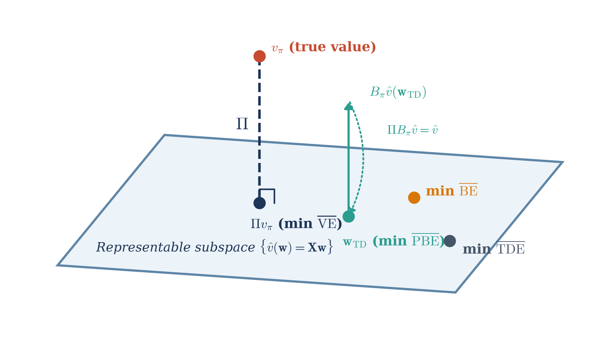

- Extending off-policy algorithms from tabular lookup tables (Chapters 6 and 7) to parameterized function approximation turns out to be dramatically harder than the on-policy case.
- Rather than converging reliably with small step sizes, standard bootstrapped off-policy updates can become unstable and send parameter weights off to infinity, even in linear settings.
- Two distinct difficulties emerge when combining off-policy data with function approximation:
  1. **Target mismatch**: The update target must reflect the target policy $\pi$ even though transitions were collected under a different behavior policy $b$.
  2. **Distribution mismatch**: The visitation frequencies of states and actions encountered under $b$ do not align with the stationary distribution induced by $\pi$.

## Semi-gradient Methods {#sec-ch11-11-1}

- Adapting tabular off-policy algorithms to function approximation starts by converting their update targets into **semi-gradient updates**, addressing the target-mismatch problem directly.
- Recall the general semi-gradient rule that nudges the parameter vector $\mathbf{w}$ toward a target $U_t$:

$$\mathbf{w}_{t+1} = \mathbf{w}_t + \alpha\!\left[U_t - \hat{v}(S_t, \mathbf{w}_t)\right] \nabla \hat{v}(S_t, \mathbf{w}_t)$$

$$U_t = R_{t+1} + \gamma \hat{v}(S_{t+1}, \mathbf{w}_t)$$

- Unlike tabular learning where each state or state-action entry sits in an independent array cell, all updates now modify a shared weight vector $\mathbf{w}$.
- To correct for actions sampled from $b$ instead of $\pi$, many state-value algorithms weight each step by the **per-step importance sampling ratio**:

$$\rho_t \doteq \rho_{t:t} = \frac{\pi(A_t \vert S_t)}{b(A_t \vert S_t)}$$

- **Off-policy semi-gradient TD(0)**: Adjusts weights along the value gradient just like the on-policy variant, multiplying the step by $\rho_t$:

$$\boxed{\mathbf{w}_{t+1} \doteq \mathbf{w}_t + \alpha \rho_t\, \delta_t \nabla \hat{v}(S_t, \mathbf{w}_t)}$$

$$
\begin{aligned}
\text{(episodic)} \quad \delta_t &= R_{t+1} + \gamma \hat{v}(S_{t+1}, \mathbf{w}_t) - \hat{v}(S_t, \mathbf{w}_t) \\
\text{(continuing)} \quad \delta_t &= R_{t+1} - \bar{R}_t + \hat{v}(S_{t+1}, \mathbf{w}_t) - \hat{v}(S_t, \mathbf{w}_t)
\end{aligned}
$$

- **Off-policy semi-gradient Expected Sarsa**: Evaluates action values without any importance sampling factor because the target expectation sums explicitly over next-step actions under $\pi$:

$$\boxed{\mathbf{w}_{t+1} = \mathbf{w}_t + \alpha\, \delta_t \nabla \hat{q}(S_t, A_t, \mathbf{w}_t)}$$

$$
\begin{aligned}
\text{(episodic)} \quad \delta_t &= R_{t+1} + \gamma \sum_a \pi(a \vert S_{t+1}) \hat{q}(S_{t+1}, a, \mathbf{w}_t) - \hat{q}(S_t, A_t, \mathbf{w}_t) \\
\text{(continuing)} \quad \delta_t &= R_{t+1} - \bar{R}_t + \sum_a \pi(a \vert S_{t+1}) \hat{q}(S_{t+1}, a, \mathbf{w}_t) - \hat{q}(S_t, A_t, \mathbf{w}_t)
\end{aligned}
$$

- Omitting importance sampling in Expected Sarsa is subtly open to debate once weights are shared across state-action pairs, because each sample alters predictions for neighboring pairs as well. Settling how samples ought to be weighted demands deeper **function approximation theory**.
- Moving beyond one-step backups introduces importance sampling into action-value methods too. **Off-policy semi-gradient $n$-step Sarsa** multiplies the next $n$ policy ratios:

$$\boxed{\mathbf{w}_{t+n} \doteq \mathbf{w}_{t+n-1} + \alpha \rho_{t+1} \cdots \rho_{t+n}\!\left[G_{t:t+n} - \hat{q}(S_t, A_t, \mathbf{w}_{t+n-1})\right] \nabla \hat{q}(S_t, A_t, \mathbf{w}_{t+n-1})}$$

$$
\begin{aligned}
\text{(episodic)} \quad G_{t:t+n} &= R_{t+1} + \ldots + \gamma^{n-1} R_{t+n} + \gamma^n \hat{q}(S_{t+n}, A_{t+n}, \mathbf{w}_{t+n-1}) \\
\text{(continuing)} \quad G_{t:t+n} &= R_{t+1} - \bar{R}_t + \ldots + R_{t+n} - \bar{R}_{t+n-1} + \hat{q}(S_{t+n}, A_{t+n}, \mathbf{w}_{t+n-1})
\end{aligned}
$$

$$\text{where } \rho_k = 1 \quad \text{ for } k \geq T \quad \text{and} \quad G_{t:t+n} = G_t \quad \text{ if } t+n \geq T$$

- **Off-policy semi-gradient $n$-step tree backup**: Avoids importance sampling altogether by propagating expected TD errors weighted by target-policy probabilities along the trajectory:

$$\boxed{\mathbf{w}_{t+n} \doteq \mathbf{w}_{t+n-1} + \alpha\!\left[G_{t:t+n} - \hat{q}(S_t, A_t, \mathbf{w}_{t+n-1})\right] \nabla \hat{q}(S_t, A_t, \mathbf{w}_{t+n-1})}$$

$$G_{t:t+n} \doteq \hat{q}(S_t, A_t, \mathbf{w}_{t+n}) + \sum_{k=t}^{t+n-1} \delta_k \prod_{i=t+1}^{k} \gamma \pi(A_i \vert S_i)$$

$$\text{where } \delta_t \text{ is the Expected Sarsa TD error defined earlier in this section.}$$

## Examples of Off-Policy Divergence {#sec-ch11-11-2}

- Addressing target mismatch alone is insufficient because the second obstacle, distribution mismatch, can destabilize semi-gradient updates.
- Three classic counterexamples illustrate exactly how linear semi-gradient bootstrapping blows up under off-policy sampling (see Sutton & Barto, 2018, §11.2, for the transition diagrams of these MDPs).

### Example 1 {#example-1}

- Imagine an isolated two-state fragment embedded inside a larger MDP (Sutton & Barto, 2018, §11.2): a single deterministic transition with reward $R = 0$ moves from a state valued at $w$ to a second state valued at $2w$, sharing the same scalar parameter $w$.
- Suppose off-policy updates repeatedly sample only this transition with $\rho_t = 1$. Whenever $w > 0$ and the discount factor is sufficiently large, the destination state looks strictly better than the origin, pushing $w$ upward without bound.
- The resulting TD error along the transition is:

$$
\begin{aligned}
\delta_t &= R_{t+1} + \gamma \hat{v}(S_{t+1}, \mathbf{w}_t) - \hat{v}(S_t, \mathbf{w}_t) \\
&= 0 + \gamma \cdot 2\mathbf{w}_t - \mathbf{w}_t \\
&= (2\gamma - 1)\, \mathbf{w}_t
\end{aligned}
$$

- Substituting $\delta_t$ into off-policy semi-gradient TD(0) yields a geometric recurrence:

$$
\begin{aligned}
\mathbf{w}_{t+1} &= \mathbf{w}_t + \alpha \rho_t\, \delta_t \nabla \hat{v}(S_t, \mathbf{w}_t) \\
&= \mathbf{w}_t + (\alpha)(1)\!\left[(2\gamma - 1) \mathbf{w}_t\right](1) \\
&= \mathbf{w}_t\!\left[1 + \alpha(2\gamma - 1)\right]
\end{aligned}
$$

$$
\begin{aligned}
\Rightarrow \quad & 1 + \alpha(2\gamma - 1) > 1 \\
& \alpha(2\gamma - 1) > 0 \\
& 2\gamma - 1 > 0 \\
& \gamma > \tfrac{1}{2} \quad \longrightarrow \quad w \to \pm\infty
\end{aligned}
$$

- For any $\gamma > 0.5$ and any positive step size $\alpha > 0$, the multiplier exceeds $1$, driving $w$ to $\pm\infty$.

### Example 2 (Baird's Counterexample) {#example-2-bairds-counterexample}

- To show that divergence occurs in a self-contained MDP rather than an isolated fragment, **Baird's counterexample** constructs a complete 7-state, 2-action star-shaped MDP (diagrammed in Sutton & Barto, 2018, §11.2).
- **Problem setup**:
  - **Behavior policy**: Picks the dashed action with probability $b(\text{dashed}\,\vert\,\cdot) = 6/7$ (transitioning uniformly among the six top nodes) and the solid action with $b(\text{solid}\,\vert\,\cdot) = 1/7$ (entering the single bottom node deterministically).
  - **Target policy**: Always picks the solid action, $\pi(\text{solid}\,\vert\,\cdot) = 1$, keeping the agent permanently in the lower state.
  - **Rewards and discounting**: Every transition yields $R = 0$ with discount factor $\gamma = 0.99$.
  - **Linear value approximation**: Each of the six upper states $i \in \{1, \dots, 6\}$ has value $2w_i + w_8$, while the seventh (lower) state has value $w_7 + 2w_8$.
- For instance, the first upper state corresponds to the 8-dimensional feature vector:

$$\mathbf{x}(1) = (2, 0, 0, 0, 0, 0, 0, 1)^T$$

$$R = 0 \quad \therefore\quad v_\pi(s) = 0 \; \forall s, \text{ which can be exactly approximated if } \mathbf{w} = \mathbf{0}$$

- Although the parameter space is overparameterized (8 weights for 7 states) and admits exact zero-error solutions, semi-gradient TD(0) still diverges to infinity for every positive step size $\alpha > 0$.
- Even exact expected updates suffer the same fate: **semi-gradient dynamic programming (DP)** sweeps uniformly across all states and still diverges:

$$\mathbf{w}_{k+1} \doteq \mathbf{w}_k + \frac{\alpha}{\vert S \vert} \sum_s \left(\mathbb{E}_\pi\!\left[R_{t+1} + \gamma \hat{v}(S_{t+1}, \mathbf{w}_k) \mid S_t = s\right] - \hat{v}(s, \mathbf{w}_k)\right) \nabla \hat{v}(s, \mathbf{w}_k)$$

- Baird's star MDP proves that instability arises from the most elementary ingredients imaginable:
  - **Minimal bootstrapping**: One-step TD or synchronous DP backups.
  - **Minimal approximation**: Linear features updated by semi-gradient descent.

### Example 3 (Tsitsiklis & Van Roy's Counterexample) {#example-3-tsitsiklis-van-roys-counterexample}

- **Tsitsiklis and Van Roy's counterexample** shows that even exact least-squares projection at every DP iteration can fail (Sutton & Barto, 2018, §11.2). It modifies Example 1 by adding a terminal state reached from the $2w$ state with probability $\varepsilon$ (and self-looping with probability $1 - \varepsilon$), with all rewards equal to $0$.
- Choosing the next scalar weight $w_{k+1}$ to minimize squared value error $\overline{\text{VE}}$ against the current one-step Bellman targets gives:

$$
\begin{aligned}
w_{k+1} &= \arg\min_{w \in \mathbb{R}} \sum_{s \in S} \left(\hat{v}(s, w) - \mathbb{E}_\pi\!\left[R_{t+1} + \gamma \hat{v}(S_{t+1}, w_k) \mid S_t = s\right]\right)^2 \\[6pt]
&= \arg\min_{w \in \mathbb{R}} \left(w - \gamma \cdot 2w_k\right)^2 + \left(2w - (1 - \varepsilon)\gamma \cdot 2w_k\right)^2 \\[6pt]
&= \left(\frac{6 - 4\varepsilon}{5}\right) \gamma w_k
\end{aligned}
$$

- Whenever $\gamma > \dfrac{5}{6 - 4\varepsilon}$ and $w_0 \neq 0$, the multiplier exceeds $1$ and the sequence $\{w_k\}$ grows exponentially without bound.

### Takeaways {#ch11-takeaways}

- Stability can be restored by restricting function approximation to architectures that never extrapolate outside the range of observed targets.
- **Averagers**: Function approximators whose predictions are always convex combinations (weighted averages) of observed target values; because they are non-expansive, they guarantee stability under off-policy DP and TD.
  - **Guaranteed averagers**: Non-parametric interpolators such as $k$-nearest neighbors and kernel-weighted local regression meet this non-expansive property.
  - **Non-averagers**: General linear approximators (including tile coding with overlapping tilings) and artificial neural networks can extrapolate beyond observed targets and therefore do not automatically prevent divergence.

## The Deadly Triad {#sec-ch11-11-3}

- **The deadly triad**: Divergence and unbounded oscillations become a genuine risk whenever three mechanisms operate simultaneously:
  1. **Function approximation**: Generalizing across large state spaces via a compact parameter vector whose dimension is far smaller than $\vert \mathcal{S} \vert$.
  2. **Bootstrapping**: Constructing update targets from existing value estimates instead of waiting for complete empirical returns.
  3. **Off-policy training**: Learning about $\pi$ from trajectories sampled under a distinct exploratory policy $b$, creating a mismatch in state visitation.
- Removing any single leg of the triad eliminates this specific instability mode, yet each leg serves a vital role:
  - **Cannot drop function approximation**: Tabular lookup tables cannot scale to high-dimensional or continuous domains.
  - **Dropping bootstrapping is costly**: Pure Monte Carlo avoids instability but sacrifices sample efficiency and online computational convenience.
  - **Dropping off-policy learning limits generality**: Switching from Q-learning to Sarsa restores on-policy stability, yet off-policy updates remain essential for learning multiple predictions in parallel, reusing replay buffers, and planning.

## Linear Value-Function Geometry {#sec-ch11-11-4}

- To diagnose why off-policy updates drift and which objectives are actually achievable, it helps to view value functions geometrically as vectors in $\mathbb{R}^{\vert \mathcal{S} \vert}$, separate from any particular update rule.
- Picture a tiny 3-state MDP ($\mathcal{S} = \{s_1, s_2, s_3\}$) approximated linearly with 2 weights $\mathbf{w} = (w_1, w_2)^T$:
  - Every possible state-value function corresponds to a point in 3D Euclidean space.
  - Varying $\mathbf{w}$ sweeps out a 2D flat plane (linear subspace) embedded inside that 3D space.
  - Typically, the true value vector $v_\pi$ lies off this plane and cannot be represented exactly.
- Different learning algorithms effectively choose different points inside the representable plane to stand in for $v_\pi$, depending on which error geometry they minimize (@fig-114).

::: {#fig-114}
{width=85% fig-align="center" fig-alt="Geometric diagram of linear value-function approximation showing v_pi projected onto the linear subspace alongside VE, PBE, BE, and TDE solutions."}

**Geometry of linear value-function approximation.** The true value vector $v_\pi$ lies outside the representable linear plane; orthogonal projection $\Pi v_\pi$ minimizes $\overline{\text{VE}}$, whereas the TD fixed point ($\overline{\text{PBE}} = 0$), minimum $\overline{\text{BE}}$, and minimum $\overline{\text{TDE}}$ generally differ.
:::

### Projection Operation {#projection-operation}

- **Weighted Euclidean norm**: Distances in value space are measured relative to the state-weighting distribution $\mu(s)$, defining both the Mean Squared Value Error $\overline{\text{VE}}$ and the **projection operator** $\Pi$:

$$
\begin{aligned}
\lVert v \rVert_\mu^2 &\doteq \sum_{s \in S} \mu(s)\, v(s)^2 \\[6pt]
\overline{\text{VE}}(\mathbf{w}) &= \lVert v_\mathbf{w} - v_\pi \rVert_\mu^2 \\[6pt]
\Pi\, v &\doteq v_\mathbf{w} \quad \\[6pt]
\text{where } \mathbf{w} = \arg\min_{\mathbf{w} \in \mathbb{R}^d} \lVert v - v_\mathbf{w} \rVert_\mu^2 &  \quad \text{and} \quad  \Pi \equiv \text{projection operator}
\end{aligned}
$$

- **Best linear approximation**: The closest representable vector to $v_\pi$ under $\lVert \cdot \rVert_\mu$ is its orthogonal projection $\Pi v_\pi$, which is the asymptotic fixed point of linear Monte Carlo methods.
- **Projection matrix**: Let $\mathbf{D}$ be the $\vert S \vert \times \vert S \vert$ diagonal matrix with entries $\mu(s)$ along the diagonal, and let $\mathbf{X}$ be the $\vert S \vert \times d$ feature matrix stacking each row $\mathbf{x}(s)^T$. Then $\Pi$ takes the closed form:

$$\Pi \doteq \mathbf{X}\!\left(\mathbf{X}^T \mathbf{D} \mathbf{X}\right)^{-1} \mathbf{X}^T \mathbf{D}$$

- Whenever $\mathbf{X}^T \mathbf{D} \mathbf{X}$ is singular, the Moore-Penrose pseudoinverse replaces the ordinary inverse. In matrix notation, the weighted squared norm and linear value vector compactly read:

$$\lVert v \rVert_\mu^2 = v^T \mathbf{D}\, v$$

$$v_\mathbf{w} = \mathbf{X}\mathbf{w}$$

### TD Solutions {#td-solutions}

- **Bellman error**: While $v_\pi$ satisfies the Bellman equation with zero discrepancy everywhere, an approximate vector $v_\mathbf{w}$ generally incurs a non-zero residual at each state $s$:

$$
\begin{aligned}
\bar{\delta}_\mathbf{w}(s) &\doteq \left(\sum_a \pi(a \vert s) \sum_{s', r} p(s', r \vert s, a)\!\left[r + \gamma v_\mathbf{w}(s')\right]\right) - v_\mathbf{w}(s) \\
&= \mathbb{E}_\pi\!\left[R_{t+1} + \gamma v_\mathbf{w}(S_{t+1}) - v_\mathbf{w}(S_t) \mid S_t = s, A_t \sim \pi\right]
\end{aligned}
$$

- **Bellman error vector ($\text{BE}$)**: Stacking the expected TD errors $\bar{\delta}_\mathbf{w}(s)$ across all states produces $\bar{\delta}_\mathbf{w} \in \mathbb{R}^{\vert S \vert}$.
- **Mean Squared Bellman Error ($\overline{\text{BE}}$)**: Measures the $\mu$-weighted squared length of the Bellman error vector:

$$\overline{\text{BE}}(\mathbf{w}) = \lVert \bar{\delta}_\mathbf{w} \rVert_\mu^2$$

- **Bellman operator ($B_\pi$)**: Maps any value vector $v \in \mathbb{R}^{\vert S \vert}$ through one full expected policy backup, expressing both the Bellman error and fixed-point condition cleanly:

$$
\begin{aligned}
(B_\pi v)(s) &\doteq \sum_a \pi(a \vert s) \sum_{s', r} p(s', r \vert s, a)\!\left[r + \gamma v(s')\right], \quad \forall s \in S \text{ and } v : S \to \mathbb{R} \\[6pt]
\bar{\delta}_\mathbf{w} &= B_\pi v_\mathbf{w} - v_\mathbf{w} \\[6pt]
v_\pi &= B_\pi v_\pi
\end{aligned}
$$

- Because $B_\pi v_\mathbf{w}$ generally leaves the representable linear plane, the **Projected Bellman Error ($\text{PBE}$)** projects the Bellman error vector back onto the subspace:

$$\text{PBE} = \Pi\, \bar{\delta}_\mathbf{w}$$

- **Mean Squared Projected Bellman Error ($\overline{\text{PBE}}$)**: Evaluates the squared norm of that projected residual:

$$\overline{\text{PBE}}(\mathbf{w}) = \lVert \Pi\, \bar{\delta}_\mathbf{w} \rVert_\mu^2$$

- **TD fixed point ($\mathbf{w}_\text{TD}$)**: Under linear function approximation, there always exists a weight vector inside the subspace where $\overline{\text{PBE}}(\mathbf{w}_\text{TD}) = 0$, meaning the Bellman error is purely orthogonal to the feature plane.

## Gradient Descent in the Bellman Error {#sec-ch11-11-5}

- Because semi-gradient updates ignore how parameter changes alter the bootstrapped target, an appealing alternative is to perform true stochastic gradient descent (SGD) on a well-defined scalar error objective.

### TD Error (Naive Residual-Gradient Algorithm) {#td-error-naive-residual-gradient-algorithm}

- A first candidate loss penalizes the average squared magnitude of single-step TD residuals, where:

$$\delta_t = R_{t+1} + \gamma \hat{v}(S_{t+1}, \mathbf{w}_t) - \hat{v}(S_t, \mathbf{w}_t)$$

- **Mean Squared TD Error ($\overline{\text{TDE}}$)**: Averaging $\delta_t^2$ under the target policy (and rewriting via importance sampling under $b$) yields:

$$
\begin{aligned}
\overline{\text{TDE}}(\mathbf{w}) &= \sum_{s \in S} \mu(s)\, \mathbb{E}\!\left[\delta_t^2 \mid S_t = s, A_t \sim \pi\right] \\
&= \sum_{s \in S} \mu(s)\, \mathbb{E}\!\left[\rho_t\, \delta_t^2 \mid S_t = s, A_t \sim b\right] \\
&= \mathbb{E}_b\!\left[\rho_t\, \delta_t^2\right]
\end{aligned}
$$

- **Naive residual-gradient update**: Differentiating $\rho_t \delta_t^2$ directly with respect to $\mathbf{w}$ produces a genuine SGD step:

$$
\begin{aligned}
\mathbf{w}_{t+1} &= \mathbf{w}_t - \tfrac{1}{2}\alpha \nabla\!\left(\rho_t\, \delta_t^2\right) \\
&= \mathbf{w}_t - \alpha \rho_t\, \delta_t \nabla \delta_t \\
&= \mathbf{w}_t + \alpha \rho_t\, \delta_t\!\left(\nabla \hat{v}(S_t, \mathbf{w}_t) - \gamma \nabla \hat{v}(S_{t+1}, \mathbf{w}_t)\right)
\end{aligned}
$$

- Compared to semi-gradient TD(0), this rule adds the negative bootstrapped gradient term $-\gamma \nabla \hat{v}(S_{t+1}, \mathbf{w}_t)$, guaranteeing convergence as true SGD.
- **Why it is naive**: Minimizing raw sample-by-sample $\delta_t^2$ punishes stochastic reward and transition variance just as harshly as prediction bias, smoothing values across time rather than recovering true expected returns (even in tabular stochastic chains).

### Bellman Error (Residual-Gradient Algorithm) {#bellman-error-residual-gradient-algorithm}

- **Residual-gradient algorithm**: Instead of squaring individual sample errors, true SGD on $\overline{\text{BE}}$ differentiates the squared *expected* TD error:

$$
\begin{aligned}
\mathbf{w}_{t+1} &= \mathbf{w}_t - \tfrac{1}{2}\alpha \nabla\!\left(\mathbb{E}_\pi\!\left[\delta_t\right]^2\right) \\
&= \mathbf{w}_t - \tfrac{1}{2}\alpha \nabla\!\left(\mathbb{E}_b\!\left[\rho_t\, \delta_t\right]^2\right) \\
&= \mathbf{w}_t - \alpha\, \mathbb{E}_b\!\left[\rho_t\, \delta_t\right] \nabla \mathbb{E}_b\!\left[\rho_t\, \delta_t\right] \\
&= \mathbf{w}_t - \alpha\, \mathbb{E}_b\!\left[\rho_t\!\left(R_{t+1} + \gamma \hat{v}(S_{t+1}, \mathbf{w}) - \hat{v}(S_t, \mathbf{w})\right)\right] \mathbb{E}_b\!\left[\rho_t \nabla \delta_t\right] \\
&= \mathbf{w}_t + \alpha\!\left[\mathbb{E}_b\!\left[\rho_t\!\left(R_{t+1} + \gamma \hat{v}(S_{t+1}, \mathbf{w})\right)\right] - \hat{v}(S_t, \mathbf{w})\right]\!\left[\nabla \hat{v}(S_t, \mathbf{w}) - \gamma\, \mathbb{E}_b\!\left[\rho_t \nabla \hat{v}(S_{t+1}, \mathbf{w})\right]\right]
\end{aligned}
$$

- **Double-sampling problem**: Because the gradient involves a product of two expectations over $S_{t+1}$, plugging a single observed transition into both factors introduces bias (reverting to the naive algorithm). Unbiased updates require one of two conditions:
  1. **Deterministic transitions**: The next state is unique, so both expectations collapse to a single sample.
  2. **Two independent samples**: A simulator or model is queried twice from the exact same state $S_t$ to obtain independent draws of $S_{t+1}$.
- When either condition holds and step sizes decay appropriately, residual-gradient converges reliably to a minimum of $\overline{\text{BE}}$.
- **Three major shortcomings**:
  - **Sluggish convergence**: Learning progresses far more slowly than semi-gradient TD in practice.
  - **Poor value estimates**: Even on simple problems with function approximation, minimizing $\overline{\text{BE}}$ can converge to less accurate predictions than the TD fixed point.
  - **Fundamental non-learnability**: As shown next, the $\overline{\text{BE}}$ objective itself cannot be identified from trajectory data alone.

## The Bellman Error is Not Learnable {#sec-ch11-11-6}

- **Learnability**: An objective (or its optimal parameter vector) is learnable only if it is uniquely determined by the observable stream of feature vectors, actions, and rewards, without peering inside the underlying MDP states.
- The strongest argument against pursuing $\overline{\text{BE}}$ in model-free RL is that neither $\overline{\text{BE}}$ nor its minimizer is learnable from experience alone.
- Two pairs of indistinguishable Markov Reward Processes (MRPs) demonstrate this distinction cleanly (see Sutton & Barto, 2018, §11.6, for the full state-transition diagrams).

### Example 1 {#example-1-1}

- Consider two distinct MRPs that share identical feature representations (all states map to the same constant feature) and emit the exact same endless alternating stream of rewards $0, 2, 0, 2, \ldots$ (Sutton & Barto, 2018, §11.6): one has a single state with a $50/50$ random reward of $0$ or $2$, while the other deterministically cycles through two indistinguishable states yielding $0$ and $2$.
- From the agent's observations alone, no amount of infinite data can tell whether the environment has one stochastic state or two deterministic states.
- Consequently, the **Mean Squared Value Error** ($\overline{\text{VE}}$) itself cannot be estimated from data, because $v_\pi(s)$ differs between the two MRPs:

$$\overline{\text{VE}}(\mathbf{w}) \doteq \sum_{s \in S} \mu(s)\!\left[v_\pi(s) - \hat{v}(s, \mathbf{w})\right]^2$$

- Crucially, however, the *minimizing parameter vector* of $\overline{\text{VE}}$ IS learnable! Both MRPs have the exact same optimal weight vector.
- **Return error and $\overline{\text{RE}}$**: Replacing the unobservable true value $v_\pi(S_t)$ with the observable Monte Carlo return $G_t$ defines the **Mean Squared Return Error** ($\overline{\text{RE}}$), which differs from $\overline{\text{VE}}$ only by a constant independent of $\mathbf{w}$:

$$
\begin{aligned}
\overline{\text{RE}}(\mathbf{w}) &= \mathbb{E}\!\left[\left(G_t - \hat{v}(S_t, \mathbf{w})\right)^2\right] \\
&= \overline{\text{VE}}(\mathbf{w}) + \mathbb{E}\!\left[\left(G_t - v_\pi(S_t)\right)^2\right]
\end{aligned}
$$

- Thus $\overline{\text{RE}}$ is directly learnable from data and shares the exact same minimizer as $\overline{\text{VE}}$. By contrast, $\overline{\text{BE}}$ can only be evaluated with full knowledge of the MDP dynamics, and its minimizer cannot be recovered from data.

### Example 2 {#example-2}

- A slightly richer pair of deterministic MRPs with aliased features (Sutton & Barto, 2018, §11.6) proves that $\overline{\text{BE}}$ fails even the weaker test of optimal-parameter learnability.
- Both MRPs generate identical observable distributions over feature sequences and rewards, yet they possess *different* $\overline{\text{BE}}$-minimizing weight vectors.
- Because the optimal $\mathbf{w}$ is not a function of the data distribution, no model-free algorithm can possibly learn the $\overline{\text{BE}}$ solution from interaction data alone.
- **Learnable bootstrapping alternatives**: Both $\overline{\text{PBE}}$ and $\overline{\text{TDE}}$ depend solely on the observable data distribution, making them genuinely learnable; their optimal parameter vectors generally differ from one another and from the unlearnable $\overline{\text{BE}}$ minimizer (see Sutton & Barto, 2018, §11.6, for the causal dependency diagram relating MDPs, data distributions, and error objectives).
- Since $\overline{\text{BE}}$ is restricted to model-based settings with access to environment dynamics, **$\overline{\text{PBE}}$** serves as the preferred bootstrapping objective for stable model-free off-policy learning.

## Gradient-TD Methods {#sec-ch11-11-7}

- **Gradient-TD methods**: True stochastic gradient descent algorithms designed to minimize the learnable $\overline{\text{PBE}}$ objective, retaining stability even under off-policy sampling and nonlinear architectures.
- With linear features, there exists an exact fixed point $\mathbf{w}_\text{TD}$ where $\overline{\text{PBE}}$ vanishes completely.
- Exact least-squares TD (LSTD) finds $\mathbf{w}_\text{TD}$ directly at $O(d^2)$ cost per step; Gradient-TD achieves $O(d)$ memory and per-step computation via incremental SGD.
- Rewriting $\overline{\text{PBE}}(\mathbf{w})$ in matrix form for linear approximation gives:

$$
\begin{aligned}
\overline{\text{PBE}}(\mathbf{w}) &= \lVert \Pi\, \bar{\delta}_\mathbf{w} \rVert_\mu^2 \\
&= \left(\Pi\, \bar{\delta}_\mathbf{w}\right)^T \mathbf{D}\, \Pi\, \bar{\delta}_\mathbf{w} \\
&= \bar{\delta}_\mathbf{w}^T \Pi^T \mathbf{D}\, \Pi\, \bar{\delta}_\mathbf{w} \\
&= \bar{\delta}_\mathbf{w}^T \mathbf{D} \mathbf{X}\!\left(\mathbf{X}^T \mathbf{D} \mathbf{X}\right)^{-1} \mathbf{X}^T \mathbf{D}\, \bar{\delta}_\mathbf{w} \\
&= \left(\mathbf{X}^T \mathbf{D}\, \bar{\delta}_\mathbf{w}\right)^T \!\left(\mathbf{X}^T \mathbf{D} \mathbf{X}\right)^{-1} \!\left(\mathbf{X}^T \mathbf{D}\, \bar{\delta}_\mathbf{w}\right)
\end{aligned}
$$

$\quad \left(\text{using } \Pi = \mathbf{X}\!\left(\mathbf{X}^T \mathbf{D} \mathbf{X}\right)^{-1} \mathbf{X}^T \mathbf{D} \text{ and the identity } \Pi^T \mathbf{D} \Pi = \mathbf{D} \mathbf{X}\!\left(\mathbf{X}^T \mathbf{D} \mathbf{X}\right)^{-1} \mathbf{X}^T \mathbf{D}\right)$

- Differentiating $\overline{\text{PBE}}(\mathbf{w})$ with respect to $\mathbf{w}$ yields a product of three factors:

$$\nabla \overline{\text{PBE}}(\mathbf{w}) = 2\, \nabla\!\left[\mathbf{X}^T \mathbf{D}\, \bar{\delta}_\mathbf{w}\right]^T \!\left(\mathbf{X}^T \mathbf{D} \mathbf{X}\right)^{-1} \!\left(\mathbf{X}^T \mathbf{D}\, \bar{\delta}_\mathbf{w}\right)$$

- Each of those three matrix factors can be rewritten as an expectation under the behavior distribution:

$$
\begin{aligned}
\mathbf{X}^T \mathbf{D}\, \bar{\delta}_\mathbf{w} &= \sum_s \mu(s)\, \mathbf{x}(s)\, \bar{\delta}_\mathbf{w}(s) = \mathbb{E}\!\left[\rho_t\, \delta_t\, \mathbf{x}_t\right] \\[6pt]
\nabla\!\left[\mathbf{X}^T \mathbf{D}\, \bar{\delta}_\mathbf{w}\right] &= \nabla \mathbb{E}\!\left[\rho_t\, \delta_t\, \mathbf{x}_t\right] \\
&= \mathbb{E}\!\left[\rho_t \nabla \delta_t^T\, \mathbf{x}_t^T\right] \\
&= \mathbb{E}\!\left[\rho_t \nabla\!\left(R_{t+1} + \gamma \mathbf{w}^T \mathbf{x}_{t+1} - \mathbf{w}^T \mathbf{x}_t\right) \mathbf{x}_t^T\right] \\
&= \mathbb{E}\!\left[\rho_t\!\left(\gamma \mathbf{x}_{t+1} - \mathbf{x}_t\right) \mathbf{x}_t^T\right] \\[6pt]
\mathbf{X}^T \mathbf{D} \mathbf{X} &= \sum_s \mu(s)\, \mathbf{x}_s\, \mathbf{x}_s^T = \mathbb{E}\!\left[\mathbf{x}_t\, \mathbf{x}_t^T\right]
\end{aligned}
$$

- Plugging all three expectations back into $\nabla \overline{\text{PBE}}(\mathbf{w})$ gives:

$$\nabla \overline{\text{PBE}}(\mathbf{w}) = 2\, \mathbb{E}\!\left[\rho_t\!\left(\gamma \mathbf{x}_{t+1} - \mathbf{x}_t\right) \mathbf{x}_t^T\right] \mathbb{E}\!\left[\mathbf{x}_t\, \mathbf{x}_t^T\right]^{-1} \mathbb{E}\!\left[\rho_t\, \delta_t\, \mathbf{x}_t\right]$$

- Sampling all three factors from the same transition creates a **biased gradient estimate** because the first and third factors correlate, while maintaining separate matrix estimates would revert to $O(d^2)$ cost.

### Gradient-TD {#gradient-td}

- **Secondary weight vector ($\mathbf{v}$)**: Rather than inverting a $d \times d$ covariance matrix, Gradient-TD maintains an auxiliary $d$-dimensional vector $\mathbf{v}$ that tracks the product of the last two terms:

$$\mathbf{v} \approx \mathbb{E}\!\left[\mathbf{x}_t\, \mathbf{x}_t^T\right]^{-1} \mathbb{E}\!\left[\rho_t\, \delta_t\, \mathbf{x}_t\right]$$

- Notice that this expression is simply the linear least-squares regression solution predicting $\rho_t \delta_t$ from $\mathbf{x}_t$.
- **Least Mean Square (LMS) update**: Minimizing the expected squared regression error $\left(\mathbf{v}^T \mathbf{x}_t - \rho_t \delta_t\right)^2$ incrementally updates $\mathbf{v}$ in $O(d)$ time per step:

$$\mathbf{v}_{t+1} \doteq \mathbf{v}_t + \beta \rho_t\!\left(\delta_t - \mathbf{v}_t^T \mathbf{x}_t\right) \mathbf{x}_t$$

$$
\begin{aligned}
\text{where} \\
\beta &> 0 \equiv \text{another step-size parameter} \\
\rho_t &\equiv \text{importance sampling ratio} \\
O(d) &\equiv \text{storage \& per-step computational complexity}
\end{aligned}
$$

### GTD2 {#gtd2}

- **GTD2**: Substituting the running estimate $\mathbf{v}_t$ for the final two expectations in $-\tfrac{1}{2}\alpha \nabla \overline{\text{PBE}}(\mathbf{w}_t)$ yields a direct $O(d)$ update for $\mathbf{w}_t$:

$$
\begin{aligned}
\mathbf{w}_{t+1} &= \mathbf{w}_t - \tfrac{1}{2}\alpha \nabla \overline{\text{PBE}}(\mathbf{w}_t) \\
&= \mathbf{w}_t - \tfrac{1}{2}\alpha\!\left(2\, \mathbb{E}\!\left[\rho_t\!\left(\gamma \mathbf{x}_{t+1} - \mathbf{x}_t\right) \mathbf{x}_t^T\right] \mathbb{E}\!\left[\mathbf{x}_t\, \mathbf{x}_t^T\right]^{-1} \mathbb{E}\!\left[\rho_t\, \delta_t\, \mathbf{x}_t\right]\right) \\
&= \mathbf{w}_t + \alpha\, \mathbb{E}\!\left[\rho_t\!\left(\mathbf{x}_t - \gamma \mathbf{x}_{t+1}\right) \mathbf{x}_t^T\right] \mathbb{E}\!\left[\mathbf{x}_t\, \mathbf{x}_t^T\right]^{-1} \mathbb{E}\!\left[\rho_t\, \delta_t\, \mathbf{x}_t\right] \\
&\approx \mathbf{w}_t + \alpha\, \mathbb{E}\!\left[\rho_t\!\left(\mathbf{x}_t - \gamma \mathbf{x}_{t+1}\right) \mathbf{x}_t^T\right] \mathbf{v}_t \\
&\approx \mathbf{w}_t + \alpha \rho_t\!\left(\mathbf{x}_t - \gamma \mathbf{x}_{t+1}\right) \mathbf{x}_t^T \mathbf{v}_t
\end{aligned}
$$

- Evaluating the scalar inner product $(\mathbf{x}_t^T \mathbf{v}_t)$ first keeps per-step computation strictly $O(d)$.

### TD(0) with Gradient Correction (GTD(0) or TDC) {#td0-with-gradient-correction-gtd0-or-tdc}

- **TDC (GTD(0))**: Rearranging the algebra before inserting $\mathbf{v}_t$ cancels $\mathbb{E}[\mathbf{x}_t \mathbf{x}_t^T]$ against its inverse on the first term, producing standard TD(0) plus a stabilizing gradient-correction term:

$$
\begin{aligned}
\mathbf{w}_{t+1} &= \mathbf{w}_t + \alpha\, \mathbb{E}\!\left[\rho_t\!\left(\mathbf{x}_t - \gamma \mathbf{x}_{t+1}\right) \mathbf{x}_t^T\right] \mathbb{E}\!\left[\mathbf{x}_t\, \mathbf{x}_t^T\right]^{-1} \mathbb{E}\!\left[\rho_t\, \delta_t\, \mathbf{x}_t\right] \\
&= \mathbf{w}_t + \alpha\!\left(\mathbb{E}\!\left[\rho_t\, \mathbf{x}_t\, \mathbf{x}_t\right] - \gamma\, \mathbb{E}\!\left[\rho_t\, \mathbf{x}_{t+1}\, \mathbf{x}_t^T\right]\right) \mathbb{E}\!\left[\mathbf{x}_t\, \mathbf{x}_t^T\right]^{-1} \mathbb{E}\!\left[\rho_t\, \delta_t\, \mathbf{x}_t\right] \\
&= \mathbf{w}_t + \alpha\!\left(\mathbb{E}\!\left[\mathbf{x}_t\, \mathbf{x}_t\right] - \gamma\, \mathbb{E}\!\left[\rho_t\, \mathbf{x}_{t+1}\, \mathbf{x}_t^T\right]\right) \mathbb{E}\!\left[\mathbf{x}_t\, \mathbf{x}_t^T\right]^{-1} \mathbb{E}\!\left[\rho_t\, \delta_t\, \mathbf{x}_t\right] \\
&= \mathbf{w}_t + \alpha\!\left(\mathbb{E}\!\left[\mathbf{x}_t\, \rho_t\, \delta_t\right] - \gamma\, \mathbb{E}\!\left[\rho_t\, \mathbf{x}_{t+1}\, \mathbf{x}_t^T\right] \mathbb{E}\!\left[\mathbf{x}_t\, \mathbf{x}_t^T\right]^{-1} \mathbb{E}\!\left[\rho_t\, \delta_t\, \mathbf{x}_t\right]\right) \\
&\approx \mathbf{w}_t + \alpha\!\left(\mathbb{E}\!\left[\mathbf{x}_t\, \rho_t\, \delta_t\right] - \gamma\, \mathbb{E}\!\left[\rho_t\, \mathbf{x}_{t+1}\, \mathbf{x}_t^T\right] \mathbf{v}_t\right) \\
&\approx \mathbf{w}_t + \alpha \rho_t\!\left(\delta_t\, \mathbf{x}_t - \gamma \mathbf{x}_{t+1}\, \mathbf{x}_t^T \mathbf{v}_t\right)
\end{aligned}
$$

- As with GTD2, computing $(\mathbf{x}_t^T \mathbf{v}_t)$ first ensures $O(d)$ cost per time step, and TDC typically learns noticeably faster than GTD2 in practice.

### Takeaways {#takeaways-1}

- **Cascade structure**: Both GTD2 and TDC pair two coupled learners: primary value weights $\mathbf{w}$ rely on secondary weights $\mathbf{v}$, whereas $\mathbf{v}$ tracks the TD error for the current $\mathbf{w}$ at its own step size $\beta$.
- Gradient-TD algorithms remain among the best-analyzed $O(d)$ stable off-policy estimators, with broad extensions across RL:
  1. **Action-value control**: GQ (Maei et al., 2010).
  2. **Eligibility traces**: GTD($\lambda$) and GQ($\lambda$) (Maei, 2011; Maei & Sutton, 2010).
  3. **Nonlinear approximation**: Smooth nonlinear value functions (Maei et al., 2009).
- **Hybrid and saddle-point variants**:
  1. Blending classical semi-gradient updates with gradient-corrected steps to recover standard TD speed on-policy (Hackman, 2012; White & White, 2016).
  2. Reformulating the objective as a convex-concave saddle point solved with proximal steps and variance-reducing control variates (Mahadevan et al., 2014; Du et al., 2017).

## Emphatic-TD Methods {#sec-ch11-11-8}

- A fundamentally different strategy restores stability without adding a second weight vector or abandoning semi-gradient updates.
- Linear semi-gradient TD converges reliably whenever states are updated in proportion to the on-policy visitation distribution $\mu_\pi$, because those state weights balance the transition probabilities under $\pi$.
- Off-policy experience breaks that balance: states arrive according to $b$ rather than $\pi$.
- **Emphatic-TD**: Re-weights each transition dynamically, amplifying underrepresented states and down-weighting overrepresented ones, until the effective update distribution mirrors the on-policy steady state and restores convergence guarantees.
- **One-step Emphatic-TD** (episodic state values) scales the semi-gradient TD(0) update by a recursively accumulated scalar emphasis $M_t$:

$$\delta_t = R_{t+1} + \gamma \hat{v}(S_{t+1}, \mathbf{w}_t) - \hat{v}(S_t, \mathbf{w}_t)$$

$$\mathbf{w}_{t+1} = \mathbf{w}_t + \alpha M_t \rho_t\, \delta_t \nabla \hat{v}(S_t, \mathbf{w}_t)$$

$$M_t = \gamma \rho_{t-1} M_{t-1} + \mathcal{I}_t$$

$$
\begin{aligned}
\text{where} \\
\mathcal{I}_t &\equiv \text{the interest} \\
M_t &\equiv \text{the emphasis} \quad (M_{-1} = 0)
\end{aligned}
$$

- Here the non-negative **interest** $\mathcal{I}_t$ lets the designer specify how strongly accuracy matters at state $S_t$, while the **emphasis** $M_t$ accumulates discounted importance-weighted past interest along trajectories leading into $S_t$.
- Although Emphatic-TD converges in expectation on Baird's counterexample, its multiplicative chain of importance ratios can generate extreme variance, making empirical runs noisy without dedicated variance-reduction techniques.

## Reducing Variance {#sec-ch11-11-9}

- Off-policy learning naturally exhibits higher variance than on-policy learning because it attempts to evaluate a policy using trajectories produced by a different one.
- Despite that statistical penalty, off-policy estimation is indispensable for reusing past experience and simultaneously evaluating many target policies from a single stream of behavior.
- **Why importance sampling amplifies variance**:
  - Multi-step off-policy estimators multiply per-step policy ratios along the trajectory:

  $$\rho_{t:T-1} = \prod_{k=t}^{T-1} \frac{\pi(A_k \vert S_k)}{b(A_k \vert S_k)}$$

  - Each individual ratio averages to $1$ under $b$, yet individual realizations can drop to $0$ or spike to huge numbers:

  $$\mathbb{E}\!\left[\frac{\pi(A_k \vert S_k)}{b(A_k \vert S_k)}\right] \doteq \sum_a b(a \vert S_k) \frac{\pi(a \vert S_k)}{b(a \vert S_k)} = \sum_a \pi(a \vert S_k) = 1$$

  - Because sequential ratios are uncorrelated, their product retains an expectation of $1$ while its variance can grow exponentially with horizon length.
  - Inside SGD, a massive importance ratio effectively multiplies the step size on a single update, threatening to knock the parameters far off course.
- **Practical variance-reduction strategies**:
  - **Optimizer stabilization**: Momentum, Polyak-Ruppert iterate averaging, and per-parameter adaptive step-size schedules dampen occasional huge steps.
  - **Importance-weight-aware updates**: Rescaling nonlinearly for large ratios prevents overshooting (Karampatziakis & Langford, 2015).
  - **Weighted importance sampling**: Normalizing by cumulative weights sharply reduces variance relative to ordinary importance sampling, though integrating it cleanly into general function approximation remains nontrivial (Mahmood & Sutton, 2015).
  - **Ratio-free backups**: Tree-backup methods avoid importance sampling altogether by computing target expectations over actions.
  - **Behavior-aware targets**: Keeping the target policy $\pi$ reasonably close to the behavior policy $b$ caps the worst-case magnitude of $\rho_t$.

## Summary {#sec-ch11-11-10}

- Tabular off-policy learners such as Q-learning, Expected Sarsa, and tree backup converge reliably, yet introducing even linear function approximation unlocks severe divergence hazards.
- Two distinct challenges must be addressed: adjusting update targets from $b$ to $\pi$, and stabilizing parameter dynamics when the sampled visitation distribution disagrees with the target policy's on-policy distribution.
- **The deadly triad**: Combining **function approximation**, **bootstrapping**, and **off-policy updates** can send weights to infinity even on minimal MDPs like Baird's counterexample.
- Direct SGD on **Mean Squared Bellman Error ($\overline{\text{BE}}$)** fails in model-free RL because $\overline{\text{BE}}$ and its minimizing parameter vector are not learnable from observable trajectory data.
- **Gradient-TD** algorithms (GTD2, TDC) achieve $O(d)$ stable off-policy learning by minimizing the learnable **Projected Bellman Error ($\overline{\text{PBE}}$)**, whereas **Emphatic-TD** restores stability by re-weighting state updates toward an on-policy distribution.
- Multiplicative importance-sampling ratios still inject severe variance, motivating conservative step sizes, variance-aware optimization, weighted ratios, or tree-backup style updates.
