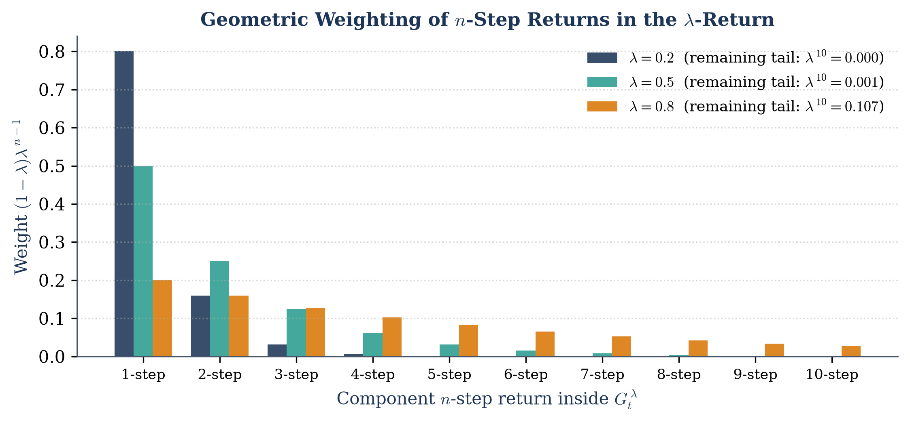

- **Eligibility traces** form a core reinforcement learning mechanism that smoothly bridges temporal-difference (TD) bootstrapping and Monte Carlo (MC) estimation inside one unified framework.
- Parameterized by a single decay constant $\lambda \in [0, 1]$, trace-based TD algorithms span a continuous spectrum from one-step TD(0) at $\lambda = 0$ to full Monte Carlo behavior at $\lambda = 1$.
- Crucially, eligibility traces allow Monte Carlo style credit assignment to execute incrementally online and on continuing, non-episodic tasks.
- Although $n$-step returns also interpolate between TD and MC, eligibility traces offer a cleaner, constant-memory algorithmic realization:
  - **Trace vector ($\mathbf{z}_t$)**: Alongside the long-term weight vector $\mathbf{w}_t \in \mathbb{R}^d$, the agent maintains a short-term memory vector $\mathbf{z}_t \in \mathbb{R}^d$ of matching dimension.
  - **Activity and decay**: Whenever a parameter component participates in predicting a state's value, its corresponding entry in $\mathbf{z}_t$ jumps upward and then decays geometrically over subsequent steps.
  - **Credit assignment**: Any non-zero TD error that arrives before a component's trace vanishes adjusts the associated weight in $\mathbf{w}_t$ proportionally to that remaining trace strength.
  - **Trace-decay parameter ($\lambda$)**: Governs how rapidly past feature activations fade from short-term memory.
- **Why eligibility traces beat $n$-step buffers**:
  - **Compact memory**: Storing one running vector $\mathbf{z}_t$ replaces buffering the last $n$ feature vectors and rewards.
  - **Uniform online computation**: Updates happen evenly at every step rather than pausing until $n$ steps later or scrambling to flush a backlog when an episode ends, allowing learned improvements to influence control immediately.
  - **Mechanistic simplicity**: Rather than looking ahead along future trajectories, traces update weights backward from each newly observed TD error.
- **Forward view vs. backward view**:
  - **Forward view**: Conceptual perspective defining how a visited state's value *should* move toward a weighted combination of future rewards and bootstrapped values.
  - **Backward view**: Practical online mechanism that broadcasts the current step's TD error backward to recently active weights via decaying traces, closely matching the forward view's cumulative updates.
- Throughout this chapter, we move progressively from state-value prediction to action-value control, and from on-policy updates to stable off-policy methods, focusing primarily on linear function approximation (which subsumes tabular and state-aggregation settings).

## The $\lambda$-return {#sec-ch12-12-1}

- Recall from [Chapter 7](#sec-ch07-7-1) that an $n$-step return sums the next $n$ discounted rewards and bootstraps from the estimated value reached $n$ steps ahead:

$$G_{t:t+n} \doteq R_{t+1} + \gamma R_{t+2} + \ldots + \gamma^{n-1} R_{t+n} + \gamma^n \hat{v}(S_{t+n}, \mathbf{w}_{t+n-1}), \quad 0 \leq t \leq T - n$$

- **Compound updates**: Nothing restricts an update target to a single horizon $n$; any convex combination of $n$-step returns forms a valid target, provided the mixture weights are non-negative and sum to $1$.
  - For example, blending half of the 2-step return with half of the 4-step return produces the valid compound target $\frac{1}{2} G_{t:t+2} + \frac{1}{2} G_{t:t+4}$ (see Sutton & Barto, 2018, Ch. 12, for compound backup diagrams).
- Taking weighted averages across multiple horizons unlocks broad algorithmic families:
  1. Blending short-horizon and infinite-horizon returns links TD bootstrapping seamlessly with Monte Carlo rollouts.
  2. Combining sampled returns with full dynamic programming backups merges model-free learning and model-based planning in one target.
- **The $\lambda$-return ($G_t^\lambda$)**: A specific compound target that averages *all* $n$-step returns ($n = 1, 2, \dots$), assigning each horizon a geometric weight proportional to $\lambda^{n-1}$ (with $\lambda \in [0, 1]$) and normalizing by $(1 - \lambda)$ so all weights sum to $1$ (see Sutton & Barto, 2018, Ch. 12, for the TD($\lambda$) backup diagram):

$$\boxed{G_t^\lambda \doteq (1-\lambda) \sum_{n=1}^{\infty} \lambda^{n-1} G_{t:t+n}}$$

### TD($\lambda$) Weighting

- Examining the geometric weights $(1 - \lambda)\lambda^{n-1}$ reveals how $\lambda$ allocates influence across lookahead depths (@fig-ch12-12-1-weighting):
  - The 1-step return carries the largest share, $1 - \lambda$.
  - Each additional step multiplies the previous weight by $\lambda$: $(1 - \lambda)\lambda$ for $n = 2$, $(1 - \lambda)\lambda^2$ for $n = 3$, and $(1 - \lambda)\lambda^{n-1}$ in general.
  - Once an episode terminates at time $T$, every return with $t + n \geq T$ collapses to the exact full return $G_t$.
- Separating pre-termination bootstrapped terms from all post-termination terms yields the episodic decomposition:

$$
\begin{array}{l}
G_t^\lambda = (1-\lambda) \sum\nolimits_{n=1}^{T-t-1} \lambda^{n-1} G_{t:t+n} + \lambda^{T-t-1} G_t \\
\hspace{3em} \underbrace{\hspace{11em}}_{\text{pre-termination}} \quad \underbrace{\hspace{4em}}_{\text{post-termination}}
\end{array}
$$

- Evaluating the two extreme values of $\lambda$ confirms the exact bridge between TD(0) and Monte Carlo:

$$
\begin{aligned}
\text{if } \lambda = 1: \quad & G_t^\lambda = G_t \hspace{18em} \text{(MC)} \\[6pt]
\text{if } \lambda = 0: \quad & G_t^\lambda = \left\{ \begin{array}{ll} \sum_{n=1}^{T-t-1} G_{t:t+n} & \text{for } n=1 \\ 0 & \text{for } n > 1 \end{array} \right\} = G_{t:t+1} \quad \text{(TD(0))}
\end{aligned}
$$

::: {#fig-ch12-12-1-weighting}
{width=85% fig-align="center" fig-alt="Bar chart comparing geometric lambda-return weights (1-lambda)*lambda^(n-1) across 1-step to 10-step returns for lambda = 0.2, 0.5, and 0.8."}

**Geometric weighting in the $\lambda$-return.** Each $n$-step return receives weight $(1-\lambda)\lambda^{n-1}$; smaller $\lambda$ concentrates mass near TD(0), while larger $\lambda$ extends weight deeper toward Monte Carlo.
:::

- **Off-line $\lambda$-return algorithm**: The simplest learner built on $G_t^\lambda$ waits for each episode to conclude and then sweeps through $t = 0, 1, \dots, T - 1$ using a semi-gradient update toward $G_t^\lambda$:

$$\boxed{\mathbf{w}_{t+1} \doteq \mathbf{w}_t + \alpha \!\left[G_t^\lambda - \hat{v}(S_t, \mathbf{w}_t)\right] \nabla \hat{v}(S_t, \mathbf{w}_t)}$$

- Tuning $\lambda$ smoothly trades off bias against variance across the TD-to-MC spectrum, performing comparably to tuning $n$ in $n$-step TD while offering a much cleaner online counterpart.

### Forward View {#forward-view}

- The off-line $\lambda$-return algorithm embodies the theoretical **forward view** of credit assignment (illustrated in Sutton & Barto, 2018, Ch. 12):
  - At every visited state $S_t$, we look forward across all upcoming transitions to assemble the compound target $G_t^\lambda$.
  - Because $G_t^\lambda$ depends on rewards all the way through termination $T$, this pure forward-view update cannot run until the episode finishes.

## TD($\lambda$) {#sec-ch12-12-2}

- **TD($\lambda$)** is the landmark algorithm connecting a clean theoretical forward view with a practical backward-view eligibility trace mechanism.
- Compared with the off-line $\lambda$-return algorithm, TD($\lambda$) brings three major operational advantages:
  - **Incremental step-by-step updates**: Weights adapt immediately on every step instead of waiting for episode completion.
  - **Even computational load**: Work is spread uniformly across time steps rather than concentrated in a burst at termination.
  - **Continuing-task generality**: No episode boundary is required, so discounted continuing tasks work out of the box.
- **Semi-gradient TD($\lambda$)**: With differentiable function approximation, the **accumulating eligibility trace** $\mathbf{z}_t \in \mathbb{R}^d$ starts at zero, decays by $\gamma\lambda$ at each step, and adds the current value gradient:

$$
\begin{aligned}
\mathbf{z}_{-1} &\doteq \mathbf{0} \\
\mathbf{z}_t &\doteq \gamma\lambda \mathbf{z}_{t-1} + \nabla \hat{v}(S_t, \mathbf{w}_t), \quad 0 \leq t \leq T
\end{aligned}
$$

$$
\begin{aligned}
\text{where} \\
\lambda &\equiv \text{trace decay parameter} \\
\gamma &\equiv \text{discount rate}
\end{aligned}
$$

- **Recency heuristic**: Each entry of $\mathbf{z}_t$ records how strongly and how recently the corresponding weight influenced state-value predictions, with the timescale of "recency" set by $\gamma\lambda$.
- Pairing the standard one-step state-value TD error with the trace vector yields the TD($\lambda$) parameter update:

$$\delta_t \doteq R_{t+1} + \gamma \hat{v}(S_{t+1}, \mathbf{w}_t) - \hat{v}(S_t, \mathbf{w}_t)$$

$$\boxed{\mathbf{w}_{t+1} \doteq \mathbf{w}_t + \alpha\, \delta_t\, \mathbf{z}_t}$$

### Backward View {#backward-view}

- Whereas the forward view explains *what* objective we are targeting, the **backward view** specifies the online *mechanism* that executes on incomplete trajectories (diagrammed in Sutton & Barto, 2018, Ch. 12).
- In the tabular special case, every state maintains a scalar trace and receives a simultaneous adjustment proportional to the current TD error and its trace magnitude:

$$
\begin{aligned}
\delta_t &= R_{t+1} + \gamma V(S_{t+1}) - V(S_t) \\
V(s) &\leftarrow V(s) + \alpha\, \delta_t\, \mathbf{z}_t
\end{aligned}
$$

- Inspecting how $\lambda$ shapes the backward-view recurrence shows its direct correspondence with the forward view:

$$
\begin{aligned}
\text{if } \lambda = 0: \quad & \mathbf{z}_t = \nabla \hat{v}(S_t, \mathbf{w}_t) \\
& \mathbf{w}_{t+1} = \mathbf{w}_t + \alpha\, \delta_t \nabla \hat{v}(S_t, \mathbf{w}_t) \quad \longrightarrow \quad \text{TD(0)} \\[6pt]
\text{if } 0 < \lambda < 1: \quad & \text{earlier states are given less credit for the TD error} \\[6pt]
\text{if } \lambda = 1: \quad & \mathbf{z}_t = \gamma \mathbf{z}_{t-1} + \nabla \hat{v}(S_t, \mathbf{w}_t) \quad \longrightarrow \quad \text{credit for earlier states falls by } \gamma \text{ per step} \\[6pt]
\text{if } \lambda = 1,\ \gamma = 1: \quad & \mathbf{z}_t = \mathbf{z}_{t-1} + \nabla \hat{v}(S_t, \mathbf{w}_t) \quad \longrightarrow \quad \text{MC-like behavior (no time decay for ET)} \\[6pt]
\text{if } \lambda = 1: \quad & \text{we get TD(1)}
\end{aligned}
$$

- **TD(1)** generalizes Monte Carlo learning well beyond episodic off-line rollouts:
  - Handles discounted continuing environments naturally.
  - Runs fully online and incrementally at every transition.
  - Adapts predictions and control behavior mid-episode the instant an unexpected reward or penalty occurs.
- **Asymptotic convergence bound**: Under on-policy sampling and standard decaying step sizes, linear TD($\lambda$) converges reliably to a $\lambda$-dependent fixed point $\mathbf{w}_\infty$ whose weighted value error satisfies:

$$\overline{\text{VE}}(\mathbf{w}_\infty) \leq \frac{1 - \gamma\lambda}{1 - \gamma} \min_\mathbf{w} \overline{\text{VE}}(\mathbf{w})$$

- As $\lambda$ varies from $0$ to $1$, this error multiplier tightens smoothly from TD(0)'s bound down to the optimal linear projection:

$$
\begin{aligned}
\text{as } \lambda \to 1: \quad & \overline{\text{VE}}(\mathbf{w}_\infty) \to \min_\mathbf{w} \overline{\text{VE}}(\mathbf{w}) \\[6pt]
\text{as } \lambda \to 0: \quad & \overline{\text{VE}}(\mathbf{w}_\infty) \to \frac{1}{1-\gamma} \min_\mathbf{w} \overline{\text{VE}}(\mathbf{w}) = \overline{\text{VE}}(\mathbf{w}_\text{TD}) \quad \text{(TD(0))}
\end{aligned}
$$

- Despite enjoying the tightest asymptotic error bound, setting $\lambda = 1$ often performs poorly in finite time because of elevated variance and sensitivity to step size.

## $n$-step Truncated $\lambda$-return Methods {#sec-ch12-12-3}

- Waiting until an episode ends makes the off-line $\lambda$-return impractical for long episodes and unusable in continuing problems.
- **Truncated $\lambda$-return ($G_{t:h}^\lambda$)**: Cuts off the geometric sum at a finite future horizon $h$ (playing the role of termination time $T$), assigning all remaining tail probability $\lambda^{h - t - 1}$ to the longest available return $G_{t:h}$ (see Sutton & Barto, 2018, Ch. 12, for the truncated backup diagram):

$$G_{t:h}^\lambda \doteq (1-\lambda) \sum_{n=1}^{h-t-1} \lambda^{n-1} G_{t:t+n} + \lambda^{h-t-1} G_{t:h}, \quad 0 \leq t \leq h \leq T$$

$$
\begin{aligned}
\text{where} \\
h &\equiv \text{horizon (plays same role as time of termination } T\text{)}
\end{aligned}
$$

- **Truncated TD($\lambda$) / TTD($\lambda$)**: Applying a fixed lookahead delay $n$ produces a practical $n$-step family of $\lambda$-return learners, defined for $0 \leq t < T$ as:

$$\boxed{\mathbf{w}_{t+n} \doteq \mathbf{w}_{t+n-1} + \alpha \!\left[G_{t:t+n}^\lambda - \hat{v}(S_t, \mathbf{w}_{t+n-1})\right] \nabla \hat{v}(S_t, \mathbf{w}_{t+n-1})}$$

- **TD-error telescoping form**: Computing TTD($\lambda$) efficiently relies on expressing the $k$-step truncated $\lambda$-return as the initial estimate plus a discounted sum of TD errors evaluated under fixed weights $\mathbf{w}_{t-1}$:

$$\boxed{G_{t:t+k}^\lambda = \hat{v}(S_t, \mathbf{w}_{t-1}) + \sum_{i=t}^{t+k-1} (\gamma\lambda)^{i-t} \delta_i'}$$

$$
\begin{aligned}
\text{where} \\
\delta_i' &\equiv R_{i+1} + \gamma \hat{v}(S_{i+1}, \mathbf{w}_{t-1}) - \hat{v}(S_i, \mathbf{w}_{t-1})
\end{aligned}
$$

## Redoing Updates: Online $\lambda$-return Algorithm {#sec-ch12-12-4}

- Selecting the truncation length $n$ in TTD($\lambda$) exposes a fundamental tension:
  - A **large $n$** closely mirrors the full off-line $\lambda$-return target.
  - A **small $n$** applies updates rapidly so improved estimates guide decisions right away.
- **Online $\lambda$-return algorithm**: Resolves this tension conceptually by re-running every update from the start of the episode at every new time step $h$, incorporating the freshly observed transition into all earlier truncated targets.
- Each horizon $h = 1, 2, \dots, T$ generates its own full pass of weight vectors $\mathbf{w}_1^h, \dots, \mathbf{w}_h^h$ starting from the episode's initial weights $\mathbf{w}_0^h$. The first three passes read:

$$
\begin{aligned}
h=1: \quad & \mathbf{w}_1^1 \doteq \mathbf{w}_0^1 + \alpha \!\left[G_{0:1}^\lambda - \hat{v}(S_0, \mathbf{w}_0^1)\right] \nabla \hat{v}(S_0, \mathbf{w}_0^1) \\[6pt]
h=2: \quad & \mathbf{w}_1^2 \doteq \mathbf{w}_0^2 + \alpha \!\left[G_{0:2}^\lambda - \hat{v}(S_0, \mathbf{w}_0^2)\right] \nabla \hat{v}(S_0, \mathbf{w}_0^2) \\
& \mathbf{w}_2^2 \doteq \mathbf{w}_1^2 + \alpha \!\left[G_{1:2}^\lambda - \hat{v}(S_1, \mathbf{w}_1^2)\right] \nabla \hat{v}(S_1, \mathbf{w}_1^2) \\[6pt]
h=3: \quad & \mathbf{w}_1^3 \doteq \mathbf{w}_0^3 + \alpha \!\left[G_{0:3}^\lambda - \hat{v}(S_0, \mathbf{w}_0^3)\right] \nabla \hat{v}(S_0, \mathbf{w}_0^3) \\
& \mathbf{w}_2^3 \doteq \mathbf{w}_1^3 + \alpha \!\left[G_{1:3}^\lambda - \hat{v}(S_1, \mathbf{w}_1^3)\right] \nabla \hat{v}(S_1, \mathbf{w}_1^3) \\
& \mathbf{w}_3^3 \doteq \mathbf{w}_2^3 + \alpha \!\left[G_{2:3}^\lambda - \hat{v}(S_2, \mathbf{w}_2^3)\right] \nabla \hat{v}(S_2, \mathbf{w}_2^3)
\end{aligned}
$$

$$
\begin{aligned}
\text{where} \\
\mathbf{w}_t^h &\equiv \text{weights used to generate the value at time } t \text{ in the sequence up to horizon } h \\
\mathbf{w}_0^h &\equiv \text{1st weight vector in each sequence that is inherited from the previous episode} \\
\mathbf{w}_n^h &\equiv \text{last weight vector in each sequence or the ultimate weight-vector sequence}
\end{aligned}
$$

- In general, for $0 \leq t < h \leq T$, the **online $\lambda$-return update** advances along each row and outputs the diagonal vector $\mathbf{w}_t \doteq \mathbf{w}_t^t$ at time $t$:

$$\boxed{\mathbf{w}_{t+1}^h \doteq \mathbf{w}_t^h + \alpha \!\left[G_{t:h}^\lambda - \hat{v}(S_t, \mathbf{w}_t^h)\right] \nabla \hat{v}(S_t, \mathbf{w}_t^h)}$$

$$\mathbf{w}_t \doteq \mathbf{w}_t^t$$

- While empirically superior to the off-line $\lambda$-return algorithm, explicitly replaying the entire episode at every step is computationally prohibitive.

## True Online TD($\lambda$) {#sec-ch12-12-5}

- **True Online TD($\lambda$)** algebraically inverts the forward-view online $\lambda$-return algorithm ([Section 12.4](#sec-ch12-12-4)) into an exact backward-view eligibility-trace recurrence for linear function approximation.
- Instead of maintaining the full lower-triangular table of intermediate weight vectors $\mathbf{w}_t^h$, it tracks only the diagonal entries $\mathbf{w}_t = \mathbf{w}_t^t$ directly from step $t$ to step $t + 1$:

$$
\begin{aligned}
\begin{bmatrix}
\mathbf{w}_0^0 & & & & \\
\mathbf{w}_0^1 & \mathbf{w}_1^1 & & & \\
\mathbf{w}_0^2 & \mathbf{w}_1^2 & \mathbf{w}_2^2 & & \\
\mathbf{w}_0^3 & \mathbf{w}_1^3 & \mathbf{w}_2^3 & \mathbf{w}_3^3 & \\
\vdots & \vdots & \vdots & \vdots & \ddots \\
\mathbf{w}_0^T & \mathbf{w}_1^T & \mathbf{w}_2^T & \mathbf{w}_3^T & \cdots & \mathbf{w}_T^T
\end{bmatrix}
&\longrightarrow
\begin{bmatrix}
\mathbf{w}_0^0 \\
& \mathbf{w}_1^1 \\
& & \mathbf{w}_2^2 \\
& & & \mathbf{w}_3^3 \\
& & & & \ddots \\
& & & & & \mathbf{w}_T^T
\end{bmatrix} \\
\end{aligned}
$$

$$\text{Online } \lambda\text{-return} \hspace{8em} \text{True Online TD}(\lambda)$$

- For linear value estimates $\hat{v}(s, \mathbf{w}) = \mathbf{w}^T \mathbf{x}(s)$, the exact **True Online TD($\lambda$)** update is:

$$\boxed{\mathbf{w}_{t+1} \doteq \mathbf{w}_t + \alpha\, \delta_t\, \mathbf{z}_t + \alpha \!\left(\mathbf{w}_t^T \mathbf{x}_t - \mathbf{w}_{t-1}^T \mathbf{x}_t\right)\!\left(\mathbf{z}_t - \mathbf{x}_t\right)}$$

$$
\begin{aligned}
\text{where} \\
\mathbf{w}_t &\doteq \mathbf{w}_t^t \\
\mathbf{x}_t &\doteq \mathbf{x}(S_t) \\
\mathbf{z}_t &\doteq \gamma\lambda \mathbf{z}_{t-1} + (1 - \alpha\gamma\lambda\, \mathbf{z}_{t-1}^T \mathbf{x}_t)\, \mathbf{x}_t
\end{aligned}
$$

- Per-step memory and runtime remain $O(d)$, identical in asymptotic complexity to classic TD($\lambda$), yet the updates match the ideal online $\lambda$-return algorithm exactly on every time step.
- **Three families of eligibility traces**:
  - **Dutch trace**: The modified trace $\mathbf{z}_t$ appearing in True Online TD($\lambda$), which dampens repeated feature activations by $(1 - \alpha\gamma\lambda \mathbf{z}_{t-1}^T \mathbf{x}_t)$ and enjoys both rigorous forward-view equivalence and strong empirical accuracy.
  - **Accumulating trace**: The classic $\gamma\lambda \mathbf{z}_{t-1} + \nabla \hat{v}(S_t, \mathbf{w}_t)$ trace from TD($\lambda$); it remains useful for nonlinear networks where linear dutch traces do not directly apply.
  - **Replacing trace**: An older heuristic restricted to tabular or binary feature vectors (such as tile coding) that clamps active components to $1$:

$$\tilde{z}_{i,t} \doteq \left\{ \begin{array}{ll} 1 & \text{if } x_{i,t} = 1 \\ \gamma\lambda\, z_{i,t-1} & \text{otherwise} \end{array} \right\}$$

- In modern linear RL, dutch traces largely supersede replacing traces because they match or exceed empirical performance while resting on exact mathematical equivalence.

## Dutch Traces in Monte Carlo Learning {#sec-ch12-12-6}

- Although eligibility traces are historically tied to TD learning, they are not inherently a TD phenomenon: **dutch traces emerge naturally even in pure Monte Carlo learning**.
- Inverting linear gradient Monte Carlo from a forward view to an exact $O(d)$ backward view provides the cleanest explicit proof of forward-backward equivalence.
- Consider an undiscounted episodic task where a single scalar return $G$ arrives at termination $T$, updated sequentially at each step $0 \leq t < T$ via the linear **Least Mean Square (LMS)** rule:

$$\mathbf{w}_{t+1} \doteq \mathbf{w}_t + \alpha \!\left[G - \mathbf{w}_t^T \mathbf{x}_t\right] \mathbf{x}_t, \quad 0 \leq t < T$$

- To reproduce the exact final weight vector $\mathbf{w}_T$ without storing all past feature vectors until time $T$, factor the final step using a **fading (forgetting) matrix** $\mathbf{F}_t \doteq \mathbf{I} - \alpha \mathbf{x}_t \mathbf{x}_t^T$:

$$
\begin{aligned}
\mathbf{w}_T &= \mathbf{w}_{T-1} + \alpha \!\left(G - \mathbf{w}_{T-1}^T \mathbf{x}_{T-1}\right) \mathbf{x}_{T-1} \\
&= \mathbf{w}_{T-1} + \alpha \mathbf{x}_{T-1}\!\left(-\mathbf{x}_{T-1}^T \mathbf{w}_{T-1}\right) + \alpha G \mathbf{x}_{T-1} \\
&= \!\left(\mathbf{I} - \alpha \mathbf{x}_{T-1} \mathbf{x}_{T-1}^T\right) \mathbf{w}_{T-1} + \alpha G \mathbf{x}_{T-1} \\
&= \mathbf{F}_{T-1}\, \mathbf{w}_{T-1} + \alpha G \mathbf{x}_{T-1}
\end{aligned}
$$

$$
\begin{aligned}
\text{where} \\
\mathbf{F}_t &\doteq \mathbf{I} - \alpha \mathbf{x}_t \mathbf{x}_t^T \equiv \text{a forgetting or fading matrix}
\end{aligned}
$$

$$\therefore\quad \mathbf{w}_{T-1} = \mathbf{F}_{T-2}\, \mathbf{w}_{T-2} + \alpha G \mathbf{x}_{T-2}$$

- Unrolling this linear recurrence all the way back to $\mathbf{w}_0$ splits $\mathbf{w}_T$ cleanly into two terms:

$$
\begin{aligned}
\mathbf{w}_T &= \mathbf{F}_{T-1}\, \mathbf{w}_{T-1} + \alpha G \mathbf{x}_{T-1} \\
&= \mathbf{F}_{T-1}\!\left(\mathbf{F}_{T-2}\, \mathbf{w}_{T-2} + \alpha G \mathbf{x}_{T-2}\right) + \alpha G \mathbf{x}_{T-1} \\
&= \mathbf{F}_{T-1} \mathbf{F}_{T-2}\, \mathbf{w}_{T-2} + \alpha G\!\left(\mathbf{F}_{T-1} \mathbf{x}_{T-2} + \mathbf{x}_{T-1}\right) \\
&= \mathbf{F}_{T-1} \mathbf{F}_{T-2}\!\left(\mathbf{F}_{T-3}\, \mathbf{w}_{T-3} + \alpha G\, \mathbf{x}_{T-3}\right) + \alpha G\!\left(\mathbf{F}_{T-1}\, \mathbf{x}_{T-2} + \mathbf{x}_{T-1}\right) \\
&= \mathbf{F}_{T-1} \mathbf{F}_{T-2} \mathbf{F}_{T-3}\, \mathbf{w}_{T-3} + \alpha G\!\left(\mathbf{F}_{T-1} \mathbf{F}_{T-2}\, \mathbf{x}_{T-3} + \mathbf{F}_{T-1}\, \mathbf{x}_{T-2} + \mathbf{x}_{T-1}\right) \\
&\quad \vdots \\
&= \underbrace{\mathbf{F}_{T-1} \mathbf{F}_{T-2} \cdots \mathbf{F}_0\, \mathbf{w}_0}_{\mathbf{a}_{T-1}} + \alpha G \underbrace{\sum\nolimits_{k=0}^{T-1} \mathbf{F}_{T-1} \mathbf{F}_{T-2} \cdots \mathbf{F}_{k+1}\, \mathbf{x}_k}_{\mathbf{z}_{T-1}} \\
&= \mathbf{a}_{T-1} + \alpha G\, \mathbf{z}_{T-1}
\end{aligned}
$$

$$
\begin{aligned}
\text{where} \\
\mathbf{a}_{T-1}\ \&\ \mathbf{z}_{T-1} &\equiv \text{values at time } T-1 \text{ of 2 auxiliary memory vectors that can be updated} \\
&\phantom{{}\equiv{}} \text{incrementally w/o knowledge of } G \text{ and with } O(d) \text{ complexity per time step} \\
\mathbf{z}_t &\equiv \text{dutch-style eligibility trace, initialized to } \mathbf{z}_0 = \mathbf{x}_0
\end{aligned}
$$

- Expanding $\mathbf{z}_t$ recursively with $\mathbf{z}_0 = \mathbf{x}_0$ reveals the exact dutch trace recurrence for $\gamma\lambda = 1$:

$$
\begin{aligned}
\mathbf{z}_t &= \sum\nolimits_{k=0}^{t} \mathbf{F}_t \mathbf{F}_{t-1} \cdots \mathbf{F}_{k+1}\, \mathbf{x}_k, \quad 1 \leq t < T \\
&= \sum\nolimits_{k=0}^{t-1} \mathbf{F}_t \mathbf{F}_{t-1} \cdots \mathbf{F}_{k+1}\, \mathbf{x}_k + \mathbf{x}_t \\
&= \mathbf{F}_t \sum\nolimits_{k=0}^{t-1} \mathbf{F}_{t-1} \mathbf{F}_{t-2} \cdots \mathbf{F}_{k+1}\, \mathbf{x}_k + \mathbf{x}_t \\
&= \mathbf{F}_t\, \mathbf{z}_{t-1} + \mathbf{x}_t \\
&= \!\left(\mathbf{I} - \alpha \mathbf{x}_t \mathbf{x}_t^T\right) \mathbf{z}_{t-1} + \mathbf{x}_t \\
&= \mathbf{z}_{t-1} - \alpha\!\left(\mathbf{z}_{t-1}^T \mathbf{x}_t\right) \mathbf{x}_t + \mathbf{x}_t \\
&\boxed{= \mathbf{z}_{t-1} + \!\left(1 - \alpha\, \mathbf{z}_{t-1}^T \mathbf{x}_t\right) \mathbf{x}_t}
\end{aligned}
$$

- Meanwhile, the auxiliary vector $\mathbf{a}_t$ starts at $\mathbf{a}_0 = \mathbf{w}_0$ and evolves in $O(d)$ time per step:

$$
\begin{aligned}
\mathbf{a}_t &= \mathbf{F}_t \mathbf{F}_{t-1} \cdots \mathbf{F}_0\, \mathbf{w}_0, \quad 1 \leq t < T \\
&= \mathbf{F}_t\, \mathbf{a}_{t-1} \\
&= \mathbf{a}_{t-1} - \alpha \mathbf{x}_t \mathbf{x}_t^T \mathbf{a}_{t-1} \\
&\boxed{= \!\left(\mathbf{I} - \alpha \mathbf{x}_t \mathbf{x}_t^T\right) \mathbf{a}_{t-1}}
\end{aligned}
$$

### Takeaways {#ch12-takeaways}

- Maintaining $\mathbf{a}_t$ and $\mathbf{z}_t$ incrementally during the episode allows the exact final LMS weights to be assembled in one $O(d)$ step once $G$ arrives at time $T$:

$$\boxed{\mathbf{w}_T = \mathbf{a}_{T-1} + \alpha G\, \mathbf{z}_{T-1}}$$

- **Broader significance**: Eligibility traces arise whenever long-horizon predictions must be updated efficiently online in $O(d)$ time and space, regardless of whether bootstrapping is used.

## Sarsa($\lambda$) {#sec-ch12-12-7}

- Extending eligibility traces from prediction to control replaces state values $\hat{v}(s, \mathbf{w})$ with action values $\hat{q}(s, a, \mathbf{w})$.
- The action-value **$n$-step return** bootstraps from $\hat{q}(S_{t+n}, A_{t+n}, \mathbf{w}_{t+n-1})$:

$$G_{t:t+n} \doteq R_{t+1} + \ldots + \gamma^{n-1} R_{t+n} + \gamma^n \hat{q}(S_{t+n}, A_{t+n}, \mathbf{w}_{t+n-1}), \quad t+n < T$$

$$\text{with} \quad G_{t:t+n} = G_t \quad \text{if } t+n \geq T$$

- Averaging these action-value returns with the same geometric weights $(1 - \lambda)\lambda^{n-1}$ defines the action-value **off-line $\lambda$-return update** for $t = 0, \dots, T - 1$:

$$\boxed{\mathbf{w}_{t+1} \doteq \mathbf{w}_t + \alpha \!\left[G_t^\lambda - \hat{q}(S_t, A_t, \mathbf{w}_t)\right] \nabla \hat{q}(S_t, A_t, \mathbf{w}_t)}$$

$$
\begin{aligned}
\text{where} \\
G_t^\lambda &\doteq G_{t:\infty}^\lambda
\end{aligned}
$$

- Conceptually, the forward-view backup diagram (see Sutton & Barto, 2018, Ch. 12) mirrors TD($\lambda$) but starts and ends on state-action pairs: blending 1-step lookaheads, 2-step lookaheads, longer multi-step rollouts, and the complete episode return with identical $(1 - \lambda)\lambda^{n-1}$ weights.
- **Sarsa($\lambda$)**: The backward-view online control algorithm retains the exact parameter-update form of TD($\lambda$) while swapping in the action-value TD error and action-value gradient trace:

$$\boxed{\mathbf{w}_{t+1} \doteq \mathbf{w}_t + \alpha\, \delta_t\, \mathbf{z}_t}$$

$$\delta_t \doteq R_{t+1} + \gamma \hat{q}(S_{t+1}, A_{t+1}, \mathbf{w}_t) - \hat{q}(S_t, A_t, \mathbf{w}_t)$$

$$
\begin{aligned}
\mathbf{z}_{-1} &\doteq \mathbf{0} \\
\mathbf{z}_t &\doteq \gamma\lambda \mathbf{z}_{t-1} + \nabla \hat{q}(S_t, A_t, \mathbf{w}_t), \quad 0 \leq t \leq T
\end{aligned}
$$

- **True Online Sarsa($\lambda$)**: Every derivation from [Section 12.4](#sec-ch12-12-4) through [Section 12.6](#sec-ch12-12-6) carries over directly to control simply by replacing state feature vectors $\mathbf{x}(S_t)$ with state-action feature vectors $\mathbf{x}(S_t, A_t)$, yielding an exact $O(d)$ dutch-trace implementation of the online action-value $\lambda$-return.
- **Forward Sarsa($\lambda$)**: A truncated forward-view variant of Sarsa($\lambda$) that often pairs well with deep multilayer neural networks where backward-view traces are harder to integrate cleanly with mini-batch optimizers.

## Variable $\lambda$ and $\gamma$ {#sec-ch12-12-8}

- Modern unified TD formulations generalize both the bootstrapping rate and the discount factor from fixed scalars into **state- and action-dependent functions**:

$$
\begin{aligned}
\lambda_t &\doteq \lambda(S_t, A_t), \quad & \lambda &: S \times A \to [0,1] \\
\gamma_t &\doteq \gamma(S_t), \quad & \gamma &: S \to [0,1]
\end{aligned}
$$

- **Continuation / termination function ($\gamma_t$)**: Allowing $\gamma$ to vary by state generalizes the return $G_t$ recursively so that episodic and continuing tasks collapse into one seamless framework:

$$
\begin{aligned}
G_t &\doteq R_{t+1} + \gamma_{t+1} G_{t+1} \\
&= R_{t+1} + \gamma_{t+1} R_{t+2} + \gamma_{t+1} \gamma_{t+2} R_{t+3} + \gamma_{t+1} \gamma_{t+2} \gamma_{t+3} R_{t+4} + \ldots \\
&= \sum_{k=t}^{\infty} \left(\prod_{i=t+1}^{k} \gamma_i\right) R_{k+1}
\end{aligned}
$$

$$
\begin{aligned}
\text{where} \\
\prod_{k=t}^{\infty} \gamma_k &= 0 \text{ with probability 1 for all } t, \text{ to assure the sums are finite}
\end{aligned}
$$

- Under this unified return, episode boundaries vanish: a terminal state is simply any state where $\gamma(s) = 0$ that resets into the start-state distribution, turning an entire lifetime of episodes into one uninterrupted stream of experience.
- **Recursive variable-$\lambda$ state return ($G_t^{\lambda s}$)**:

$$\boxed{G_t^{\lambda s} \doteq R_{t+1} + \gamma_{t+1}\!\left[(1 - \lambda_{t+1})\, \hat{v}(S_{t+1}, \mathbf{w}_t) + \lambda_{t+1}\, G_{t+1}^{\lambda s}\right]}$$

- **Recursive variable-$\lambda$ action returns ($G_t^{\lambda a}$)**: Take either a **Sarsa form** (bootstrapping from the sampled next action) or an **Expected Sarsa form** (bootstrapping from the policy-averaged next value $\bar{V}_t$):

$$\boxed{G_t^{\lambda a} \doteq R_{t+1} + \gamma_{t+1}\!\left[(1 - \lambda_{t+1})\, \hat{q}(S_{t+1}, A_{t+1}, \mathbf{w}_t) + \lambda_{t+1}\, G_{t+1}^{\lambda a}\right]}$$

$$\boxed{G_t^{\lambda a} \doteq R_{t+1} + \gamma_{t+1}\!\left[(1 - \lambda_{t+1})\, \bar{V}_t(S_{t+1}) + \lambda_{t+1}\, G_{t+1}^{\bar{\lambda}a}\right]}$$

$$
\begin{aligned}
\text{where} \\
\bar{V}_t(s) &\doteq \sum_a \pi(a \vert s)\, \hat{q}(s, a, \mathbf{w}_t)
\end{aligned}
$$

### Superscripts notation for $i$ in $G_t^{\lambda i}$

$$
\begin{aligned}
\text{"s"} &: \text{bootstraps from state values} \\
\text{"a"} &: \text{bootstraps from action values}
\end{aligned}
$$

## Off-Policy Traces with Control Variates {#sec-ch12-12-9}

- Extending eligibility traces to off-policy experience builds control-variate importance sampling ([Section 7.4](ch07-nstep-bootstrapping.qmd#sec-ch07-7-4)) directly into the recursive $\lambda$-return.
- **Off-policy state-based $\lambda$-return**: Generalizing [Section 12.8](#sec-ch12-12-8) with the importance ratio $\rho_t$ and a control-variate anchor $(1 - \rho_t)\hat{v}(S_t, \mathbf{w}_t)$ gives:

$$\boxed{G_t^{\lambda s} \doteq \rho_t \!\left(R_{t+1} + \gamma_{t+1}\!\left[(1 - \lambda_{t+1})\, \hat{v}(S_{t+1}, \mathbf{w}_t) + \lambda_{t+1}\, G_{t+1}^{\lambda s}\right]\right) + (1 - \rho_t)\, \hat{v}(S_t, \mathbf{w}_t)}$$

$$
\begin{aligned}
\text{where} \\
\rho_t &= \frac{\pi(A_t \vert S_t)}{b(A_t \vert S_t)}
\end{aligned}
$$

- Expanding this recursion into a series of state-based TD errors $\delta_k^s$ gives an expression that is exact whenever $\mathbf{w}$ remains constant across steps (and approximate when $\mathbf{w}$ updates slowly):

$$
\begin{aligned}
G_t^{\lambda s} &\approx \hat{v}(S_t, \mathbf{w}_t) + \rho_t \sum_{k=t}^{\infty} \delta_k^s \prod_{i=t+1}^{k} \gamma_i \lambda_i \rho_i \\
\delta_t^s &\doteq R_{t+1} + \gamma_{t+1}\, \hat{v}(S_{t+1}, \mathbf{w}_t) - \hat{v}(S_t, \mathbf{w}_t)
\end{aligned}
$$

- Plugging this expansion into the forward-view update produces:

$$
\begin{aligned}
\mathbf{w}_{t+1} &= \mathbf{w}_t + \alpha \!\left[G_t^{\lambda s} - \hat{v}(S_t, \mathbf{w}_t)\right] \nabla \hat{v}(S_t, \mathbf{w}_t) \\
&\boxed{\approx \mathbf{w}_t + \alpha \rho_t \!\left(\sum_{k=t}^{\infty} \delta_k^s \prod_{i=t+1}^{k} \gamma_i \lambda_i \rho_i\right) \nabla \hat{v}(S_t, \mathbf{w}_t)}
\end{aligned}
$$

- **Forward-to-backward summation trick**: Summing all forward-view increments across $t = 0, 1, \dots$ and swapping the order of summation groups all past gradients that multiply each single TD error $\delta_k^s$:

$$
\begin{aligned}
\sum_{t=0}^{\infty} \!\left(\mathbf{w}_{t+1} - \mathbf{w}_t\right) &\approx \sum_{t=0}^{\infty} \sum_{k=t}^{\infty} \alpha \rho_t\, \delta_k^s \nabla \hat{v}(S_t, \mathbf{w}_t) \prod_{i=t+1}^{k} \gamma_i \lambda_i \rho_i \\
&= \sum_{k=0}^{\infty} \sum_{t=0}^{k} \alpha \rho_t \nabla \hat{v}(S_t, \mathbf{w}_t)\, \delta_k^s \prod_{i=t+1}^{k} \gamma_i \lambda_i \rho_i \\
&\quad \left(\text{using the summation rule: } \sum_{t=x}^{y} \sum_{k=t}^{y} = \sum_{k=x}^{y} \sum_{t=x}^{k}\right) \\
&= \sum_{k=0}^{\infty} \alpha\, \delta_k^s \sum_{t=0}^{k} \rho_t \nabla \hat{v}(S_t, \mathbf{w}_t) \prod_{i=t+1}^{k} \gamma_i \lambda_i \rho_i
\end{aligned}
$$

- Defining the inner sum as the trace $\mathbf{z}_k$ reveals an exact incremental recurrence from step $k - 1$ to step $k$:

$$
\begin{aligned}
\mathbf{z}_k &= \sum_{t=0}^{k} \rho_t \nabla \hat{v}(S_t, \mathbf{w}_t) \prod_{i=t+1}^{k} \gamma_i \lambda_i \rho_i \\
&= \sum_{t=0}^{k-1} \rho_t \nabla \hat{v}(S_t, \mathbf{w}_t) \prod_{i=t+1}^{k} \gamma_i \lambda_i \rho_i + \rho_k \nabla \hat{v}(S_k, \mathbf{w}_k) \\
&= \gamma_k \lambda_k \rho_k \underbrace{\sum_{t=0}^{k-1} \rho_t \nabla \hat{v}(S_t, \mathbf{w}_t) \prod_{i=t+1}^{k-1} \gamma_i \lambda_i \rho_i}_{\mathbf{z}_{k-1}} + \rho_k \nabla \hat{v}(S_k, \mathbf{w}_k)
\end{aligned}
$$

$$\boxed{\mathbf{z}_k = \rho_k \!\left[\gamma_k \lambda_k\, \mathbf{z}_{k-1} + \nabla \hat{v}(S_k, \mathbf{w}_k)\right]}$$

- **General accumulating trace (state values)**: Relabeling $k \to t$ yields the unified trace update usable for both on-policy and off-policy semi-gradient TD($\lambda$):

$$\boxed{\mathbf{z}_t \doteq \rho_t \!\left[\gamma_t \lambda_t\, \mathbf{z}_{t-1} + \nabla \hat{v}(S_t, \mathbf{w}_t)\right]}$$

- Notice how cleanly this reduces in the on-policy special case ($\rho_t = 1$ everywhere) to variable-parameter TD($\lambda$):

$$\mathbf{z}_t \doteq \gamma_t \lambda_t\, \mathbf{z}_{t-1} + \nabla \hat{v}(S_t, \mathbf{w}_t)$$

- In the off-policy setting, pairing this trace with ordinary semi-gradient updates fixes target bias, though stability still requires the specialized methods covered in [Section 12.11](#sec-ch12-12-11).
- **Off-policy action-value $\lambda$-return**: Starting from the Expected Sarsa recursion in [Section 12.8](#sec-ch12-12-8) and adding per-decision importance sampling with control variates gives:

$$
\boxed{\begin{aligned}
G_t^{\lambda a} &\doteq R_{t+1} + \gamma_{t+1}\!\left(\!\left[1 - \lambda_{t+1}\right] \bar{V}_t(S_{t+1}) + \lambda_{t+1}\!\left[\rho_{t+1} G_{t+1}^{\lambda a} + \bar{V}_t(S_{t+1}) - \rho_{t+1}\, \hat{q}(S_{t+1}, A_{t+1}, \mathbf{w}_t)\right]\right) \\
&= R_{t+1} + \gamma_{t+1}\!\left(\bar{V}_t(S_{t+1}) + \lambda_{t+1} \rho_{t+1} \!\left[G_{t+1}^{\lambda a} - \hat{q}(S_{t+1}, A_{t+1}, \mathbf{w}_t)\right]\right)
\end{aligned}}
$$

$$
\begin{aligned}
\text{where} \\
\bar{V}_t(S_{t+1}) &= \sum_a \pi(a \vert S_{t+1})\, \hat{q}(S_{t+1}, a, \mathbf{w}_t)
\end{aligned}
$$

- Writing $G_t^{\lambda a}$ as a sum of expected action-value TD errors $\delta_k^a$ and applying the identical index-reordering derivation produces the **off-policy action-value eligibility trace**:

$$
\begin{aligned}
G_t^{\lambda a} &\approx \hat{q}(S_t, A_t, \mathbf{w}_t) + \sum_{k=t}^{\infty} \delta_k^a \prod_{i=t+1}^{k} \gamma_i \lambda_i \rho_i \\
\delta_t^a &= R_{t+1} + \gamma_{t+1} \bar{V}(S_{t+1}) - \hat{q}(S_t, A_t, \mathbf{w}_t)
\end{aligned}
$$

$$\boxed{\mathbf{z}_t \doteq \gamma_t \lambda_t \rho_t\, \mathbf{z}_{t-1} + \nabla \hat{q}(S_t, A_t, \mathbf{w}_t)}$$

- **Expected Sarsa($\lambda$)**: Combining this trace with $\delta_t^a$ and $\mathbf{w}_{t+1} = \mathbf{w}_t + \alpha \delta_t^a \mathbf{z}_t$ handles both on-policy and off-policy trajectories seamlessly; when $\rho_t = 1$ with constant $\gamma$ and $\lambda$, it simplifies immediately to standard Sarsa($\lambda$):

$$
\begin{aligned}
&\quad \rho_t = 1, \quad \nabla\lambda_t = \nabla\gamma_t = 0 \\
&\boxed{\mathbf{z}_t \doteq \gamma\lambda\, \mathbf{z}_{t-1} + \nabla \hat{q}(S_t, A_t, \mathbf{w}_t)}
\end{aligned}
$$

- **Monte Carlo connection and provisional weights**:
  - At $\lambda = 1$, these off-policy trace methods match off-policy Monte Carlo updates in expectation, though not identically episode by episode.
  - Exact step-by-step off-policy equivalence has been achieved via **provisional weights** in **PTD($\lambda$)** and **PQ($\lambda$)** (Sutton, Mahmood, Precup & van Hasselt, 2014), which maintain an extra vector tracking tentative parameter adjustments that can be amplified or undone as later actions unfold.
- **Deadly triad caution**: Whenever $\lambda < 1$, bootstrapping interacts with off-policy updates and function approximation; semi-gradient trace methods fix target correction (challenge 1 of off-policy learning) but do not resolve visitation-distribution mismatch (challenge 2), which is addressed in [Section 12.11](#sec-ch12-12-11).

## Watkins's Q($\lambda$) to Tree-Backup($\lambda$) {#sec-ch12-12-10}

### Watkins's Q($\lambda$)

- **Watkins's Q($\lambda$)** was the classic early attempt to combine Q-learning with eligibility traces (backup diagram in Sutton & Barto, 2018, Ch. 12).
- As long as the agent selects greedy actions with respect to the current action-value estimates, traces decay normally by $\gamma\lambda$; the instant an exploratory (non-greedy) action occurs, Watkins's Q($\lambda$) zeroes out the eligibility trace to cut off off-policy contamination.

### Tree-Backup($\lambda$)

- **Tree-Backup($\lambda$) / TB($\lambda$)**: Extends the $n$-step tree-backup algorithm ([Section 7.5](#sec-ch07-7-5)) to eligibility traces and serves as the principled off-policy successor to Q-learning because it requires **no importance sampling ratios** (see Sutton & Barto, 2018, Ch. 12, for the TB($\lambda$) backup diagram).
- Weighting every finite-depth tree-backup return geometrically with $\lambda_{t+1}$ gives a compact recursive action-value target:

$$
\boxed{\begin{aligned}
G_t^{\lambda a} &\doteq R_{t+1} + \gamma_{t+1}\!\left(\!\left[1 - \lambda_{t+1}\right] \bar{V}_t(S_{t+1}) + \lambda_{t+1}\!\left[\sum_{a \neq A_{t+1}} \pi(a \vert S_{t+1})\, \hat{q}(S_{t+1}, a, \mathbf{w}_t) + \pi(A_{t+1} \vert S_{t+1}) G_{t+1}^{\lambda a}\right]\right) \\
&= R_{t+1} + \gamma_{t+1}\!\left(\bar{V}_t(S_{t+1}) + \lambda_{t+1} \pi(A_{t+1} \vert S_{t+1}) \!\left[G_{t+1}^{\lambda a} - \hat{q}(S_{t+1}, A_{t+1}, \mathbf{w}_t)\right]\right)
\end{aligned}}
$$

- Expanding $G_t^{\lambda a}$ into a telescoping sum of expected TD errors $\delta_k^a$ (assuming slowly varying weights) gives:

$$
\begin{aligned}
G_t^{\lambda a} &\approx \hat{q}(S_t, A_t, \mathbf{w}_t) + \sum_{k=t}^{\infty} \delta_k^a \prod_{i=t+1}^{k} \gamma_i \lambda_i \pi(A_i \vert S_i) \\
\delta_t^a &= R_{t+1} + \gamma_{t+1} \bar{V}_t(S_{t+1}) - \hat{q}(S_t, A_t, \mathbf{w}_t)
\end{aligned}
$$

- Applying the forward-to-backward summation identity yields the **Tree-Backup($\lambda$) trace**, where the target-policy probability $\pi(A_t \vert S_t)$ replaces the importance ratio $\rho_t$:

$$\boxed{\mathbf{z}_t \doteq \gamma_t \lambda_t \pi(A_t \vert S_t)\, \mathbf{z}_{t-1} + \nabla \hat{q}(S_t, A_t, \mathbf{w}_t)}$$

- Pairing this trace with the semi-gradient update $\mathbf{w}_{t+1} = \mathbf{w}_t + \alpha \delta_t^a \mathbf{z}_t$ defines TB($\lambda$). Notice that when $\pi$ is deterministic greedy, $\pi(A_t \vert S_t)$ drops to $0$ on non-greedy steps, automatically recovering Watkins's trace cut-off without dividing by behavior probabilities.
- Because TB($\lambda$) remains a semi-gradient bootstrapping method, it is still vulnerable to the **deadly triad** under general function approximation and off-policy data.

## Stable Off-Policy Methods with Traces {#sec-ch12-12-11}

- Four prominent linear-approximation algorithms combine eligibility traces with guaranteed off-policy convergence, building on either the **Gradient-TD** or **Emphatic-TD** paradigm.

### GTD($\lambda$)

- **GTD($\lambda$)**: Generalizes TDC to arbitrary traces, estimating $\hat{v}(s, \mathbf{w}_t) = \mathbf{w}_t^T \mathbf{x}(s) \approx v_\pi(s)$ stably from behavior-policy trajectories using a secondary weight vector $\mathbf{v}_t \in \mathbb{R}^d$:

$$
\begin{aligned}
\mathbf{w}_{t+1} &\doteq \mathbf{w}_t + \alpha\, \delta_t^s\, \mathbf{z}_t - \alpha \gamma_{t+1}(1 - \lambda_{t+1})\!\left(\mathbf{z}_t^T \mathbf{v}_t\right) \mathbf{x}_{t+1} \\
\mathbf{v}_{t+1} &\doteq \mathbf{v}_t + \beta\, \delta_t^s\, \mathbf{z}_t - \beta\!\left(\mathbf{v}_t^T \mathbf{x}_t\right) \mathbf{x}_t
\end{aligned}
$$

$$
\begin{aligned}
\text{where} \\
\mathbf{v} &\in \mathbb{R}^d \equiv \text{a vector of the same dimension as } \mathbf{w}, \text{ initialized to } \mathbf{v}_0 = \mathbf{0} \\
\beta &> 0 \equiv \text{a 2nd step-size parameter}
\end{aligned}
$$

### GQ($\lambda$)

- **GQ($\lambda$)**: The action-value Gradient-TD counterpart with traces, learning $\hat{q}(s, a, \mathbf{w}_t) = \mathbf{w}_t^T \mathbf{x}(s, a) \approx q_\pi(s, a)$ off-policy. Choosing $\pi$ to be greedy or $\varepsilon$-greedy with respect to $\hat{q}$ turns GQ($\lambda$) into a stable off-policy control method:

$$
\begin{aligned}
\mathbf{w}_{t+1} &\doteq \mathbf{w}_t + \alpha\, \delta_t^a\, \mathbf{z}_t - \alpha \gamma_{t+1}(1 - \lambda_{t+1})\!\left(\mathbf{z}_t^T \mathbf{v}_t\right) \bar{\mathbf{x}}_{t+1} \\
\bar{\mathbf{x}}_t &\doteq \sum_a \pi(a \vert S_t)\, \mathbf{x}(S_t, a) \\
\delta_t^a &\doteq R_{t+1} + \gamma_{t+1}\, \mathbf{w}_t^T \bar{\mathbf{x}}_{t+1} - \mathbf{w}_t^T \mathbf{x}_t \\
\mathbf{z}_t &\doteq \gamma_t \lambda_t \rho_t\, \mathbf{z}_{t-1} + \nabla \hat{q}(S_t, A_t, \mathbf{w}_t)
\end{aligned}
$$

$$
\begin{aligned}
\text{where} \\
\bar{\mathbf{x}}_t &\equiv \text{average feature vector for } S_t \text{ under the target policy} \\
\delta_t^a &\equiv \text{expectation form of the TD error}
\end{aligned}
$$

### HTD($\lambda$)

- **Hybrid TD($\lambda$) / HTD($\lambda$)**: Merges TD($\lambda$) and GTD($\lambda$) so that the algorithm strictly reduces to ordinary TD($\lambda$) whenever behavior and target policies coincide (a property GTD($\lambda$) lacks):

$$b(A_t \vert S_t) = \pi(A_t \vert S_t), \quad \rho_t = 1 \implies \text{HTD}(\lambda) = \text{TD}(\lambda)$$

- HTD($\lambda$) maintains both a secondary parameter vector $\mathbf{v}_t$ and a second behavior-policy trace $\mathbf{z}_t^b$:

$$
\begin{aligned}
\mathbf{w}_{t+1} &\doteq \mathbf{w}_t + \alpha\, \delta_t^s\, \mathbf{z}_t + \alpha\!\left[\!\left(\mathbf{z}_t - \mathbf{z}_t^b\right)^T \mathbf{v}_t\right]\!\left(\mathbf{x}_t - \gamma_{t+1} \mathbf{x}_{t+1}\right) \\
\mathbf{v}_{t+1} &\doteq \mathbf{v}_t + \beta\, \delta_t^s\, \mathbf{z}_t - \beta\!\left(\mathbf{z}_t^T \mathbf{v}_t\right)\!\left(\mathbf{x}_t - \gamma_{t+1} \mathbf{x}_{t+1}\right), \quad & \mathbf{v}_0 \doteq \mathbf{0} \\
\mathbf{z}_t &\doteq \rho_t \!\left(\gamma_t \lambda_t\, \mathbf{z}_{t-1} + \mathbf{x}_t\right), \quad & \mathbf{z}_{-1} \doteq \mathbf{0} \\
\mathbf{z}_t^b &\doteq \gamma_t \lambda_t\, \mathbf{z}_{t-1}^b + \mathbf{x}_t, \quad & \mathbf{z}_{-1}^b \doteq \mathbf{0}
\end{aligned}
$$

- When $\rho_t = 1$ at every step, $\mathbf{z}_t$ and $\mathbf{z}_t^b$ remain identical, causing the correction term to vanish cleanly:

$$
\begin{aligned}
\mathbf{z}_t^b = \mathbf{z}_t \text{ if all } \rho_t = 1 &\implies \left(\mathbf{z}_t - \mathbf{z}_t^b\right)^T = \mathbf{0} \\
&\implies \mathbf{w}_{t+1} = \mathbf{w}_t + \alpha\, \delta_t^s\, \mathbf{z}_t \quad \text{(TD(}\lambda\text{))}
\end{aligned}
$$

### Emphatic TD($\lambda$)

- **Emphatic TD($\lambda$)**: Generalizes one-step Emphatic TD ([Sections 9.11](ch09-on-policy-prediction-approximation.qmd#sec-ch09-9-11) and [11.8](ch11-off-policy-methods-approximation.qmd#sec-ch11-11-8)) to arbitrary traces and state-dependent bootstrapping.
  - **Strengths**: Preserves strong linear off-policy convergence guarantees across any bootstrapping profile $\lambda_t$.
  - **Drawbacks**: Multiplicative importance ratios inside the followon trace can induce substantial variance and slow empirical convergence.
- Its update equations couple an emphasis scalar $M_t$ and a followon trace $F_t$:

$$
\begin{aligned}
\mathbf{w}_{t+1} &\doteq \mathbf{w}_t + \alpha\, \delta_t\, \mathbf{z}_t \\
\delta_t &\doteq R_{t+1} + \gamma_{t+1}\, \mathbf{w}_t^T \mathbf{x}_{t+1} - \mathbf{w}_t^T \mathbf{x}_t \\
\mathbf{z}_t &\doteq \rho_t \!\left(\gamma_t \lambda_t\, \mathbf{z}_{t-1} + M_t \mathbf{x}_t\right), \quad & \mathbf{z}_{-1} \doteq \mathbf{0} \\
M_t &\doteq \lambda_t \mathcal{I}_t + (1 - \lambda_t) F_t \\
F_t &\doteq \rho_{t-1} \gamma_t F_{t-1} + \mathcal{I}_t, \quad & F_0 \doteq \mathcal{i}(S_0)
\end{aligned}
$$

$$
\begin{aligned}
\text{where} \\
M_t &\geq 0 \equiv \text{emphasis} \\
F_t &\geq 0 \equiv \text{followon trace} \\
\mathcal{I}_t &\geq 0 \equiv \text{interest}
\end{aligned}
$$

- **On-policy distinction**: Even when $\rho_t = 1$ everywhere, Emphatic TD($\lambda$) differs meaningfully from ordinary TD($\lambda$): Emphatic TD($\lambda$) remains provably convergent for *arbitrary* state-dependent $\lambda(s)$ functions, whereas standard TD($\lambda$) can diverge if $\lambda$ varies across states (see Yu's counterexample in Ghassian, Rafiee & Sutton, 2016).

## Implementation Issues {#sec-ch12-12-12}

- **Sparse trace optimization**: Updating every entry of a large tabular trace array on serial hardware looks daunting at first glance, yet nearly all entries sit effectively at zero; tracking only the small active list of recently visited states trims tabular overhead to a modest multiple of one-step TD.
- **Relative overhead with function approximation**: Because tabular methods update only a single entry per step without traces, they actually represent the *worst-case* relative slowdown when adding traces.
- **Neural network cost**: When updating dense neural network parameters via backpropagation, every weight is already touched at every step; maintaining a parallel eligibility trace vector roughly doubles memory and arithmetic rather than multiplying it by the state-space size.

## Conclusions {#sec-ch12-12-13}

- **Unified credit assignment**: Eligibility traces offer an elegant, constant-memory, online mechanism that interpolates smoothly between one-step TD and Monte Carlo updates.
- **Empirical sweet spot**: Across most benchmark problems, intermediate values of $\lambda$ outperform both extremes; pushing toward MC improves credit assignment, while going all the way to $\lambda = 1$ typically degrades sample efficiency due to high variance.
- **Delayed rewards and partial observability**: Eligibility traces serve as a primary tool for coping with long reward delays and non-Markovian observations by reducing reliance on potentially inaccurate intermediate value estimates.
- **When to use traces**: Traces shine in online, data-constrained settings where squeezing maximum learning speed out of each environment interaction justifies modest extra computation per step.
- **When to skip traces**: In offline or simulator-rich pipelines where experience is virtually free and throughput bottlenecks learning, simpler one-step updates often process far more transitions per second and win overall.
- **Forward-backward bridge**: Exact dutch-trace inversions such as True Online TD($\lambda$) demonstrate how idealized multi-step forward targets can be realized online in $O(d)$ time per step.
