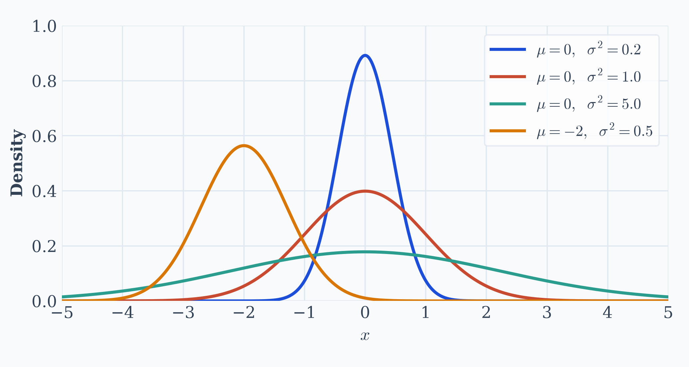

- Aside from gradient bandits ([Section 2.8](ch02-multi-armed-bandits.qmd#sec-ch02-2-8)), every control algorithm studied up to this point belongs to the family of **action-value methods**, which estimate action values first and derive a behavior rule indirectly (such as $\varepsilon$-greedy selection).
- **Policy gradient methods** flip that architecture: they optimize a **parametrized policy** directly so actions can be sampled without querying an action-value table or network at decision time.
- A learned value function is optional during action selection, though pairing a policy with a value estimator often accelerates parameter updates dramatically.
- Letting $\boldsymbol{\theta} \in \mathbb{R}^{d'}$ denote the policy parameter vector, the stochastic policy specifies the probability of picking action $a$ in state $s$:

$$\pi(a \vert s, \boldsymbol{\theta}) = \Pr\{A_t = a \vert S_t = s,\ \boldsymbol{\theta}_t = \boldsymbol{\theta}\}$$

- **Stochastic gradient ascent**: Given a scalar performance objective $J(\boldsymbol{\theta})$, policy gradient algorithms push $\boldsymbol{\theta}$ uphill along an unbiased (or approximately unbiased) stochastic estimate of its gradient:

$$\boldsymbol{\theta}_{t+1} = \boldsymbol{\theta}_t + \alpha \widehat{\nabla J(\boldsymbol{\theta}_t)}$$

$$
\begin{aligned}
\text{where} \\
\widehat{\nabla J(\boldsymbol{\theta}_t)} &\in \mathbb{R}^{d'} \equiv \text{a stochastic estimate whose expectation approximates} \\
&\phantom{{}\equiv{}} \text{the gradient of the performance measure } J \text{ w.r.t. } \boldsymbol{\theta}_t
\end{aligned}
$$

- **Actor-critic methods**: Algorithms that simultaneously learn both a parameterized policy and a parameterized value estimator:
  - **Actor**: The parameterized policy $\pi(a \vert s, \boldsymbol{\theta})$ responsible for choosing actions.
  - **Critic**: The learned state-value estimator $\hat{v}(s, \mathbf{w})$ that scores transitions to guide the actor's updates.

## Policy Approximation & Its Advantages {#sec-ch13-13-1}

- Any smooth parametric family can represent a policy, provided $\pi(a \vert s, \boldsymbol{\theta})$ is differentiable with finite partial derivatives everywhere in parameter space:

$$\nabla \pi(a \vert s, \boldsymbol{\theta}) \text{ exists and is finite for all } s \in S,\ a \in A(s),\ \boldsymbol{\theta} \in \mathbb{R}^{d'}$$

- **Softmax in action preferences**: For manageable discrete action spaces, a standard construction assigns a real-valued scalar preference $h(s, a, \boldsymbol{\theta}) \in \mathbb{R}$ to every state-action pair and maps those scores into probabilities through the exponential softmax transform:

$$\boxed{\pi(a \vert s, \boldsymbol{\theta}) \doteq \frac{e^{h(s,a,\boldsymbol{\theta})}}{\sum_b e^{h(s,b,\boldsymbol{\theta})}}}$$

- Action preferences themselves may come from a deep neural network or a simple linear feature model:

$$h(s, a, \boldsymbol{\theta}) = \boldsymbol{\theta}^T \mathbf{x}(s, a)$$

- **Key advantages of direct policy parametrization over $\varepsilon$-greedy value control**:
  - **Smooth convergence to determinism**: Preference gaps can grow arbitrarily large so the policy approaches a deterministic optimum asymptotically, whereas fixed $\varepsilon$-greedy policies always retain $\varepsilon$ exploratory noise.
  - **Arbitrary stochastic policies**: Some partially observable or adversarial tasks demand genuinely randomized optima (for instance, mixing bluffs in imperfect-information card games like poker), which deterministic greedy policies cannot express.
  - **Simpler functional form**: In many domains, the optimal decision boundary is far easier to represent directly than the exact numerical value of every state-action pair.
  - **Natural injection of domain knowledge**: Choosing the policy family directly lets engineers embed structural priors about reasonable control laws into the agent.

## The Policy Gradient Theorem {#sec-ch13-13-2}

- Because action probabilities vary smoothly with $\boldsymbol{\theta}$, small parameter nudges produce small policy shifts and smooth changes in state visitation, giving policy-gradient ascent stronger local convergence guarantees than value-based control where tiny value perturbations can abruptly flip greedy actions.
- In the **episodic setting**, we judge a policy $\pi_{\boldsymbol{\theta}}$ by the expected return achieved from a fixed starting state $s_0$:

$$J(\boldsymbol{\theta}) \doteq v_{\pi_{\boldsymbol{\theta}}}(s_0)$$

$$
\begin{aligned}
\text{where} \\
v_{\pi_{\boldsymbol{\theta}}} &\equiv \text{the true value function for } \pi_{\boldsymbol{\theta}}\text{, the policy determined by } \boldsymbol{\theta} \\
s_0 &\equiv \text{some non-random state}
\end{aligned}
$$

- **Core theoretical obstacle**: Perturbing $\boldsymbol{\theta}$ alters not only which actions are taken in each state, but also the resulting distribution of visited states across the MDP, which depends on unknown environment dynamics.
- **Policy gradient theorem**: Remarkably, the analytic ascent direction of $J(\boldsymbol{\theta})$ avoids differentiating state visitation frequencies altogether; for episodic tasks it takes the form:

$$\boxed{\nabla J(\boldsymbol{\theta}) \propto \sum_s \mu(s) \sum_a q_\pi(s,a)\, \nabla\pi(a \vert s, \boldsymbol{\theta})}$$

$$
\begin{aligned}
\text{where} \quad &\\
\nabla J(\boldsymbol{\theta}) &\equiv \text{column vectors of partial derivatives w.r.t. the components of } \boldsymbol{\theta} \\
\mu &\equiv \text{the on-policy distribution under the policy } \pi \\
&\phantom{{}\equiv{}} \text{(in the episodic case, proportionality constant is the average length of an episode;} \\
&\phantom{{}\equiv{}} \text{in the continuing case it is 1)}
\end{aligned}
$$



::: {.callout-note}
## Proof: Policy Gradient Theorem (Episodic Case) {#sec-ch13-proof-episodic}

We derive the episodic policy gradient theorem directly via the product rule and Bellman expansion.

**Notation:** Throughout this derivation, the dependence $\pi = \pi(\cdot \vert \cdot, \boldsymbol{\theta})$ and differentiation with respect to $\boldsymbol{\theta}$ are left implicit.

$$
\begin{aligned}
\nabla v_\pi(s) &= \nabla \!\left[\sum_a \pi(a \vert s)\, q_\pi(s,a)\right], \quad \text{for all } s \in \mathcal{S} \\
&= \sum_a \!\left[\nabla\pi(a \vert s)\, q_\pi(s,a) + \pi(a \vert s)\, \nabla q_\pi(s,a)\right] \\
&= \sum_a \!\left[\nabla\pi(a \vert s)\, q_\pi(s,a) + \pi(a \vert s)\, \nabla \sum_{s',r} p(s',r \vert s,a)\!\left(r + v_\pi(s')\right)\right] \\
&= \sum_a \!\left[\nabla\pi(a \vert s)\, q_\pi(s,a) + \pi(a \vert s) \sum_{s'} p(s' \vert s,a)\, \nabla v_\pi(s')\right] \\
&= \sum_a \Biggl[\nabla\pi(a \vert s)\, q_\pi(s,a) + \pi(a \vert s) \sum_{s'} p(s' \vert s,a) \sum_{a'} \Biggl[\nabla\pi(a' \vert s')\, q_\pi(s',a') \\
&\qquad\qquad + \pi(a' \vert s') \sum_{s''} p(s'' \vert s',a')\, \nabla v_\pi(s'')\Biggr]\Biggr]
\end{aligned}
$$

Repeatedly expanding $\nabla v_\pi(\cdot)$ across all future steps $k = 0, 1, 2, \dots$ collects multi-step transition probabilities:

$$\boxed{\nabla v_\pi(s) = \sum_{x \in \mathcal{S}} \sum_{k=0}^{\infty} \Pr(s \to x, k, \pi) \sum_a \nabla\pi(a \vert x)\, q_\pi(x,a)}$$

$$
\begin{aligned}
\Pr(s \to x, k, \pi) &\equiv \text{probability of transitioning from state } s \text{ to state } x \text{ in } k \text{ steps under policy } \pi
\end{aligned}
$$

Evaluating at the start state $s_0$ and normalizing expected visit counts $\eta(s)$ into the on-policy distribution $\mu(s)$ yields:

$$
\begin{aligned}
\nabla J(\boldsymbol{\theta}) &= \nabla v_\pi(s_0) \\
&= \sum_s \!\left(\sum_{k=0}^{\infty} \Pr(s_0 \to s, k, \pi)\right) \sum_a \nabla\pi(a \vert s)\, q_\pi(s,a) \\
&= \sum_s \eta(s) \sum_a \nabla\pi(a \vert s)\, q_\pi(s,a) \\
&= \sum_{s'} \eta(s') \sum_s \frac{\eta(s)}{\sum_{s'} \eta(s')} \sum_a \nabla\pi(a \vert s)\, q_\pi(s,a) \\
&= \sum_{s'} \eta(s') \sum_s \mu(s) \sum_a \nabla\pi(a \vert s)\, q_\pi(s,a)
\end{aligned}
$$

$$\boxed{\nabla J(\boldsymbol{\theta}) \propto \sum_s \mu(s) \sum_a \nabla\pi(a \vert s)\, q_\pi(s,a)}$$
:::

## REINFORCE: Monte Carlo Policy Gradient {#sec-ch13-13-3}

- **REINFORCE** turns the policy gradient theorem into a practical Monte Carlo optimization algorithm by constructing a per-step random vector whose expectation matches $\nabla J(\boldsymbol{\theta})$ up to a positive constant factor (any constant scale simply folds into the step size $\alpha$).
- Because the outer sum in the policy gradient theorem weights states by $\mu(s)$, it immediately rewrites as an on-policy expectation over visited states $S_t$:

$$
\begin{aligned}
\nabla J(\boldsymbol{\theta}) &\propto \sum_s \mu(s) \sum_a q_\pi(s,a)\, \nabla\pi(a \vert s, \boldsymbol{\theta}) \\
&= \mathbb{E}_\pi \!\left[\sum_a q_\pi(S_t, a)\, \nabla\pi(a \vert S_t, \boldsymbol{\theta})\right]
\end{aligned}
$$

- **Score-function (log-derivative) trick**: Multiplying and dividing inside the action sum by $\pi(a \vert S_t, \boldsymbol{\theta})$ converts the deterministic sum over all actions into an expectation over the sampled action $A_t \sim \pi$, and substituting the empirical return $G_t$ for its conditional expectation $q_\pi(S_t, A_t)$ gives an unbiased sample gradient:

$$
\begin{aligned}
\nabla J(\boldsymbol{\theta}) &\propto \mathbb{E}_\pi \!\left[\sum_a \pi(a \vert S_t, \boldsymbol{\theta})\, q_\pi(S_t, a)\, \frac{\nabla\pi(a \vert S_t, \boldsymbol{\theta})}{\pi(a \vert S_t, \boldsymbol{\theta})}\right] \\
&= \mathbb{E}_\pi \!\left[q_\pi(S_t, A_t)\, \frac{\nabla\pi(A_t \vert S_t, \boldsymbol{\theta})}{\pi(A_t \vert S_t, \boldsymbol{\theta})}\right] \quad \text{(replacing } a \text{ by the sample } A_t \sim \pi\text{)} \\
&= \mathbb{E}_\pi \!\left[G_t\, \frac{\nabla\pi(A_t \vert S_t, \boldsymbol{\theta})}{\pi(A_t \vert S_t, \boldsymbol{\theta})}\right] \quad \text{(because } \mathbb{E}_\pi[G_t \vert S_t, A_t] = q_\pi(S_t, A_t)\text{)}
\end{aligned}
$$

- Using the calculus identity $\nabla \ln \pi(A_t \vert S_t, \boldsymbol{\theta}) = \dfrac{\nabla \pi(A_t \vert S_t, \boldsymbol{\theta})}{\pi(A_t \vert S_t, \boldsymbol{\theta})}$ produces the **REINFORCE update rule**:

$$\boxed{\boldsymbol{\theta}_{t+1} \doteq \boldsymbol{\theta}_t + \alpha G_t \frac{\nabla\pi(A_t \vert S_t, \boldsymbol{\theta}_t)}{\pi(A_t \vert S_t, \boldsymbol{\theta}_t)}}$$

- **Intuition behind the step**:
  - $\nabla \pi(A_t \vert S_t, \boldsymbol{\theta}_t)$ points in parameter space toward increasing the likelihood of choosing $A_t$ again in state $S_t$.
  - Scaling by the observed return $G_t$ pushes parameters more strongly toward actions that led to lucrative outcomes.
  - Dividing by $\pi(A_t \vert S_t, \boldsymbol{\theta}_t)$ counteracts sampling frequency bias so common, mediocre actions do not drown out rarer, higher-paying alternatives.
- While REINFORCE enjoys sound asymptotic convergence as a stochastic gradient method, relying on complete Monte Carlo returns induces high variance and slow finite-sample learning.

### Implementation: REINFORCE (Episodic)

```python
import numpy as np


def reinforce(env, policy, theta_init, num_episodes, alpha, gamma=1.0):
    """Episodic Monte Carlo policy gradient ascent."""
    theta = np.array(theta_init, dtype=float, copy=True)

    for _ in range(num_episodes):
        trajectory, state, done = [], env.reset(), False
        while not done:
            action = policy.sample(state, theta)
            next_state, reward, done = env.step(action)
            trajectory.append((state, action, reward))
            state = next_state

        g_t, returns = 0.0, []
        for _, _, reward in reversed(trajectory):
            g_t = reward + gamma * g_t
            returns.append(g_t)

        discount = 1.0
        for (state, action, _), g_val in zip(trajectory, reversed(returns)):
            theta += alpha * discount * g_val * policy.grad_log_prob(state, action, theta)
            discount *= gamma

    return theta
```

## REINFORCE with Baseline {#sec-ch13-13-4}

- **Baseline subtraction**: The policy gradient theorem allows subtracting any action-independent **baseline** $b(s)$ from $q_\pi(s, a)$ without introducing bias:

$$\nabla J(\boldsymbol{\theta}) \propto \sum_s \mu(s) \sum_a \!\left[q_\pi(s,a) - b(s)\right] \nabla\pi(a \vert s, \boldsymbol{\theta})$$

- Because $b(s)$ does not vary with $a$, its contribution to the gradient expectation vanishes identically:

$$\sum_a b(s)\, \nabla\pi(a \vert s, \boldsymbol{\theta}) = b(s)\, \nabla \sum_a \pi(a \vert s, \boldsymbol{\theta}) = b(s)\, \nabla 1 = 0$$

- Incorporating $b(S_t)$ produces the **REINFORCE with baseline** update:

$$\boxed{\boldsymbol{\theta}_{t+1} \doteq \boldsymbol{\theta}_t + \alpha \!\left[G_t - b(S_t)\right] \frac{\nabla\pi(A_t \vert S_t, \boldsymbol{\theta}_t)}{\pi(A_t \vert S_t, \boldsymbol{\theta}_t)}}$$

- **Variance reduction**: Although the expected gradient remains identical, centering returns around a state-dependent baseline dramatically shrinks gradient variance and accelerates convergence.
- **Learned state-value baseline**: A natural choice is $b(S_t) = \hat{v}(S_t, \mathbf{w})$, where the value weights $\mathbf{w}$ are trained alongside $\boldsymbol{\theta}$ using Monte Carlo regression on the same episode returns.

### Implementation: REINFORCE with Baseline (Episodic)

```python
import numpy as np


def reinforce_with_baseline(
    env, policy, value_fn, theta_init, w_init, num_episodes, alpha_theta, alpha_w, gamma=1.0
):
    """Episodic REINFORCE using a learned state-value baseline."""
    theta = np.array(theta_init, dtype=float, copy=True)
    w = np.array(w_init, dtype=float, copy=True)

    for _ in range(num_episodes):
        trajectory, state, done = [], env.reset(), False
        while not done:
            action = policy.sample(state, theta)
            next_state, reward, done = env.step(action)
            trajectory.append((state, action, reward))
            state = next_state

        g_t, returns = 0.0, []
        for _, _, reward in reversed(trajectory):
            g_t = reward + gamma * g_t
            returns.append(g_t)

        discount = 1.0
        for (state, action, _), g_val in zip(trajectory, reversed(returns)):
            delta = g_val - value_fn.predict(state, w)
            w += alpha_w * delta * value_fn.grad(state, w)
            theta += alpha_theta * discount * delta * policy.grad_log_prob(state, action, theta)
            discount *= gamma

    return theta, w
```

- Adding a baseline introduces two separate learning rates, $\alpha^{\mathbf{w}}$ and $\alpha^{\boldsymbol{\theta}}$:
  - **Value step size ($\alpha^{\mathbf{w}}$)**: Straightforward to calibrate; for linear value features, a reliable heuristic (see [Section 9.6](ch09-on-policy-prediction-approximation.qmd#sec-ch09-9-6)) scales inversely with average squared feature norm:

$$\alpha^{\mathbf{w}} = \frac{0.1}{\mathbb{E}\!\left[\|\nabla \hat{v}(S_t, \mathbf{w})\|_\mu^2\right]}$$

  - **Policy step size ($\alpha^{\boldsymbol{\theta}}$)**: Harder to pick analytically because its ideal scale depends on both reward magnitudes and the curvature of the chosen policy parametrization.

## Actor-Critic Methods {#sec-ch13-13-5}

- **Baseline vs. critic**: Even though REINFORCE with baseline learns a state-value approximator $\hat{v}(s, \mathbf{w})$, it is *not* an actor-critic method. It queries $\hat{v}$ strictly at the origin state $S_t$ to establish an expectation prior to acting, rather than bootstrapping from the destination state $S_{t+1}$ to critique the action just executed.
- **True actor-critic architecture**: Applying $\hat{v}(S_{t+1}, \mathbf{w})$ to the transition's *next* state forms a bootstrapped return $G_{t:t+1} = R_{t+1} + \gamma \hat{v}(S_{t+1}, \mathbf{w})$, letting the learned value function actively judge whether action $A_t$ turned out better or worse than expected.
- Under this division of labor, the policy **actor** drives behavior while the value **critic** supplies low-variance TD feedback to refine both itself and the actor.

### One-Step Actor-Critic Methods {#sec-ch13-13-5-1}

- **One-step actor-critic**: Swaps the full Monte Carlo return $G_t$ in REINFORCE with baseline for the one-step bootstrapped return $G_{t:t+1}$, turning the advantage factor directly into the one-step TD error $\delta_t$:

$$
\begin{aligned}
\boldsymbol{\theta}_{t+1} &\doteq \boldsymbol{\theta}_t + \alpha \!\left[G_{t:t+1} - \hat{v}(S_t, \mathbf{w})\right] \frac{\nabla\pi(A_t \vert S_t, \boldsymbol{\theta}_t)}{\pi(A_t \vert S_t, \boldsymbol{\theta}_t)} \\
&= \boldsymbol{\theta}_t + \alpha \!\left[R_{t+1} + \gamma \hat{v}(S_{t+1}, \mathbf{w}) - \hat{v}(S_t, \mathbf{w})\right] \frac{\nabla\pi(A_t \vert S_t, \boldsymbol{\theta}_t)}{\pi(A_t \vert S_t, \boldsymbol{\theta}_t)} \\
&= \boldsymbol{\theta}_t + \alpha\, \delta_t\, \frac{\nabla\pi(A_t \vert S_t, \boldsymbol{\theta}_t)}{\pi(A_t \vert S_t, \boldsymbol{\theta}_t)}
\end{aligned}
$$

- Semi-gradient TD(0) pairs naturally as the critic learner, producing a fully online, step-by-step algorithm analogous to TD(0), Sarsa(0), and Q-learning.
- Bootstrapping introduces modest bias whenever the critic is imperfect, yet the substantial variance reduction usually speeds up learning markedly.

### Implementation: One-Step Actor-Critic (Episodic)

```python
import numpy as np


def one_step_actor_critic(
    env, policy, value_fn, theta_init, w_init, num_episodes, alpha_theta, alpha_w, gamma=1.0
):
    """Online episodic one-step actor-critic using TD(0) for the critic."""
    theta = np.array(theta_init, dtype=float, copy=True)
    w = np.array(w_init, dtype=float, copy=True)

    for _ in range(num_episodes):
        state = env.reset()
        discount = 1.0
        done = False

        while not done:
            action = policy.sample(state, theta)
            next_state, reward, done = env.step(action)
            v_next = 0.0 if done else value_fn.predict(next_state, w)
            delta = reward + gamma * v_next - value_fn.predict(state, w)

            w += alpha_w * delta * value_fn.grad(state, w)
            theta += alpha_theta * discount * delta * policy.grad_log_prob(state, action, theta)
            discount *= gamma
            state = next_state

    return theta, w
```

### Actor-Critic with Eligibility Traces {#sec-ch13-13-5-2}

- Just as one-step TD generalizes through $n$-step returns to TD($\lambda$), one-step actor-critic generalizes by replacing $G_{t:t+1}$ with an $n$-step target $G_{t:t+n}$ or a $\lambda$-return $G_t^\lambda$.
- **Dual eligibility traces**: In the online backward view, separate trace vectors $\mathbf{z}^{\mathbf{w}}$ and $\mathbf{z}^{\boldsymbol{\theta}}$ with independent decay rates $\lambda^{\mathbf{w}}, \lambda^{\boldsymbol{\theta}} \in [0, 1]$ propagate the single scalar TD error $\delta_t$ simultaneously through both the critic and the actor.

### Implementation: Actor-Critic with Eligibility Traces (Episodic)

```python
import numpy as np


def actor_critic_traces_episodic(
    env, policy, value_fn, theta_init, w_init, num_episodes,
    alpha_theta, alpha_w, lam_theta, lam_w, gamma=1.0,
):
    """Episodic actor-critic with separate actor and critic eligibility traces."""
    theta = np.array(theta_init, dtype=float, copy=True)
    w = np.array(w_init, dtype=float, copy=True)

    for _ in range(num_episodes):
        state, discount, done = env.reset(), 1.0, False
        z_theta, z_w = np.zeros_like(theta), np.zeros_like(w)

        while not done:
            action = policy.sample(state, theta)
            next_state, reward, done = env.step(action)
            v_next = 0.0 if done else value_fn.predict(next_state, w)
            delta = reward + gamma * v_next - value_fn.predict(state, w)

            z_w = gamma * lam_w * z_w + value_fn.grad(state, w)
            grad_log = policy.grad_log_prob(state, action, theta)
            z_theta = gamma * lam_theta * z_theta + discount * grad_log
            w += alpha_w * delta * z_w
            theta += alpha_theta * delta * z_theta
            discount *= gamma
            state = next_state

    return theta, w
```

## Policy Gradient for Continuing Problems {#sec-ch13-13-6}

- For continuing environments without episode resets ([Section 10.3](ch10-on-policy-control-approximation.qmd#sec-ch10-10-3)), performance is measured by the long-run **average reward per step** $r(\pi)$:

$$
\begin{aligned}
J(\boldsymbol{\theta}) \doteq r(\pi) &\doteq \lim_{h \to \infty} \frac{1}{h} \sum_{t=1}^{h} \mathbb{E}\!\left[R_t \vert S_0, A_{0:t-1} \sim \pi\right] \\
&= \lim_{t \to \infty} \mathbb{E}\!\left[R_t \vert S_0, A_{0:t-1} \sim \pi\right] \\
&= \sum_s \mu(s) \sum_a \pi(a \vert s) \sum_{s',r} p(s',r \vert s,a)\, r
\end{aligned}
$$

$$
\begin{aligned}
\text{where} \\
\mu(s) &\doteq \lim_{t \to \infty} \Pr\{S_t = s \vert A_{0:t} \sim \pi\} \equiv \text{steady state distribution under } \pi\text{,} \\
&\phantom{{}\doteq{}} \text{assumed to exist and be independent of } S_0 \textbf{ [ergodicity assumption]}
\end{aligned}
$$

$$\sum_s \mu(s) \sum_a \pi(a \vert s, \boldsymbol{\theta})\, p(s' \vert s,a) = \mu(s') \quad \text{for all } s' \in S \quad \text{(ergodicity)}$$

- **Differential return and values**: State and action values $v_\pi(s) \doteq \mathbb{E}_\pi[G_t \vert S_t = s]$ and $q_\pi(s, a) \doteq \mathbb{E}_\pi[G_t \vert S_t = s, A_t = a]$ are defined relative to the **differential return**, which subtracts the average reward $r(\pi)$ from every step:

$$G_t \doteq R_{t+1} - r(\pi) + R_{t+2} - r(\pi) + R_{t+3} - r(\pi) + \ldots$$



::: {.callout-note}
## Proof: Policy Gradient Theorem (Continuing Case) {#sec-ch13-proof-continuing}

```{=latex}
\small
```

Again leaving the parameter dependence $\pi = \pi(\cdot \vert \cdot, \boldsymbol{\theta})$ and differentiation with respect to $\boldsymbol{\theta}$ implicit, let $J(\boldsymbol{\theta}) = r(\pi)$ with $v_\pi$ and $q_\pi$ defined via the **differential return**.

$$
\begin{aligned}
\nabla v_\pi(s) &= \nabla \!\left[\sum_a \pi(a \vert s)\, q_\pi(s,a)\right], \quad \text{for all } s \in \mathcal{S} \\
&= \sum_a \!\left[\nabla\pi(a \vert s)\, q_\pi(s,a) + \pi(a \vert s)\, \nabla q_\pi(s,a)\right] \\
&= \sum_a \!\left[\nabla\pi(a \vert s)\, q_\pi(s,a) + \pi(a \vert s)\, \nabla \sum_{s',r} p(s',r \vert s,a)\!\left(r - r(\boldsymbol{\theta}) + v_\pi(s')\right)\right] \\
&= \sum_a \!\left[\nabla\pi(a \vert s)\, q_\pi(s,a) + \pi(a \vert s)\!\left[-\nabla r(\boldsymbol{\theta}) + \sum_{s'} p(s' \vert s,a)\, \nabla v_\pi(s')\right]\right]
\end{aligned}
$$

Isolating $\nabla r(\boldsymbol{\theta})$ gives an identity valid at every state $s \in \mathcal{S}$:

$$\nabla r(\boldsymbol{\theta}) = \sum_a \!\left[\nabla\pi(a \vert s)\, q_\pi(s,a) + \pi(a \vert s) \sum_{s'} p(s' \vert s,a)\, \nabla v_\pi(s')\right] - \nabla v_\pi(s)$$

Averaging both sides over the stationary distribution $\mu(s)$ (where $\sum_s \mu(s) = 1$) invokes stationarity to cancel the $\nabla v_\pi$ terms cleanly:

$$
\begin{aligned}
\nabla J(\boldsymbol{\theta}) &= \sum_s \mu(s) \left(\sum_a \left[\nabla\pi(a \vert s)\, q_\pi(s,a) + \pi(a \vert s) \sum_{s'} p(s' \vert s,a)\, \nabla v_\pi(s')\right] - \nabla v_\pi(s)\right) \\
&= \sum_s \mu(s) \sum_a \nabla\pi(a \vert s)\, q_\pi(s,a) \\
&\quad + \sum_{s'} \underbrace{\sum_s \mu(s) \sum_a \pi(a \vert s)\, p(s' \vert s,a)}_{\mu(s')} \nabla v_\pi(s') - \sum_s \mu(s)\, \nabla v_\pi(s) \\
&= \sum_s \mu(s) \sum_a \nabla\pi(a \vert s)\, q_\pi(s,a) + \sum_{s'} \mu(s')\, \nabla v_\pi(s') - \sum_s \mu(s)\, \nabla v_\pi(s) \\
&= \sum_s \mu(s) \sum_a \nabla\pi(a \vert s)\, q_\pi(s,a) \qquad \text{Q.E.D.}
\end{aligned}
$$
:::

### Implementation: Actor-Critic with Eligibility Traces (Continuing)

```python
import numpy as np


def actor_critic_traces_continuing(
    env, policy, value_fn, theta_init, w_init, num_steps,
    alpha_theta, alpha_w, alpha_r, lam_theta, lam_w,
):
    """Continuing-task average-reward actor-critic with eligibility traces."""
    theta = np.array(theta_init, dtype=float, copy=True)
    w = np.array(w_init, dtype=float, copy=True)
    z_theta, z_w = np.zeros_like(theta), np.zeros_like(w)
    avg_reward, state = 0.0, env.reset()

    for _ in range(num_steps):
        action = policy.sample(state, theta)
        next_state, reward = env.step(action)[:2]
        v_s = value_fn.predict(state, w)
        delta = reward - avg_reward + value_fn.predict(next_state, w) - v_s
        avg_reward += alpha_r * delta

        z_w = lam_w * z_w + value_fn.grad(state, w)
        z_theta = lam_theta * z_theta + policy.grad_log_prob(state, action, theta)
        w += alpha_w * delta * z_w
        theta += alpha_theta * delta * z_theta
        state = next_state

    return theta, w, avg_reward
```

## Policy Parametrization for Continuous Actions {#sec-ch13-13-7}

- **Continuous action spaces**: Rather than enumerating probabilities for every discrete choice, policy gradient methods scale effortlessly to continuous control by outputting the parameters of a continuous probability density.
- **Gaussian (normal) density**: For scalar continuous controls, a classic parametric choice draws actions according to the bell-shaped Gaussian curve characterized by center $\mu$ and spread $\sigma > 0$:

$$p(x) \doteq \frac{1}{\sigma\sqrt{2\pi}} \exp\!\left(-\frac{(x-\mu)^2}{2\sigma^2}\right)$$

$$
\begin{aligned}
\text{where} \\
\mu &\equiv \text{mean of the normal distribution} \\
\sigma &\equiv \text{standard deviation of the normal distribution}
\end{aligned}
$$

::: {#fig-ch13-13-7-pdf}
{width=85% fig-align="center" fig-alt="Plot of normal probability density curves illustrating how mean mu shifts center and standard deviation sigma controls spread."}

**Gaussian probability density functions.** Continuous action policies parametrize the mean $\mu$ and standard deviation $\sigma$, shifting location and controlling exploration spread.
:::

- **Density vs. probability**: The value $p(x)$ represents probability *density* rather than a probability mass; it can exceed $1$ for narrow curves, while its integral over $(-\infty, \infty)$ equals $1$, and integrating $p(x)$ over an interval gives the probability of sampling an action inside that interval (@fig-ch13-13-7-pdf).
- **Gaussian policy parametrization**: Making both location and scale state-dependent parametric functions yields a differentiable continuous policy:

$$\pi(a \vert s, \boldsymbol{\theta}) \doteq \frac{1}{\sigma(s, \boldsymbol{\theta})\sqrt{2\pi}} \exp\!\left(-\frac{(a - \mu(s, \boldsymbol{\theta}))^2}{2\sigma(s, \boldsymbol{\theta})^2}\right)$$

$$
\begin{aligned}
\text{where} \\
\mu &: S \times \mathbb{R}^{d'} \to \mathbb{R} \equiv \text{mean function approximator} \\
\sigma &: S \times \mathbb{R}^{d'} \to \mathbb{R}^{+} \equiv \text{standard deviation function approximator}
\end{aligned}
$$

- **Split parameter vector**: Partitioning $\boldsymbol{\theta} = [\boldsymbol{\theta}_{\mu}, \boldsymbol{\theta}_{\sigma}]^T$ separates mean estimation from spread control. A common linear-feature choice models $\mu$ directly as an inner product while exponentiating a linear score for $\sigma$ to enforce positivity strictly:

$$
\begin{aligned}
\mu(s, \boldsymbol{\theta}) &\doteq \boldsymbol{\theta}_\mu^T \mathbf{x}_\mu(s) \\
\sigma(s, \boldsymbol{\theta}) &\doteq \exp\!\left(\boldsymbol{\theta}_\sigma^T \mathbf{x}_\sigma(s)\right)
\end{aligned}
$$

## Summary {#sec-ch13-13-8}

- **Direct policy optimization**: Policy gradient algorithms learn a differentiable policy $\pi(a \mid s, \boldsymbol{\theta})$ directly by ascending stochastic estimates of $\nabla J(\boldsymbol{\theta})$, avoiding indirect action-value argmax steps during execution.
- **Advantages over value-based control**: Smooth policy families naturally express stochastic optima, anneal seamlessly toward deterministic control, generalize directly to continuous action spaces via parametric densities, and enjoy stronger local convergence properties through the **policy gradient theorem**.
- **REINFORCE and baselines**: Combining the policy gradient theorem with full Monte Carlo returns yields REINFORCE; subtracting a learned state-value **baseline** preserves unbiasedness while cutting gradient variance sharply.
- **Actor-critic methods**: Using a learned state-value **critic** to bootstrap from successor states evaluates actions online at every step; trading a small amount of approximation bias for steep variance reduction typically accelerates learning just as TD improves on Monte Carlo, and extends cleanly to eligibility traces and average-reward continuing tasks.
