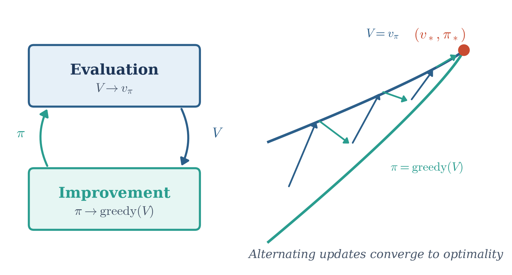
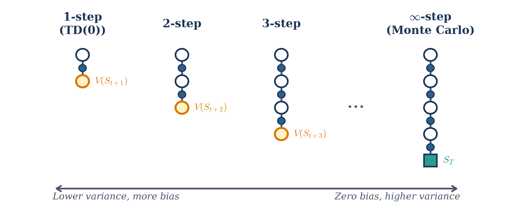
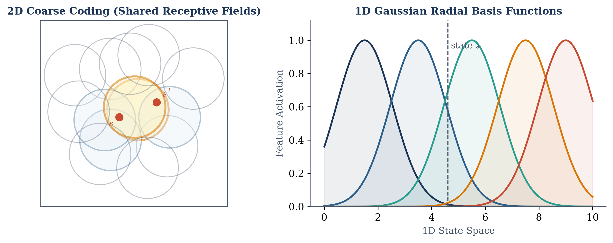
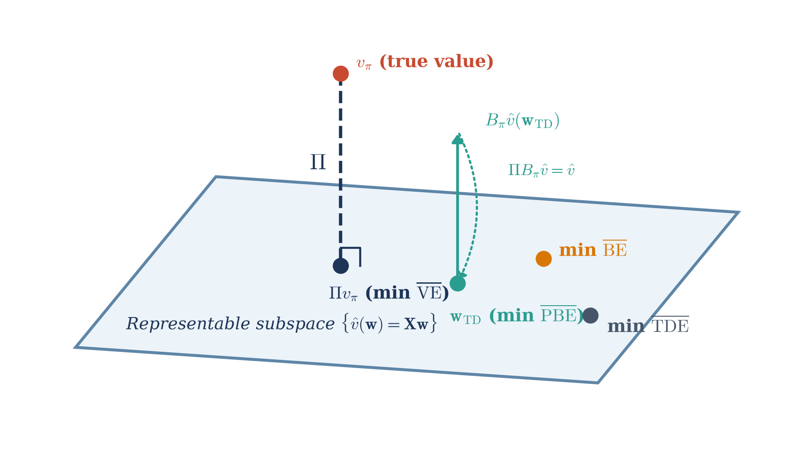
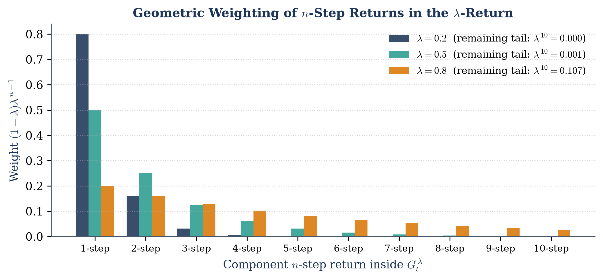

::: {.content-visible when-format="html" unless-format="epub"}

Every original diagram generated programmatically for these notes (`scripts/make-figures.py` and `scripts/make-fig-13-1.py`), numbered as it appears in the book (`chapter.figure`).

## Chapter 03 · Finite Markov Decision Processes {.unnumbered}

  <figure>
    <a class="gallery-link" href="chapters/ch03-finite-mdps.html#fig-31" title="Open Figure 3.1 in Chapter 3"><picture><source srcset="figures/webp/ch03-mdp-loop.webp" type="image/webp" /></picture></a>
    <figcaption><a class="fignum" href="chapters/ch03-finite-mdps.html#fig-31" title="Open Figure 3.1 in Chapter 3">Figure 3.1</a>: Agent-environment interaction loop.</figcaption>
  </figure>

## Chapter 04 · Dynamic Programming {.unnumbered}

  <figure>
    <a class="gallery-link" href="chapters/ch04-dynamic-programming.html#fig-41" title="Open Figure 4.1 in Chapter 4"><picture><source srcset="figures/webp/ch04-gpi-loop.webp" type="image/webp" /></picture></a>
    <figcaption><a class="fignum" href="chapters/ch04-dynamic-programming.html#fig-41" title="Open Figure 4.1 in Chapter 4">Figure 4.1</a>: Generalized Policy Iteration (GPI).</figcaption>
  </figure>

## Chapter 06 · Temporal-Difference Learning {.unnumbered}

  <figure>
    <a class="gallery-link" href="chapters/ch06-temporal-difference.html#fig-61" title="Open Figure 6.1 in Chapter 6"><picture><source srcset="figures/webp/ch06-td-backups.webp" type="image/webp" /></picture></a>
    <figcaption><a class="fignum" href="chapters/ch06-temporal-difference.html#fig-61" title="Open Figure 6.1 in Chapter 6">Figure 6.1</a>: One-step TD backup schematics.</figcaption>
  </figure>

## Chapter 07 · n-step Bootstrapping {.unnumbered}

  <figure>
    <a class="gallery-link" href="chapters/ch07-nstep-bootstrapping.html#fig-71" title="Open Figure 7.1 in Chapter 7"><picture><source srcset="figures/webp/ch07-nstep-spectrum.webp" type="image/webp" /></picture></a>
    <figcaption><a class="fignum" href="chapters/ch07-nstep-bootstrapping.html#fig-71" title="Open Figure 7.1 in Chapter 7">Figure 7.1</a>: Spectrum of $n$-step returns.</figcaption>
  </figure>

## Chapter 08 · Planning & Learning with Tabular Methods {.unnumbered}

  <figure>
    <a class="gallery-link" href="chapters/ch08-planning-learning.html#fig-81" title="Open Figure 8.1 in Chapter 8"><picture><source srcset="figures/webp/ch08-dyna-unified.webp" type="image/webp" /></picture></a>
    <figcaption><a class="fignum" href="chapters/ch08-planning-learning.html#fig-81" title="Open Figure 8.1 in Chapter 8">Figure 8.1</a>: Dyna architecture and the two-dimensional RL update space.</figcaption>
  </figure>

## Chapter 09 · On-Policy Prediction with Approximation {.unnumbered}

  <figure>
    <a class="gallery-link" href="chapters/ch09-on-policy-prediction-approximation.html#fig-91" title="Open Figure 9.1 in Chapter 9"><picture><source srcset="figures/webp/ch09-coarse-rbf.webp" type="image/webp" /></picture></a>
    <figcaption><a class="fignum" href="chapters/ch09-on-policy-prediction-approximation.html#fig-91" title="Open Figure 9.1 in Chapter 9">Figure 9.1</a>: Coarse coding and 1D radial basis functions.</figcaption>
  </figure>

## Chapter 11 · Off-Policy Methods with Approximation {.unnumbered}

  <figure>
    <a class="gallery-link" href="chapters/ch11-off-policy-methods-approximation.html#fig-114" title="Open Figure 11.1 in Chapter 11"><picture><source srcset="figures/webp/ch11-linear-projection.webp" type="image/webp" /></picture></a>
    <figcaption><a class="fignum" href="chapters/ch11-off-policy-methods-approximation.html#fig-114" title="Open Figure 11.1 in Chapter 11">Figure 11.1</a>: Geometry of linear value-function approximation.</figcaption>
  </figure>

## Chapter 12 · Eligibility Traces {.unnumbered}

  <figure>
    <a class="gallery-link" href="chapters/ch12-eligibility-traces.html#fig-ch12-12-1-weighting" title="Open Figure 12.1 in Chapter 12"><picture><source srcset="figures/webp/ch12-lambda-weights.webp" type="image/webp" /></picture></a>
    <figcaption><a class="fignum" href="chapters/ch12-eligibility-traces.html#fig-ch12-12-1-weighting" title="Open Figure 12.1 in Chapter 12">Figure 12.1</a>: Geometric weighting in the $\lambda$-return.</figcaption>
  </figure>

## Chapter 13 · Policy Gradient Methods {.unnumbered}

  <figure>
    <a class="gallery-link" href="chapters/ch13-policy-gradient-methods.html#fig-ch13-13-7-pdf" title="Open Figure 13.1 in Chapter 13"><picture><source srcset="figures/webp/ch13-13-7-prob-density-function.webp" type="image/webp" /></picture></a>
    <figcaption><a class="fignum" href="chapters/ch13-policy-gradient-methods.html#fig-ch13-13-7-pdf" title="Open Figure 13.1 in Chapter 13">Figure 13.1</a>: Gaussian probability density functions.</figcaption>
  </figure>

:::

::: {.content-visible when-format="epub"}

Every diagram redrawn for these notes, numbered as it appears in the book (chapter.figure), with the caption used next to it in the text.

{fig-alt="Agent-environment interaction loop showing action A_t sent to environment and next state S_{t+1} and reward R_{t+1} returned."}

**Figure 3.1**: Agent-environment interaction loop.

{fig-alt="Generalized Policy Iteration diagram showing evaluation and improvement driving estimates toward optimal v_* and pi_*."}

**Figure 4.1**: Generalized Policy Iteration (GPI).

{fig-alt="Side-by-side one-step backup schematics for TD(0), Sarsa, Q-learning, and Expected Sarsa."}

**Figure 6.1**: One-step TD backup schematics.

{fig-alt="Diagram illustrating n-step returns spanning 1-step TD(0) through finite n-step bootstrapping to full-episode Monte Carlo."}

**Figure 7.1**: Spectrum of $n$-step returns.

{fig-alt="Two-panel schematic: Dyna learning and planning cycle on the left, and the two-dimensional width-versus-depth RL update space on the right."}

**Figure 8.1**: Dyna architecture and the two-dimensional RL update space.

{fig-alt="Two-panel feature plot: 2D overlapping circular coarse-coding receptive fields on the left and 1D Gaussian radial basis functions on the right."}

**Figure 9.1**: Coarse coding and 1D radial basis functions.

{fig-alt="Geometric diagram of linear value-function approximation showing v_pi projected onto the linear subspace alongside VE, PBE, BE, and TDE solutions."}

**Figure 11.1**: Geometry of linear value-function approximation.

{fig-alt="Bar chart comparing geometric lambda-return weights (1-lambda)*lambda^(n-1) across 1-step to 10-step returns for lambda = 0.2, 0.5, and 0.8."}

**Figure 12.1**: Geometric weighting in the $\lambda$-return.

{fig-alt="Plot of normal probability density curves illustrating how mean mu shifts center and standard deviation sigma controls spread."}

**Figure 13.1**: Gaussian probability density functions.

:::

::: {.content-visible when-format="pdf"}

All 9 original figures in these notes, listed by chapter and numbered as they appear in the text.

| Chapter | Figures |
|:--:|:--|
| 3 | Finite Markov Decision Processes: 3.1 |
| 4 | Dynamic Programming: 4.1 |
| 6 | Temporal-Difference Learning: 6.1 |
| 7 | n-step Bootstrapping: 7.1 |
| 8 | Planning & Learning with Tabular Methods: 8.1 |
| 9 | On-Policy Prediction with Approximation: 9.1 |
| 11 | Off-Policy Methods with Approximation: 11.1 |
| 12 | Eligibility Traces: 12.1 |
| 13 | Policy Gradient Methods: 13.1 |

:::
