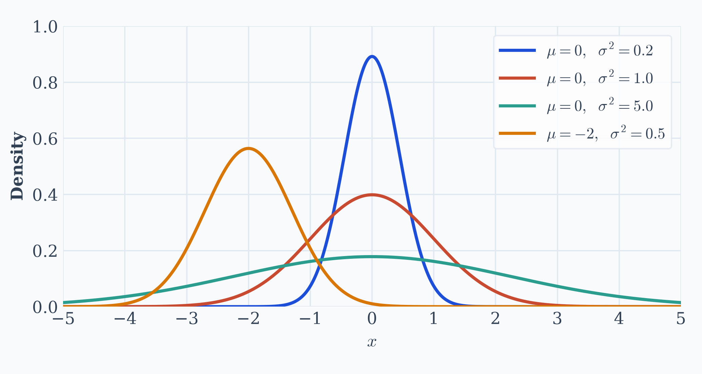

::: {.content-visible when-format="html" unless-format="epub"}

Every diagram redrawn for these notes, numbered as it appears in the book (chapter.figure), with the caption used next to it in the text.

## Chapter 03 · Finite Markov Decision Processes {.unnumbered}

  <figure>
    <a class="gallery-link" href="chapters/ch03-finite-mdps.html#fig-31" title="Open Figure 3.1 in Chapter 3"><picture><source srcset="figures/webp/ch03-3-1.webp" type="image/webp" /></picture></a>
    <figcaption><a class="fignum" href="chapters/ch03-finite-mdps.html#fig-31" title="Open Figure 3.1 in Chapter 3">Figure 3.1</a> — The agent-environment interaction in an MDP.</figcaption>
  </figure>
  <figure>
    <a class="gallery-link" href="chapters/ch03-finite-mdps.html#fig-32" title="Open Figure 3.2 in Chapter 3"><picture><source srcset="figures/webp/ch03-3-5-v-pi.webp" type="image/webp" /></picture></a>
    <figcaption><a class="fignum" href="chapters/ch03-finite-mdps.html#fig-32" title="Open Figure 3.2 in Chapter 3">Figure 3.2</a> — Backup Diagram for vπ.</figcaption>
  </figure>
  <figure>
    <a class="gallery-link" href="chapters/ch03-finite-mdps.html#fig-33" title="Open Figure 3.3 in Chapter 3"><picture><source srcset="figures/webp/ch03-3-6-v-q-optimal.webp" type="image/webp" /></picture></a>
    <figcaption><a class="fignum" href="chapters/ch03-finite-mdps.html#fig-33" title="Open Figure 3.3 in Chapter 3">Figure 3.3</a> — Backup Diagrams for v&#42; and q&#42;.</figcaption>
  </figure>

## Chapter 04 · Dynamic Programming {.unnumbered}

  <figure>
    <a class="gallery-link" href="chapters/ch04-dynamic-programming.html#fig-41" title="Open Figure 4.1 in Chapter 4"><picture><source srcset="figures/webp/ch04-4-6-GPI.webp" type="image/webp" /></picture></a>
    <figcaption><a class="fignum" href="chapters/ch04-dynamic-programming.html#fig-41" title="Open Figure 4.1 in Chapter 4">Figure 4.1</a> — Generalized Policy Iteration.</figcaption>
  </figure>

## Chapter 05 · Monte Carlo Methods {.unnumbered}

  <figure>
    <a class="gallery-link" href="chapters/ch05-monte-carlo.html#fig-51" title="Open Figure 5.1 in Chapter 5"><picture><source srcset="figures/webp/ch05-5-3-q-gpi.webp" type="image/webp" /></picture></a>
    <figcaption><a class="fignum" href="chapters/ch05-monte-carlo.html#fig-51" title="Open Figure 5.1 in Chapter 5">Figure 5.1</a> — Generalized Policy Iteration.</figcaption>
  </figure>

## Chapter 06 · Temporal-Difference Learning {.unnumbered}

  <figure>
    <a class="gallery-link" href="chapters/ch06-temporal-difference.html#fig-61" title="Open Figure 6.1 in Chapter 6"><picture><source srcset="figures/webp/ch06-6-1-td0.webp" type="image/webp" /></picture></a>
    <figcaption><a class="fignum" href="chapters/ch06-temporal-difference.html#fig-61" title="Open Figure 6.1 in Chapter 6">Figure 6.1</a> — Backup diagram for TD(0).</figcaption>
  </figure>
  <figure>
    <a class="gallery-link" href="chapters/ch06-temporal-difference.html#fig-62" title="Open Figure 6.2 in Chapter 6"><picture><source srcset="figures/webp/ch06-6-4-episode.webp" type="image/webp" /></picture></a>
    <figcaption><a class="fignum" href="chapters/ch06-temporal-difference.html#fig-62" title="Open Figure 6.2 in Chapter 6">Figure 6.2</a> — An episode.</figcaption>
  </figure>
  <figure>
    <a class="gallery-link" href="chapters/ch06-temporal-difference.html#fig-63" title="Open Figure 6.3 in Chapter 6"><picture><source srcset="figures/webp/ch06-6-4-sarsa.webp" type="image/webp" /></picture></a>
    <figcaption><a class="fignum" href="chapters/ch06-temporal-difference.html#fig-63" title="Open Figure 6.3 in Chapter 6">Figure 6.3</a> — Backup diagram for SARSA.</figcaption>
  </figure>
  <figure>
    <a class="gallery-link" href="chapters/ch06-temporal-difference.html#fig-64" title="Open Figure 6.4 in Chapter 6"><picture><source srcset="figures/webp/ch06-6-4-policy-iteration.webp" type="image/webp" /></picture></a>
    <figcaption><a class="fignum" href="chapters/ch06-temporal-difference.html#fig-64" title="Open Figure 6.4 in Chapter 6">Figure 6.4</a> — SARSA control.</figcaption>
  </figure>
  <figure>
    <a class="gallery-link" href="chapters/ch06-temporal-difference.html#fig-65" title="Open Figure 6.5 in Chapter 6"><picture><source srcset="figures/webp/ch06-6-5-q-learning.webp" type="image/webp" /></picture></a>
    <figcaption><a class="fignum" href="chapters/ch06-temporal-difference.html#fig-65" title="Open Figure 6.5 in Chapter 6">Figure 6.5</a> — Backup diagram for Q-Learning.</figcaption>
  </figure>

## Chapter 07 · n-step Bootstrapping {.unnumbered}

  <figure>
    <a class="gallery-link" href="chapters/ch07-nstep-bootstrapping.html#fig-71" title="Open Figure 7.1 in Chapter 7"><picture><source srcset="figures/webp/ch07-7-1-n-step-td.webp" type="image/webp" /></picture></a>
    <figcaption><a class="fignum" href="chapters/ch07-nstep-bootstrapping.html#fig-71" title="Open Figure 7.1 in Chapter 7">Figure 7.1</a> — Backup diagrams for n-step methods.</figcaption>
  </figure>
  <figure>
    <a class="gallery-link" href="chapters/ch07-nstep-bootstrapping.html#fig-72" title="Open Figure 7.2 in Chapter 7"><picture><source srcset="figures/webp/ch07-7-2-n-step-sarsa.webp" type="image/webp" /></picture></a>
    <figcaption><a class="fignum" href="chapters/ch07-nstep-bootstrapping.html#fig-72" title="Open Figure 7.2 in Chapter 7">Figure 7.2</a> — Backup diagrams for n-step SARSA methods.</figcaption>
  </figure>
  <figure>
    <a class="gallery-link" href="chapters/ch07-nstep-bootstrapping.html#fig-73" title="Open Figure 7.3 in Chapter 7"><picture><source srcset="figures/webp/ch07-7-5-n-step-tree.webp" type="image/webp" /></picture></a>
    <figcaption><a class="fignum" href="chapters/ch07-nstep-bootstrapping.html#fig-73" title="Open Figure 7.3 in Chapter 7">Figure 7.3</a> — The 3-step tree-backup update.</figcaption>
  </figure>
  <figure>
    <a class="gallery-link" href="chapters/ch07-nstep-bootstrapping.html#fig-74" title="Open Figure 7.4 in Chapter 7"><picture><source srcset="figures/webp/ch07-7-6-n-step-q.webp" type="image/webp" /></picture></a>
    <figcaption><a class="fignum" href="chapters/ch07-nstep-bootstrapping.html#fig-74" title="Open Figure 7.4 in Chapter 7">Figure 7.4</a> — Backup diagram for different kinds of n-step Q updates.</figcaption>
  </figure>
  <figure>
    <a class="gallery-link" href="chapters/ch07-nstep-bootstrapping.html#fig-75" title="Open Figure 7.5 in Chapter 7"><picture><source srcset="figures/webp/ch07-7-7-n-step-td-q.webp" type="image/webp" /></picture></a>
    <figcaption><a class="fignum" href="chapters/ch07-nstep-bootstrapping.html#fig-75" title="Open Figure 7.5 in Chapter 7">Figure 7.5</a> — Backup diagram for 4-step TD & 4-step Q update.</figcaption>
  </figure>

## Chapter 08 · Planning & Learning with Tabular Methods {.unnumbered}

  <figure>
    <a class="gallery-link" href="chapters/ch08-planning-learning.html#fig-81" title="Open Figure 8.1 in Chapter 8"><picture><source srcset="figures/webp/ch08-8-2-title.webp" type="image/webp" /></picture></a>
    <figcaption><a class="fignum" href="chapters/ch08-planning-learning.html#fig-81" title="Open Figure 8.1 in Chapter 8">Figure 8.1</a> — Dyna-Q interactions and general Dyna architecture.</figcaption>
  </figure>
  <figure>
    <a class="gallery-link" href="chapters/ch08-planning-learning.html#fig-82" title="Open Figure 8.2 in Chapter 8"><picture><source srcset="figures/webp/ch08-8-5-one-step.webp" type="image/webp" /></picture></a>
    <figcaption><a class="fignum" href="chapters/ch08-planning-learning.html#fig-82" title="Open Figure 8.2 in Chapter 8">Figure 8.2</a> — Backup diagrams for all the one-step updates covered so far.</figcaption>
  </figure>
  <figure>
    <a class="gallery-link" href="chapters/ch08-planning-learning.html#fig-83" title="Open Figure 8.3 in Chapter 8"><picture><source srcset="figures/webp/ch08-8-7-rtdp.webp" type="image/webp" /></picture></a>
    <figcaption><a class="fignum" href="chapters/ch08-planning-learning.html#fig-83" title="Open Figure 8.3 in Chapter 8">Figure 8.3</a> — Real-time Dynamic Programming (State space).</figcaption>
  </figure>
  <figure>
    <a class="gallery-link" href="chapters/ch08-planning-learning.html#fig-84" title="Open Figure 8.4 in Chapter 8"><picture><source srcset="figures/webp/ch08-8-9-heuristic-search.webp" type="image/webp" /></picture></a>
    <figcaption><a class="fignum" href="chapters/ch08-planning-learning.html#fig-84" title="Open Figure 8.4 in Chapter 8">Figure 8.4</a> — Heuristic search.</figcaption>
  </figure>
  <figure>
    <a class="gallery-link" href="chapters/ch08-planning-learning.html#fig-85" title="Open Figure 8.5 in Chapter 8"><picture><source srcset="figures/webp/ch08-8-11-mcts.webp" type="image/webp" /></picture></a>
    <figcaption><a class="fignum" href="chapters/ch08-planning-learning.html#fig-85" title="Open Figure 8.5 in Chapter 8">Figure 8.5</a> — Monte-Carlo Tree Search (MCTS).</figcaption>
  </figure>
  <figure>
    <a class="gallery-link" href="chapters/ch08-planning-learning.html#fig-86" title="Open Figure 8.6 in Chapter 8"><picture><source srcset="figures/webp/ch08-8-13-summary-unified-rl.webp" type="image/webp" /></picture></a>
    <figcaption><a class="fignum" href="chapters/ch08-planning-learning.html#fig-86" title="Open Figure 8.6 in Chapter 8">Figure 8.6</a> — Unified view of RL depicting a slice through the space of RL methods.</figcaption>
  </figure>

## Chapter 09 · On-Policy Prediction with Approximation {.unnumbered}

  <figure>
    <a class="gallery-link" href="chapters/ch09-on-policy-prediction-approximation.html#fig-91" title="Open Figure 9.1 in Chapter 9"><picture><source srcset="figures/webp/ch09-9-5-3-coarse-coding.webp" type="image/webp" /></picture></a>
    <figcaption><a class="fignum" href="chapters/ch09-on-policy-prediction-approximation.html#fig-91" title="Open Figure 9.1 in Chapter 9">Figure 9.1</a> — Coarse coding.</figcaption>
  </figure>
  <figure>
    <a class="gallery-link" href="chapters/ch09-on-policy-prediction-approximation.html#fig-92" title="Open Figure 9.2 in Chapter 9"><picture><source srcset="figures/webp/ch09-9-5-4-hashing-border.webp" type="image/webp" /></picture></a>
    <figcaption><a class="fignum" href="chapters/ch09-on-policy-prediction-approximation.html#fig-92" title="Open Figure 9.2 in Chapter 9">Figure 9.2</a> — Hashing.</figcaption>
  </figure>
  <figure>
    <a class="gallery-link" href="chapters/ch09-on-policy-prediction-approximation.html#fig-93" title="Open Figure 9.3 in Chapter 9"><picture><source srcset="figures/webp/ch09-9-5-5-1dim-rbf.webp" type="image/webp" /></picture></a>
    <figcaption><a class="fignum" href="chapters/ch09-on-policy-prediction-approximation.html#fig-93" title="Open Figure 9.3 in Chapter 9">Figure 9.3</a> — 1-D Radial Basis Function.</figcaption>
  </figure>
  <figure>
    <a class="gallery-link" href="chapters/ch09-on-policy-prediction-approximation.html#fig-94" title="Open Figure 9.4 in Chapter 9"><picture><source srcset="figures/webp/ch09-9-7-ann.webp" type="image/webp" /></picture></a>
    <figcaption><a class="fignum" href="chapters/ch09-on-policy-prediction-approximation.html#fig-94" title="Open Figure 9.4 in Chapter 9">Figure 9.4</a> — Generic ANN.</figcaption>
  </figure>

## Chapter 11 · Off-Policy Methods with Approximation {.unnumbered}

  <figure>
    <a class="gallery-link" href="chapters/ch11-off-policy-methods-approximation.html#fig-111" title="Open Figure 11.1 in Chapter 11"><picture><source srcset="figures/webp/ch11-11-2-example1.webp" type="image/webp" /></picture></a>
    <figcaption><a class="fignum" href="chapters/ch11-off-policy-methods-approximation.html#fig-111" title="Open Figure 11.1 in Chapter 11">Figure 11.1</a> — Simple Counterexample.</figcaption>
  </figure>
  <figure>
    <a class="gallery-link" href="chapters/ch11-off-policy-methods-approximation.html#fig-112" title="Open Figure 11.2 in Chapter 11"><picture><source srcset="figures/webp/ch11-11-2-bairds-counterexample.webp" type="image/webp" /></picture></a>
    <figcaption><a class="fignum" href="chapters/ch11-off-policy-methods-approximation.html#fig-112" title="Open Figure 11.2 in Chapter 11">Figure 11.2</a> — Baird's Counterexample.</figcaption>
  </figure>
  <figure>
    <a class="gallery-link" href="chapters/ch11-off-policy-methods-approximation.html#fig-113" title="Open Figure 11.3 in Chapter 11"><picture><source srcset="figures/webp/ch11-11-2-tsitsiklis-van-roy-counterexample.webp" type="image/webp" /></picture></a>
    <figcaption><a class="fignum" href="chapters/ch11-off-policy-methods-approximation.html#fig-113" title="Open Figure 11.3 in Chapter 11">Figure 11.3</a> — Tsitsiklis & Van Roy's Counterexample.</figcaption>
  </figure>
  <figure>
    <a class="gallery-link" href="chapters/ch11-off-policy-methods-approximation.html#fig-114" title="Open Figure 11.4 in Chapter 11"><picture><source srcset="figures/webp/ch11-11-4-linear-value-func-approx-geometry.webp" type="image/webp" /></picture></a>
    <figcaption><a class="fignum" href="chapters/ch11-off-policy-methods-approximation.html#fig-114" title="Open Figure 11.4 in Chapter 11">Figure 11.4</a> — The Geometry of Linear Value-Function Approximation.</figcaption>
  </figure>
  <figure>
    <a class="gallery-link" href="chapters/ch11-off-policy-methods-approximation.html#fig-115" title="Open Figure 11.5 in Chapter 11"><picture><source srcset="figures/webp/ch11-11-6-example1.webp" type="image/webp" /></picture></a>
    <figcaption><a class="fignum" href="chapters/ch11-off-policy-methods-approximation.html#fig-115" title="Open Figure 11.5 in Chapter 11">Figure 11.5</a> — Value Error (VE) Learnability Counterexample.</figcaption>
  </figure>
  <figure>
    <a class="gallery-link" href="chapters/ch11-off-policy-methods-approximation.html#fig-116" title="Open Figure 11.6 in Chapter 11"><picture><source srcset="figures/webp/ch11-11-6-example2.webp" type="image/webp" /></picture></a>
    <figcaption><a class="fignum" href="chapters/ch11-off-policy-methods-approximation.html#fig-116" title="Open Figure 11.6 in Chapter 11">Figure 11.6</a> — Bellman Error (BE) Learnability Counterexample.</figcaption>
  </figure>
  <figure>
    <a class="gallery-link" href="chapters/ch11-off-policy-methods-approximation.html#fig-117" title="Open Figure 11.7 in Chapter 11"><picture><source srcset="figures/webp/ch11-11-6-causal-relationships-mdps-datadistr-errors.webp" type="image/webp" /></picture></a>
    <figcaption><a class="fignum" href="chapters/ch11-off-policy-methods-approximation.html#fig-117" title="Open Figure 11.7 in Chapter 11">Figure 11.7</a> — Causal Relationships among the data distribution, MDPs & various objectives.</figcaption>
  </figure>

## Chapter 12 · Eligibility Traces {.unnumbered}

  <figure>
    <a class="gallery-link" href="chapters/ch12-eligibility-traces.html#fig-ch12-12-1-compound" title="Open Figure 12.1 in Chapter 12"><picture><source srcset="figures/webp/ch12-12-1-the-2-and-4-step-returns.webp" type="image/webp" /></picture></a>
    <figcaption><a class="fignum" href="chapters/ch12-eligibility-traces.html#fig-ch12-12-1-compound" title="Open Figure 12.1 in Chapter 12">Figure 12.1</a> — Backup Diagram for Compound Update.</figcaption>
  </figure>
  <figure>
    <a class="gallery-link" href="chapters/ch12-eligibility-traces.html#fig-ch12-12-1-tdlambda" title="Open Figure 12.2 in Chapter 12"><picture><source srcset="figures/webp/ch12-12-1-td-lambda.webp" type="image/webp" /></picture></a>
    <figcaption><a class="fignum" href="chapters/ch12-eligibility-traces.html#fig-ch12-12-1-tdlambda" title="Open Figure 12.2 in Chapter 12">Figure 12.2</a> — Backup Diagram for TD(λ).</figcaption>
  </figure>
  <figure>
    <a class="gallery-link" href="chapters/ch12-eligibility-traces.html#fig-ch12-12-1-weighting" title="Open Figure 12.3 in Chapter 12"><picture><source srcset="figures/webp/ch12-12-1-td-lambda-weighting-function.webp" type="image/webp" /></picture></a>
    <figcaption><a class="fignum" href="chapters/ch12-eligibility-traces.html#fig-ch12-12-1-weighting" title="Open Figure 12.3 in Chapter 12">Figure 12.3</a> — TD(λ) Weighting.</figcaption>
  </figure>
  <figure>
    <a class="gallery-link" href="chapters/ch12-eligibility-traces.html#fig-ch12-12-1-forward-view" title="Open Figure 12.4 in Chapter 12"><picture><source srcset="figures/webp/ch12-12-1-forward-view-td-lambda.webp" type="image/webp" /></picture></a>
    <figcaption><a class="fignum" href="chapters/ch12-eligibility-traces.html#fig-ch12-12-1-forward-view" title="Open Figure 12.4 in Chapter 12">Figure 12.4</a> — Forward View TD(λ).</figcaption>
  </figure>
  <figure>
    <a class="gallery-link" href="chapters/ch12-eligibility-traces.html#fig-ch12-12-2-backward-view" title="Open Figure 12.5 in Chapter 12"><picture><source srcset="figures/webp/ch12-12-2-backward-view-td-lambda.webp" type="image/webp" /></picture></a>
    <figcaption><a class="fignum" href="chapters/ch12-eligibility-traces.html#fig-ch12-12-2-backward-view" title="Open Figure 12.5 in Chapter 12">Figure 12.5</a> — Backward View of TD(λ).</figcaption>
  </figure>
  <figure>
    <a class="gallery-link" href="chapters/ch12-eligibility-traces.html#fig-ch12-12-3-ttdlambda" title="Open Figure 12.6 in Chapter 12"><picture><source srcset="figures/webp/ch12-12-3-truncated-td-lambda.webp" type="image/webp" /></picture></a>
    <figcaption><a class="fignum" href="chapters/ch12-eligibility-traces.html#fig-ch12-12-3-ttdlambda" title="Open Figure 12.6 in Chapter 12">Figure 12.6</a> — Backup Diagram for Truncated TD(λ).</figcaption>
  </figure>
  <figure>
    <a class="gallery-link" href="chapters/ch12-eligibility-traces.html#fig-ch12-12-7-sarsa-lambda" title="Open Figure 12.7 in Chapter 12"><picture><source srcset="figures/webp/ch12-12-7-sarsa-lambda.webp" type="image/webp" /></picture></a>
    <figcaption><a class="fignum" href="chapters/ch12-eligibility-traces.html#fig-ch12-12-7-sarsa-lambda" title="Open Figure 12.7 in Chapter 12">Figure 12.7</a> — Backup Diagram for Sarsa(λ).</figcaption>
  </figure>
  <figure>
    <a class="gallery-link" href="chapters/ch12-eligibility-traces.html#fig-ch12-12-10-watkins" title="Open Figure 12.8 in Chapter 12"><picture><source srcset="figures/webp/ch12-12-10-watkins-q-lambda.webp" type="image/webp" /></picture></a>
    <figcaption><a class="fignum" href="chapters/ch12-eligibility-traces.html#fig-ch12-12-10-watkins" title="Open Figure 12.8 in Chapter 12">Figure 12.8</a> — Backup Diagram for Watkins's Q(λ).</figcaption>
  </figure>
  <figure>
    <a class="gallery-link" href="chapters/ch12-eligibility-traces.html#fig-ch12-12-10-tree-backup" title="Open Figure 12.9 in Chapter 12"><picture><source srcset="figures/webp/ch12-12-10-tree-backup-q-lambda.webp" type="image/webp" /></picture></a>
    <figcaption><a class="fignum" href="chapters/ch12-eligibility-traces.html#fig-ch12-12-10-tree-backup" title="Open Figure 12.9 in Chapter 12">Figure 12.9</a> — Backup Diagram for Tree-Backup(λ).</figcaption>
  </figure>

## Chapter 13 · Policy Gradient Methods {.unnumbered}

  <figure>
    <a class="gallery-link" href="chapters/ch13-policy-gradient-methods.html#fig-ch13-13-7-pdf" title="Open Figure 13.1 in Chapter 13"><picture><source srcset="figures/webp/ch13-13-7-prob-density-function.webp" type="image/webp" /></picture></a>
    <figcaption><a class="fignum" href="chapters/ch13-policy-gradient-methods.html#fig-ch13-13-7-pdf" title="Open Figure 13.1 in Chapter 13">Figure 13.1</a> — Probability Density Function (PDF).</figcaption>
  </figure>

:::

::: {.content-visible when-format="epub"}

Every diagram redrawn for these notes, numbered as it appears in the book (chapter.figure), with the caption used next to it in the text.

{fig-alt="The agent-environment interaction in an MDP."}

**Figure 3.1** — The agent-environment interaction in an MDP.

{fig-alt="Backup Diagram for vπ."}

**Figure 3.2** — Backup Diagram for vπ.

{fig-alt="Backup Diagrams for v and q."}

**Figure 3.3** — Backup Diagrams for v&#42; and q&#42;.

{fig-alt="Generalized Policy Iteration."}

**Figure 4.1** — Generalized Policy Iteration.

{fig-alt="Generalized Policy Iteration."}

**Figure 5.1** — Generalized Policy Iteration.

{fig-alt="Backup diagram for TD(0)."}

**Figure 6.1** — Backup diagram for TD(0).

{fig-alt="An episode."}

**Figure 6.2** — An episode.

{fig-alt="Backup diagram for SARSA."}

**Figure 6.3** — Backup diagram for SARSA.

{fig-alt="SARSA control."}

**Figure 6.4** — SARSA control.

{fig-alt="Backup diagram for Q-Learning."}

**Figure 6.5** — Backup diagram for Q-Learning.

{fig-alt="Backup diagrams for n-step methods."}

**Figure 7.1** — Backup diagrams for n-step methods.

{fig-alt="Backup diagrams for n-step SARSA methods."}

**Figure 7.2** — Backup diagrams for n-step SARSA methods.

{fig-alt="The 3-step tree-backup update."}

**Figure 7.3** — The 3-step tree-backup update.

{fig-alt="Backup diagram for different kinds of n-step Q updates."}

**Figure 7.4** — Backup diagram for different kinds of n-step Q updates.

{fig-alt="Backup diagram for 4-step TD and 4-step Q update."}

**Figure 7.5** — Backup diagram for 4-step TD & 4-step Q update.

{fig-alt="Dyna-Q interactions and general Dyna architecture."}

**Figure 8.1** — Dyna-Q interactions and general Dyna architecture.

{fig-alt="Backup diagrams for all the one-step updates covered so far."}

**Figure 8.2** — Backup diagrams for all the one-step updates covered so far.

{fig-alt="Real-time Dynamic Programming (State space)."}

**Figure 8.3** — Real-time Dynamic Programming (State space).

{fig-alt="Heuristic search."}

**Figure 8.4** — Heuristic search.

{fig-alt="Monte-Carlo Tree Search (MCTS)."}

**Figure 8.5** — Monte-Carlo Tree Search (MCTS).

{fig-alt="Unified view of RL depicting a slice through the space of RL methods."}

**Figure 8.6** — Unified view of RL depicting a slice through the space of RL methods.

{fig-alt="Coarse coding."}

**Figure 9.1** — Coarse coding.

{fig-alt="Hashing."}

**Figure 9.2** — Hashing.

{fig-alt="1-D Radial Basis Function."}

**Figure 9.3** — 1-D Radial Basis Function.

{fig-alt="Generic ANN."}

**Figure 9.4** — Generic ANN.

{fig-alt="Simple Counterexample."}

**Figure 11.1** — Simple Counterexample.

{fig-alt="Baird's Counterexample."}

**Figure 11.2** — Baird's Counterexample.

{fig-alt="Tsitsiklis and Van Roy's Counterexample."}

**Figure 11.3** — Tsitsiklis & Van Roy's Counterexample.

{fig-alt="The Geometry of Linear Value-Function Approximation."}

**Figure 11.4** — The Geometry of Linear Value-Function Approximation.

{fig-alt="Value Error (VE) Learnability Counterexample."}

**Figure 11.5** — Value Error (VE) Learnability Counterexample.

{fig-alt="Bellman Error (BE) Learnability Counterexample."}

**Figure 11.6** — Bellman Error (BE) Learnability Counterexample.

{fig-alt="Causal Relationships among the data distribution, MDPs and various objectives."}

**Figure 11.7** — Causal Relationships among the data distribution, MDPs & various objectives.

{fig-alt="Backup Diagram for Compound Update."}

**Figure 12.1** — Backup Diagram for Compound Update.

{fig-alt="Backup Diagram for TD(λ)."}

**Figure 12.2** — Backup Diagram for TD(λ).

{fig-alt="TD(λ) Weighting."}

**Figure 12.3** — TD(λ) Weighting.

{fig-alt="Forward View TD(λ)."}

**Figure 12.4** — Forward View TD(λ).

{fig-alt="Backward View of TD(λ)."}

**Figure 12.5** — Backward View of TD(λ).

{fig-alt="Backup Diagram for Truncated TD(λ)."}

**Figure 12.6** — Backup Diagram for Truncated TD(λ).

{fig-alt="Backup Diagram for Sarsa(λ)."}

**Figure 12.7** — Backup Diagram for Sarsa(λ).

{fig-alt="Backup Diagram for Watkins's Q(λ)."}

**Figure 12.8** — Backup Diagram for Watkins's Q(λ).

{fig-alt="Backup Diagram for Tree-Backup(λ)."}

**Figure 12.9** — Backup Diagram for Tree-Backup(λ).

{fig-alt="Probability Density Function (PDF)."}

**Figure 13.1** — Probability Density Function (PDF).

:::

::: {.content-visible when-format="pdf"}

All 42 figures in these notes, listed by chapter and numbered as they appear in the text.

| Chapter | Figures |
|:--:|:--|
| 3 | Finite Markov Decision Processes: 3.1, 3.2, 3.3 |
| 4 | Dynamic Programming: 4.1 |
| 5 | Monte Carlo Methods: 5.1 |
| 6 | Temporal-Difference Learning: 6.1, 6.2, 6.3, 6.4, 6.5 |
| 7 | n-step Bootstrapping: 7.1, 7.2, 7.3, 7.4, 7.5 |
| 8 | Planning & Learning with Tabular Methods: 8.1, 8.2, 8.3, 8.4, 8.5, 8.6 |
| 9 | On-Policy Prediction with Approximation: 9.1, 9.2, 9.3, 9.4 |
| 11 | Off-Policy Methods with Approximation: 11.1, 11.2, 11.3, 11.4, 11.5, 11.6, 11.7 |
| 12 | Eligibility Traces: 12.1, 12.2, 12.3, 12.4, 12.5, 12.6, 12.7, 12.8, 12.9 |
| 13 | Policy Gradient Methods: 13.1 |

:::
