::: {.content-visible when-format="html" unless-format="epub"}

Every original diagram generated programmatically for these notes (`scripts/make-figures.py` and `scripts/make-fig-13-1.py`), numbered as it appears in the book (`chapter.figure`).

## Chapter 03 · Finite Markov Decision Processes {.unnumbered}

  <figure>
    <a class="gallery-link" href="chapters/ch03-finite-mdps.html#fig-31" title="Open Figure 3.1 in Chapter 3"><picture><source srcset="figures/webp/ch03-mdp-loop.webp" type="image/webp" />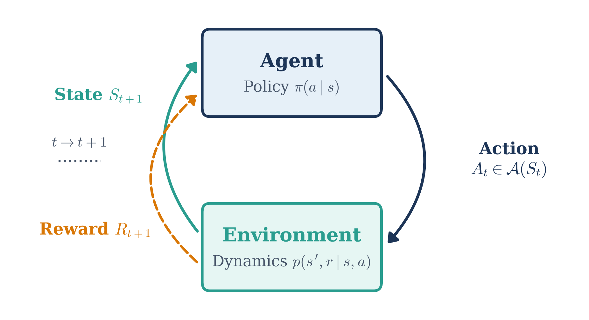</picture></a>
    <figcaption><a class="fignum" href="chapters/ch03-finite-mdps.html#fig-31" title="Open Figure 3.1 in Chapter 3">Figure 3.1</a>: Agent-environment interaction loop.</figcaption>
  </figure>

## Chapter 04 · Dynamic Programming {.unnumbered}

  <figure>
    <a class="gallery-link" href="chapters/ch04-dynamic-programming.html#fig-41" title="Open Figure 4.1 in Chapter 4"><picture><source srcset="figures/webp/ch04-gpi-loop.webp" type="image/webp" /></picture></a>
    <figcaption><a class="fignum" href="chapters/ch04-dynamic-programming.html#fig-41" title="Open Figure 4.1 in Chapter 4">Figure 4.1</a>: Generalized Policy Iteration (GPI).</figcaption>
  </figure>

## Chapter 06 · Temporal-Difference Learning {.unnumbered}

  <figure>
    <a class="gallery-link" href="chapters/ch06-temporal-difference.html#fig-61" title="Open Figure 6.1 in Chapter 6"><picture><source srcset="figures/webp/ch06-td-backups.webp" type="image/webp" />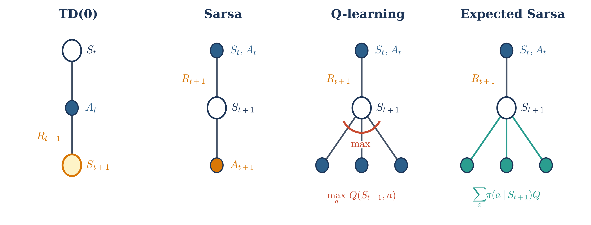</picture></a>
    <figcaption><a class="fignum" href="chapters/ch06-temporal-difference.html#fig-61" title="Open Figure 6.1 in Chapter 6">Figure 6.1</a>: One-step TD backup schematics.</figcaption>
  </figure>

## Chapter 07 · n-step Bootstrapping {.unnumbered}

  <figure>
    <a class="gallery-link" href="chapters/ch07-nstep-bootstrapping.html#fig-71" title="Open Figure 7.1 in Chapter 7"><picture><source srcset="figures/webp/ch07-nstep-spectrum.webp" type="image/webp" /></picture></a>
    <figcaption><a class="fignum" href="chapters/ch07-nstep-bootstrapping.html#fig-71" title="Open Figure 7.1 in Chapter 7">Figure 7.1</a>: Spectrum of $n$-step returns.</figcaption>
  </figure>
  <figure>
    <a class="gallery-link" href="chapters/ch07-nstep-bootstrapping.html#fig-72" title="Open Figure 7.2 in Chapter 7"><picture><source srcset="figures/webp/ch07-nstep-sarsa.webp" type="image/webp" />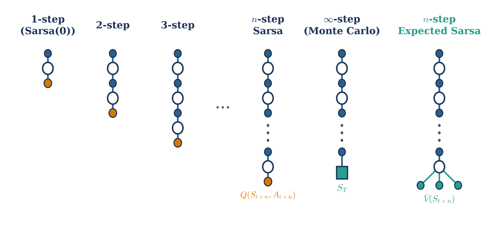</picture></a>
    <figcaption><a class="fignum" href="chapters/ch07-nstep-bootstrapping.html#fig-72" title="Open Figure 7.2 in Chapter 7">Figure 7.2</a>: Backup diagrams for $n$-step Sarsa methods.</figcaption>
  </figure>
  <figure>
    <a class="gallery-link" href="chapters/ch07-nstep-bootstrapping.html#fig-73" title="Open Figure 7.3 in Chapter 7"><picture><source srcset="figures/webp/ch07-nstep-unified.webp" type="image/webp" /></picture></a>
    <figcaption><a class="fignum" href="chapters/ch07-nstep-bootstrapping.html#fig-73" title="Open Figure 7.3 in Chapter 7">Figure 7.3</a>: Unified 4-step off-policy and $Q(\sigma)$ backup taxonomy.</figcaption>
  </figure>

## Chapter 08 · Planning & Learning with Tabular Methods {.unnumbered}

  <figure>
    <a class="gallery-link" href="chapters/ch08-planning-learning.html#fig-81" title="Open Figure 8.1 in Chapter 8"><picture><source srcset="figures/webp/ch08-dyna-unified.webp" type="image/webp" />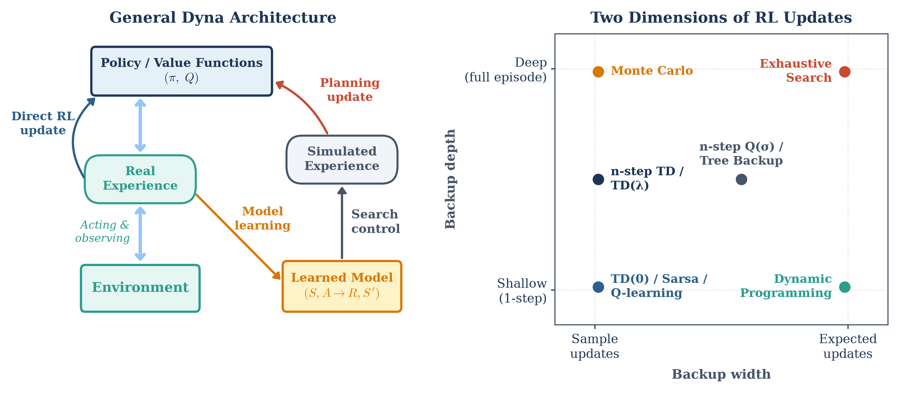</picture></a>
    <figcaption><a class="fignum" href="chapters/ch08-planning-learning.html#fig-81" title="Open Figure 8.1 in Chapter 8">Figure 8.1</a>: Dyna architecture and the two-dimensional RL update space.</figcaption>
  </figure>
  <figure>
    <a class="gallery-link" href="chapters/ch08-planning-learning.html#fig-82" title="Open Figure 8.2 in Chapter 8"><picture><source srcset="figures/webp/ch08-onestep-matrix.webp" type="image/webp" />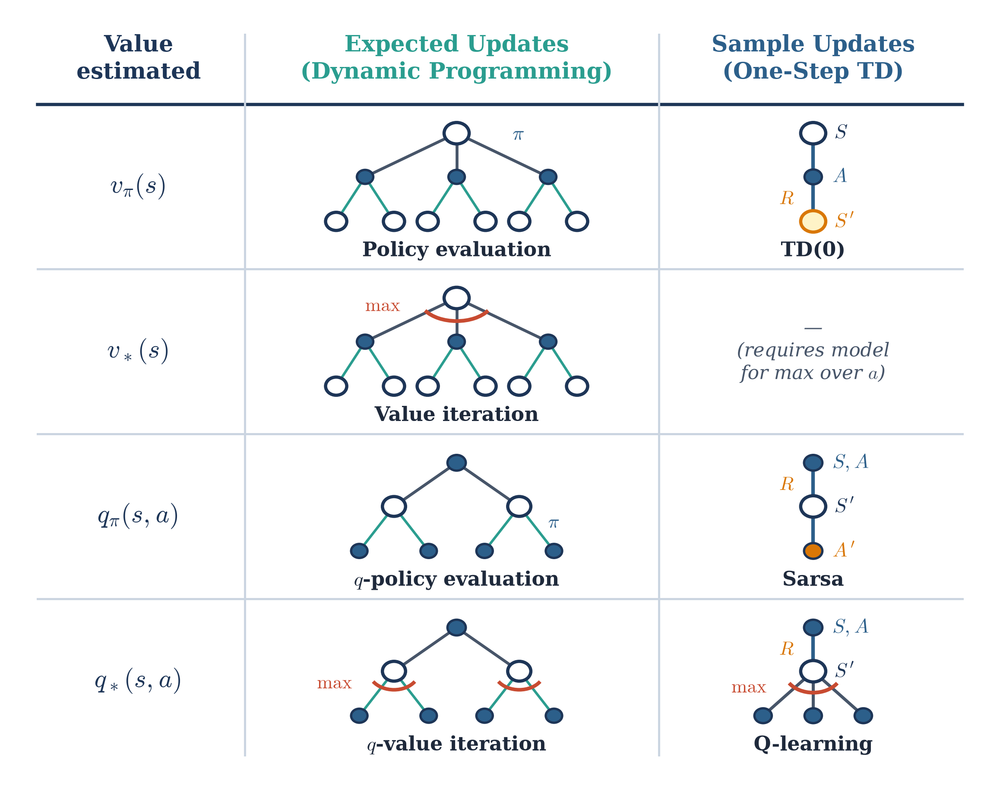</picture></a>
    <figcaption><a class="fignum" href="chapters/ch08-planning-learning.html#fig-82" title="Open Figure 8.2 in Chapter 8">Figure 8.2</a>: One-step backup comparison matrix.</figcaption>
  </figure>
  <figure>
    <a class="gallery-link" href="chapters/ch08-planning-learning.html#fig-83" title="Open Figure 8.3 in Chapter 8"><picture><source srcset="figures/webp/ch08-rtdp-states.webp" type="image/webp" />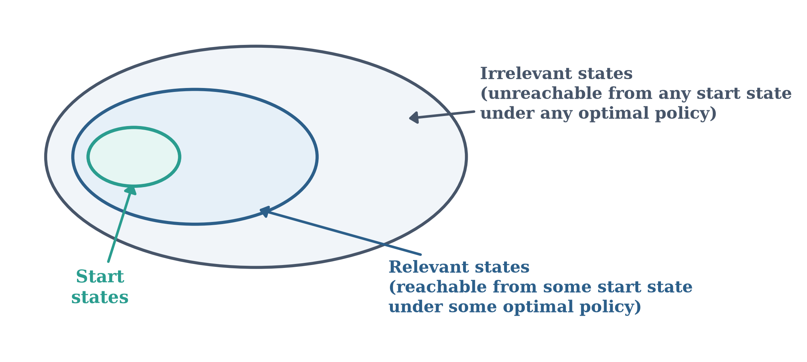</picture></a>
    <figcaption><a class="fignum" href="chapters/ch08-planning-learning.html#fig-83" title="Open Figure 8.3 in Chapter 8">Figure 8.3</a>: RTDP state-space reachability.</figcaption>
  </figure>
  <figure>
    <a class="gallery-link" href="chapters/ch08-planning-learning.html#fig-84" title="Open Figure 8.4 in Chapter 8"><picture><source srcset="figures/webp/ch08-heuristic-search.webp" type="image/webp" /></picture></a>
    <figcaption><a class="fignum" href="chapters/ch08-planning-learning.html#fig-84" title="Open Figure 8.4 in Chapter 8">Figure 8.4</a>: Heuristic search selective lookahead.</figcaption>
  </figure>
  <figure>
    <a class="gallery-link" href="chapters/ch08-planning-learning.html#fig-85" title="Open Figure 8.5 in Chapter 8"><picture><source srcset="figures/webp/ch08-mcts-cycle.webp" type="image/webp" /></picture></a>
    <figcaption><a class="fignum" href="chapters/ch08-planning-learning.html#fig-85" title="Open Figure 8.5 in Chapter 8">Figure 8.5</a>: Monte Carlo Tree Search (MCTS) four-stage cycle.</figcaption>
  </figure>

## Chapter 09 · On-Policy Prediction with Approximation {.unnumbered}

  <figure>
    <a class="gallery-link" href="chapters/ch09-on-policy-prediction-approximation.html#fig-91" title="Open Figure 9.1 in Chapter 9"><picture><source srcset="figures/webp/ch09-coarse-rbf.webp" type="image/webp" /></picture></a>
    <figcaption><a class="fignum" href="chapters/ch09-on-policy-prediction-approximation.html#fig-91" title="Open Figure 9.1 in Chapter 9">Figure 9.1</a>: Coarse coding and 1D radial basis functions.</figcaption>
  </figure>
  <figure>
    <a class="gallery-link" href="chapters/ch09-on-policy-prediction-approximation.html#fig-92" title="Open Figure 9.2 in Chapter 9"><picture><source srcset="figures/webp/ch09-ann-architecture.webp" type="image/webp" />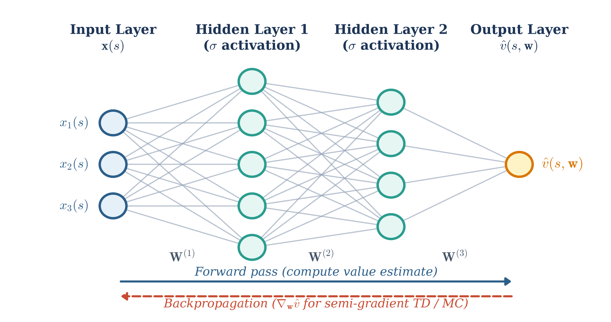</picture></a>
    <figcaption><a class="fignum" href="chapters/ch09-on-policy-prediction-approximation.html#fig-92" title="Open Figure 9.2 in Chapter 9">Figure 9.2</a>: Feedforward ANN for RL value approximation.</figcaption>
  </figure>

## Chapter 11 · Off-Policy Methods with Approximation {.unnumbered}

  <figure>
    <a class="gallery-link" href="chapters/ch11-off-policy-methods-approximation.html#fig-111" title="Open Figure 11.1 in Chapter 11"><picture><source srcset="figures/webp/ch11-counterexample-simple.webp" type="image/webp" />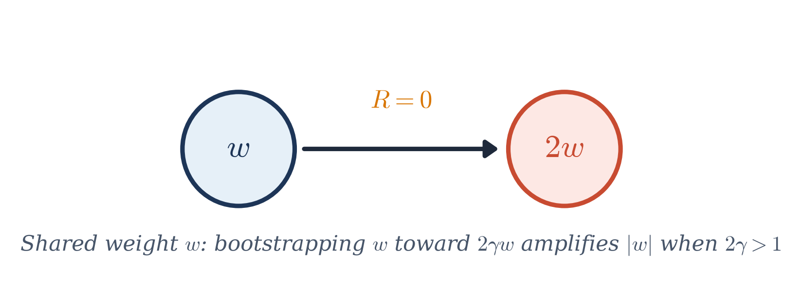</picture></a>
    <figcaption><a class="fignum" href="chapters/ch11-off-policy-methods-approximation.html#fig-111" title="Open Figure 11.1 in Chapter 11">Figure 11.1</a>: Simple two-state counterexample.</figcaption>
  </figure>
  <figure>
    <a class="gallery-link" href="chapters/ch11-off-policy-methods-approximation.html#fig-112" title="Open Figure 11.2 in Chapter 11"><picture><source srcset="figures/webp/ch11-bairds-counterexample.webp" type="image/webp" />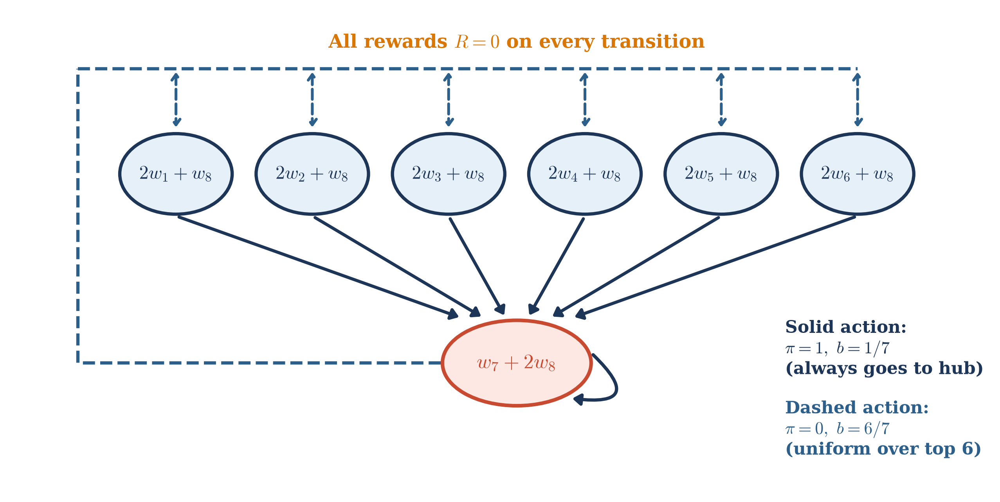</picture></a>
    <figcaption><a class="fignum" href="chapters/ch11-off-policy-methods-approximation.html#fig-112" title="Open Figure 11.2 in Chapter 11">Figure 11.2</a>: Baird's counterexample.</figcaption>
  </figure>
  <figure>
    <a class="gallery-link" href="chapters/ch11-off-policy-methods-approximation.html#fig-113" title="Open Figure 11.3 in Chapter 11"><picture><source srcset="figures/webp/ch11-tsitsiklis-van-roy.webp" type="image/webp" />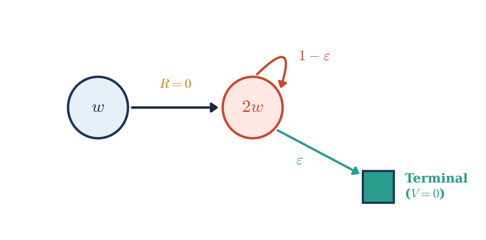</picture></a>
    <figcaption><a class="fignum" href="chapters/ch11-off-policy-methods-approximation.html#fig-113" title="Open Figure 11.3 in Chapter 11">Figure 11.3</a>: Tsitsiklis and Van Roy's counterexample.</figcaption>
  </figure>
  <figure>
    <a class="gallery-link" href="chapters/ch11-off-policy-methods-approximation.html#fig-114" title="Open Figure 11.4 in Chapter 11"><picture><source srcset="figures/webp/ch11-linear-projection.webp" type="image/webp" /></picture></a>
    <figcaption><a class="fignum" href="chapters/ch11-off-policy-methods-approximation.html#fig-114" title="Open Figure 11.4 in Chapter 11">Figure 11.4</a>: Geometry of linear value-function approximation.</figcaption>
  </figure>
  <figure>
    <a class="gallery-link" href="chapters/ch11-off-policy-methods-approximation.html#fig-115" title="Open Figure 11.5 in Chapter 11"><picture><source srcset="figures/webp/ch11-ve-learnability-mrps.webp" type="image/webp" />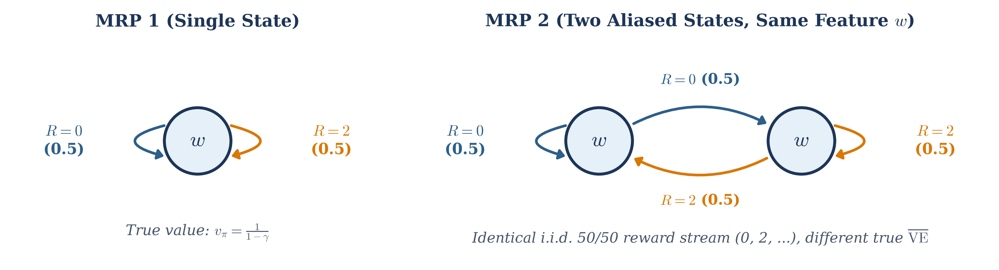</picture></a>
    <figcaption><a class="fignum" href="chapters/ch11-off-policy-methods-approximation.html#fig-115" title="Open Figure 11.5 in Chapter 11">Figure 11.5</a>: $\overline{\text{VE}}$ learnability counterexample.</figcaption>
  </figure>
  <figure>
    <a class="gallery-link" href="chapters/ch11-off-policy-methods-approximation.html#fig-116" title="Open Figure 11.6 in Chapter 11"><picture><source srcset="figures/webp/ch11-be-learnability-mrps.webp" type="image/webp" />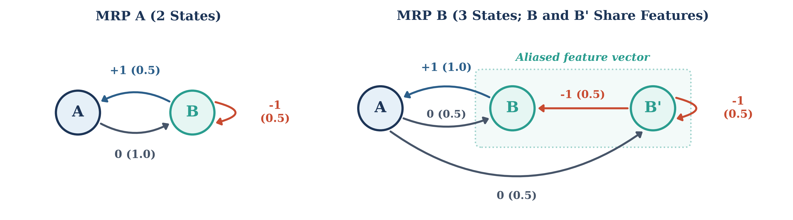</picture></a>
    <figcaption><a class="fignum" href="chapters/ch11-off-policy-methods-approximation.html#fig-116" title="Open Figure 11.6 in Chapter 11">Figure 11.6</a>: $\overline{\text{BE}}$ learnability counterexample.</figcaption>
  </figure>

## Chapter 12 · Eligibility Traces {.unnumbered}

  <figure>
    <a class="gallery-link" href="chapters/ch12-eligibility-traces.html#fig-ch12-12-1-weighting" title="Open Figure 12.1 in Chapter 12"><picture><source srcset="figures/webp/ch12-lambda-weights.webp" type="image/webp" /></picture></a>
    <figcaption><a class="fignum" href="chapters/ch12-eligibility-traces.html#fig-ch12-12-1-weighting" title="Open Figure 12.1 in Chapter 12">Figure 12.1</a>: Geometric weighting in the $\lambda$-return.</figcaption>
  </figure>
  <figure>
    <a class="gallery-link" href="chapters/ch12-eligibility-traces.html#fig-122" title="Open Figure 12.2 in Chapter 12"><picture><source srcset="figures/webp/ch12-td-lambda-backups.webp" type="image/webp" />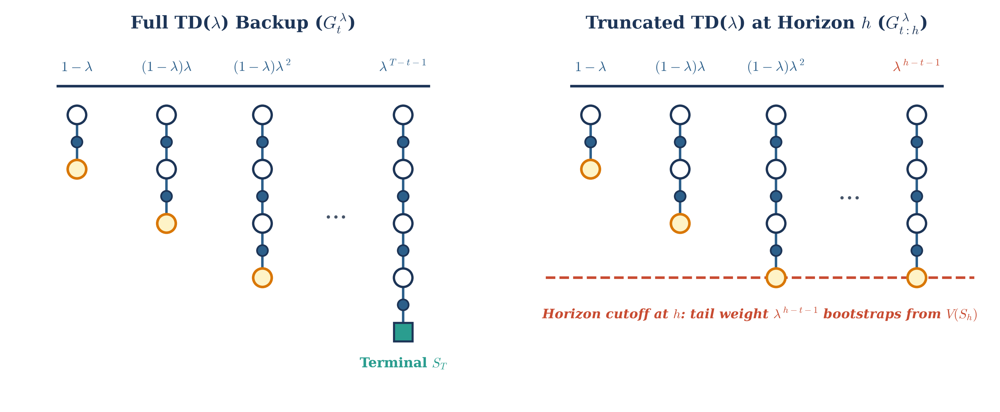</picture></a>
    <figcaption><a class="fignum" href="chapters/ch12-eligibility-traces.html#fig-122" title="Open Figure 12.2 in Chapter 12">Figure 12.2</a>: State-value $\lambda$-return backups: Full TD($\lambda$) vs. Truncated TD($\lambda$).</figcaption>
  </figure>
  <figure>
    <a class="gallery-link" href="chapters/ch12-eligibility-traces.html#fig-123" title="Open Figure 12.3 in Chapter 12"><picture><source srcset="figures/webp/ch12-forward-backward-views.webp" type="image/webp" />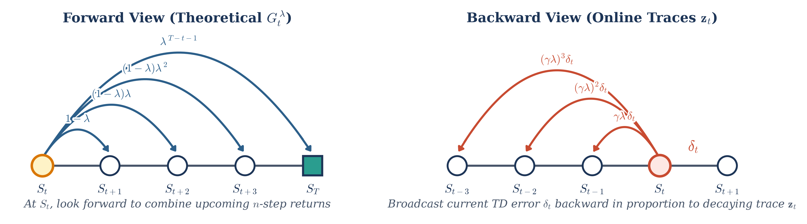</picture></a>
    <figcaption><a class="fignum" href="chapters/ch12-eligibility-traces.html#fig-123" title="Open Figure 12.3 in Chapter 12">Figure 12.3</a>: Forward view vs. backward view of TD($\lambda$).</figcaption>
  </figure>
  <figure>
    <a class="gallery-link" href="chapters/ch12-eligibility-traces.html#fig-124" title="Open Figure 12.4 in Chapter 12"><picture><source srcset="figures/webp/ch12-action-lambda-backups.webp" type="image/webp" />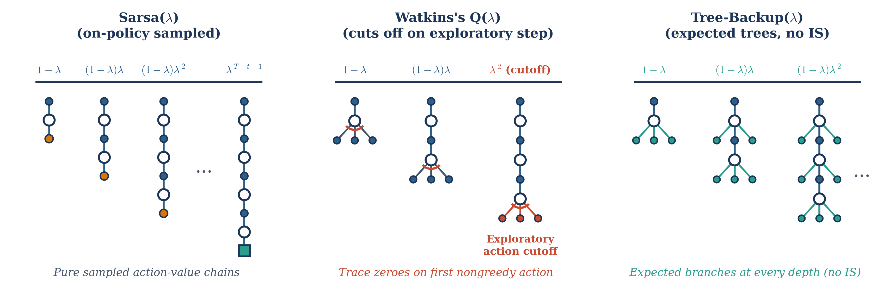</picture></a>
    <figcaption><a class="fignum" href="chapters/ch12-eligibility-traces.html#fig-124" title="Open Figure 12.4 in Chapter 12">Figure 12.4</a>: Action-value $\lambda$-backup taxonomy.</figcaption>
  </figure>

## Chapter 13 · Policy Gradient Methods {.unnumbered}

  <figure>
    <a class="gallery-link" href="chapters/ch13-policy-gradient-methods.html#fig-ch13-13-7-pdf" title="Open Figure 13.1 in Chapter 13"><picture><source srcset="figures/webp/ch13-13-7-prob-density-function.webp" type="image/webp" /></picture></a>
    <figcaption><a class="fignum" href="chapters/ch13-policy-gradient-methods.html#fig-ch13-13-7-pdf" title="Open Figure 13.1 in Chapter 13">Figure 13.1</a>: Gaussian probability density functions.</figcaption>
  </figure>

:::

::: {.content-visible when-format="epub"}

Every diagram redrawn for these notes, numbered as it appears in the book (chapter.figure), with the caption used next to it in the text.

{fig-alt="Agent-environment interaction loop showing action A_t sent to environment and next state S_{t+1} and reward R_{t+1} returned."}

**Figure 3.1**: Agent-environment interaction loop.

{fig-alt="Generalized Policy Iteration diagram showing evaluation and improvement driving estimates toward optimal v_* and pi_*."}

**Figure 4.1**: Generalized Policy Iteration (GPI).

{fig-alt="Side-by-side one-step backup schematics for TD(0), Sarsa, Q-learning, and Expected Sarsa."}

**Figure 6.1**: One-step TD backup schematics.

{fig-alt="Diagram illustrating n-step returns spanning 1-step TD(0) through finite n-step bootstrapping to full-episode Monte Carlo."}

**Figure 7.1**: Spectrum of $n$-step returns.

{fig-alt="Action-anchored backup diagrams for 1-step, 2-step, 3-step, n-step, Monte Carlo, and n-step Expected Sarsa."}

**Figure 7.2**: Backup diagrams for $n$-step Sarsa methods.

{fig-alt="Five-column comparison of 4-step TD, 4-step Sarsa, 4-step Tree Backup with trajectory labels, 4-step Expected Sarsa, and 4-step Q(sigma)."}

**Figure 7.3**: Unified 4-step off-policy and $Q(\sigma)$ backup taxonomy.

{fig-alt="Two-panel schematic: Dyna learning and planning cycle on the left, and the two-dimensional width-versus-depth RL update space on the right."}

**Figure 8.1**: Dyna architecture and the two-dimensional RL update space.

{fig-alt="Four-by-two matrix comparing one-step Expected DP backups against Sample TD backups for v_pi, v_*, q_pi, and q_*."}

**Figure 8.2**: One-step backup comparison matrix.

{fig-alt="Nested region diagram showing start states inside relevant states reachable under some optimal policy, surrounded by irrelevant unreachable states."}

**Figure 8.3**: RTDP state-space reachability.

{fig-alt="Selective depth-first lookahead tree rooted at current state S_t with numbered bottom-up backup groupings propagating leaf values toward root actions."}

**Figure 8.4**: Heuristic search selective lookahead.

{fig-alt="Four-stage Monte Carlo Tree Search cycle showing Selection via UCT, Expansion of a new node, Simulation rollout to termination, and Backup of returns along the path."}

**Figure 8.5**: Monte Carlo Tree Search (MCTS) four-stage cycle.

{fig-alt="Two-panel feature plot: 2D overlapping circular coarse-coding receptive fields on the left and 1D Gaussian radial basis functions on the right."}

**Figure 9.1**: Coarse coding and 1D radial basis functions.

{fig-alt="Generic feedforward artificial neural network with 3 state-feature inputs, two hidden layers of 5 and 4 units with nonlinear activation, and 1 scalar state-value output."}

**Figure 9.2**: Feedforward ANN for RL value approximation.

{fig-alt="Two-state MDP fragment transitioning from state valued w to state valued 2w with zero reward."}

**Figure 11.1**: Simple two-state counterexample.

{fig-alt="Baird's 7-state, 2-action star MDP with six upper states 2w_i + w_8 and one lower hub w_7 + 2w_8 connected by solid and dashed actions."}

**Figure 11.2**: Baird's counterexample.

{fig-alt="Two-state transition w to 2w with self-loop probability 1 minus epsilon and terminal transition probability epsilon."}

**Figure 11.3**: Tsitsiklis and Van Roy's counterexample.

{fig-alt="Geometric diagram of linear value-function approximation showing v_pi projected onto the linear subspace alongside VE, PBE, BE, and TDE solutions."}

**Figure 11.4**: Geometry of linear value-function approximation.

{fig-alt="Side-by-side comparison of a single-state MRP and an aliased two-state MRP that both emit an identical i.i.d. 50/50 stream of rewards 0 and 2."}

**Figure 11.5**: $\overline{\text{VE}}$ learnability counterexample.

{fig-alt="Side-by-side 2-state MRP (A, B) and 3-state MRP (A, B, B prime) where B and B prime share features, generating identical data distributions with different BE-minimizing parameters."}

**Figure 11.6**: $\overline{\text{BE}}$ learnability counterexample.

{fig-alt="Bar chart comparing geometric lambda-return weights (1-lambda)*lambda^(n-1) across 1-step to 10-step returns for lambda = 0.2, 0.5, and 0.8."}

**Figure 12.1**: Geometric weighting in the $\lambda$-return.

{fig-alt="Side-by-side backup diagrams comparing Full TD(lambda) running to terminal state S_T against Truncated TD(lambda) cutting off at horizon h."}

**Figure 12.2**: State-value $\lambda$-return backups: Full TD($\lambda$) vs. Truncated TD($\lambda$).

{fig-alt="Side-by-side comparison of the Forward View looking ahead from S_t over weighted future returns and the Backward View broadcasting current TD error delta_t backward via decaying traces."}

**Figure 12.3**: Forward view vs. backward view of TD($\lambda$).

{fig-alt="Three-panel action-value lambda-backup taxonomy comparing Sarsa(lambda), Watkins's Q(lambda) with exploratory cutoff, and Tree-Backup(lambda) with expected branches at every depth."}

**Figure 12.4**: Action-value $\lambda$-backup taxonomy.

{fig-alt="Plot of normal probability density curves illustrating how mean mu shifts center and standard deviation sigma controls spread."}

**Figure 13.1**: Gaussian probability density functions.

:::

::: {.content-visible when-format="pdf"}

All 24 original figures in these notes, listed by chapter and numbered as they appear in the text.

| Chapter | Figures |
|:--:|:--|
| 3 | Finite Markov Decision Processes: 3.1 |
| 4 | Dynamic Programming: 4.1 |
| 6 | Temporal-Difference Learning: 6.1 |
| 7 | n-step Bootstrapping: 7.1–7.3 |
| 8 | Planning & Learning with Tabular Methods: 8.1–8.5 |
| 9 | On-Policy Prediction with Approximation: 9.1–9.2 |
| 11 | Off-Policy Methods with Approximation: 11.1–11.6 |
| 12 | Eligibility Traces: 12.1–12.4 |
| 13 | Policy Gradient Methods: 13.1 |

:::
